# ADR-006: Transactional Outbox for Dispatch and Scheduling

| Field | Value |
|---|---|
| Status | **Accepted** |
| Date | 2026-10-05 |
| Deciders | Engineering |
| Supersedes | — |
| Related | [reliability.md](../architecture/reliability.md) §3, [system-overview.md](../architecture/system-overview.md) §3, [002-postgresql.md](002-postgresql.md), [003-bullmq.md](003-bullmq.md), [007-idempotency-strategy.md](007-idempotency-strategy.md) |

## Context

The engine makes a decision in PostgreSQL and that decision implies an action
somewhere else: enqueue a job in Redis, fire a schedule, wake a waiting
execution. These are two systems. The question is how to keep them consistent
without a distributed transaction.

Concretely, four things must happen together in one logical operation:

1. Advance `step_executions` from `READY` to `QUEUED` with `attempt = n`.
2. Insert a `jobs` row recording that this dispatch is due (dedup key).
3. Insert an `outbox` row saying "a dispatch is due".
4. Update `executions` and write an `audit_logs` row.

A fifth, separate operation: a `wait` step reaches its deadline, so an execution
that is `WAITING` must become runnable again. And a sixth: a schedule fires and
must create an execution.

The hazard is a **dual write**. If the database commit succeeds and the enqueue
fails, the step is `QUEUED` with no job anywhere, and it sits forever. If the
enqueue succeeds and the commit fails, a worker is handed a job for a step that
does not exist. Both are real failure modes, both happen under ordinary
conditions — a Redis blip, a process killed between two statements — and neither is
preventable by writing the code carefully.

There is a second, subtler requirement. The *schedule* cannot be a Redis delayed
job, because a schedule is a business fact ("this workflow runs at 09:00 on
weekdays") and a customer's question about it must be answerable from the system of
record ([ADR-003](003-bullmq.md) §1). The outbox is therefore also where
**long-horizon time-based wake-ups** live, not only message delivery.

## Decision

**Every action that must leave the database is recorded in an `outbox` table in the
same transaction as the state change that justifies it. A single publisher
component drains the outbox. No other component enqueues work, and no component
performs a side effect that is not recorded in the outbox first.**

### The table

```text
outbox_events
  id               uuid primary key
  organization_id  uuid not null
  type             enum('STEP_DISPATCH','EXECUTION_WAKE','SCHEDULE_FIRE','WEBHOOK_DELIVER') not null
  aggregate_type   text not null            -- 'step_execution' | 'execution' | 'schedule' | 'webhook_endpoint'
  aggregate_id     uuid not null
  state            enum('PENDING','PUBLISHING','PUBLISHED','FAILED','DEAD') not null
  payload          jsonb not null            -- identifiers only; never secrets, never payloads
  available_at     timestamptz not null      -- the authoritative wake time
  attempts         integer not null default 0
  last_error       text
  created_at       timestamptz not null

  -- state: PENDING | PUBLISHING | PUBLISHED | FAILED | DEAD
  INDEX (available_at) WHERE state IN ('PENDING', 'FAILED')
```

**Event states**, as specified in
[reliability.md](../architecture/reliability.md) §6:

```mermaid
stateDiagram-v2
    [*] --> PENDING : engine commits the transition + its intent
    PENDING --> PUBLISHING : publisher claimed it (SKIP LOCKED)
    PUBLISHING --> PUBLISHED : queue.add succeeded
    PUBLISHING --> FAILED : queue.add threw; backoff, attempts++
    FAILED --> PUBLISHING : retry due (available_at reached)
    FAILED --> DEAD : attempts >= max_publish_attempts
    DEAD --> [*] : retained for inspection, alerted, never auto-retried
```



| Type | Side effect performed by the publisher |
|---|---|
| `STEP_DISPATCH` | `queue.add(jobId = jobs.id)` for the dispatch the engine already recorded in `jobs` |
| `EXECUTION_WAKE` | `UPDATE executions ... WHERE id = $1 AND state = 'WAITING'` |
| `SCHEDULE_FIRE` | `INSERT INTO executions (...) ON CONFLICT (dedup_key) DO NOTHING` |
| `WEBHOOK_DELIVER` | Nothing; the deliverer claims `webhook_deliveries` directly |

**Deduplication is on `jobs` and on `executions`, not on the outbox.** A
`STEP_DISPATCH` row names a `jobId` that the *engine* already inserted in the same
transaction, so dispatch dedup is `UNIQUE (step_execution_id, attempt)` on `jobs` —
attempt *n* of a step can be dispatched at most once, no matter how many
publishers, reconcilers or restarts try. A `SCHEDULE_FIRE` row's dedup key is
`executions.dedup_key` (`sched:{scheduleId}:{scheduledForIso8601}`), so a redelivered
fire cannot double-fire. An `EXECUTION_WAKE` row is idempotent because it fires an
idempotent conditional `UPDATE`. A non-dispatch outbox row therefore does not need
its own key, and adding one would be a second mechanism for a problem the schema
has already solved. `DEAD` rows are retained rather than deleted, and are an
alerting condition, because a `DEAD` row is unperformed work.

### The publisher

```sql
-- apps/scheduler/src/outbox/publisher.ts
BEGIN;

SELECT * FROM outbox_events
WHERE state IN ('PENDING', 'FAILED') AND available_at <= now()
ORDER BY available_at
FOR UPDATE SKIP LOCKED
LIMIT 50;

UPDATE outbox_events SET state = 'PUBLISHING'
WHERE id = ANY($ids);

-- for each claimed row, in the same transaction:
--   STEP_DISPATCH   -> queue.add(jobId = payload->>'jobId')
--   EXECUTION_WAKE  -> UPDATE executions SET ... WHERE id = $1 AND state = 'WAITING'
--   SCHEDULE_FIRE   -> INSERT INTO executions (...) ON CONFLICT (dedup_key) DO NOTHING
--   WEBHOOK_DELIVER -> nothing; the deliverer claims webhook_deliveries
UPDATE outbox_events SET state = 'PUBLISHED'
WHERE id = ANY($ids);

COMMIT;
-- on queue.add throw: state = 'FAILED', attempts = attempts + 1,
--                     available_at = now() + backoff, last_error = $err
```

```text
apps/scheduler/src/outbox/
  publisher.ts      claim, perform, mark published
  claim.ts          FOR UPDATE SKIP LOCKED helper
  payloads.ts       payload construction per type
```

**`FOR UPDATE SKIP LOCKED` is what makes multiple publisher replicas safe**, and it
is the reason we can run `scheduler` with `--replicas=2` without a leader
election, a lease, or a queue. Concurrent publishers simply partition the backlog;
two replicas never claim the same row. The row lock is held for the duration of
the side effect, which is safe precisely because the side effect is a local
`INSERT` into `jobs` and never a call to a customer's system
([reliability.md](../architecture/reliability.md) §3.2).

**The side effect is inside the transaction.** This is a deliberate deviation from
the textbook outbox, which usually writes the broker inside the transaction and
risks a broker-visible message for a rolled-back transaction. Here the "message" is
an insert into our *own* `jobs` table, in the *same* database, so it is atomic by
construction and there is no cross-system visibility window. The only non-local
step is the BullMQ `queue.add` for the *immediate* wake-up of a waiting worker, and
that is explicitly best-effort and idempotent: the reconciler covers the gap
([Reliability of the immediate path](#the-immediate-path-and-why-it-is-best-effort)).

**Nothing about a step's execution is decided here.** The publisher only makes work
*due*. Whether a job is still valid when a worker picks it up is decided by the
worker's conditional claim
([ADR-007](007-idempotency-strategy.md) §5). A published job for a step that has
since been cancelled is a no-op, and that is the correct behaviour.

### Long-horizon wake-ups live here too

A `wait` step of six hours does **not** become a BullMQ delayed job. The engine
commits:

```text
step_executions.state         = 'WAITING'
step_executions.available_at  = <now + 6h>
outbox_events row               = EXECUTION_WAKE, available_at = <now + 6h>
```

The publisher's `WHERE available_at <= now()` naturally becomes a timer. The
execution is not "in" Redis for six hours; it is a row in PostgreSQL with a
timestamp, which means:

- The API can answer "when does this resume?" from `available_at`.
- A Redis flush costs nothing for a six-hour wait, because nothing was in Redis.
- The wake-up survives everything short of losing PostgreSQL.

`SCHEDULE_FIRE` works identically: `schedules` holds the recurrence rule, and each
due occurrence is an `outbox_events` row with `available_at` set to the exact
`scheduled_for` instant. Once that row is committed, an occurrence is guaranteed
and needs no special recovery code — the row is simply still `PENDING` with
`available_at <= now()`, so a scheduler down for an hour drains what it had
already committed, in order, each under the unique `executions.dedup_key`
`sched:{scheduleId}:{scheduledForIso8601}`.

There is a deliberate limit to that guarantee: a slot that comes due **entirely
while the ticker is down** produces no outbox row at all, because the ticker
recomputes `next_run_at` from `now()` and emits one row for the next future
occurrence. Replaying every missed slot would turn a four-hour outage into a burst
of thousands of executions against an already-sick downstream. Missed slots are
counted in `schedules.missed` instead, so the customer can see the gap and decide
whether to backfill deliberately.

### Delivery semantics

**At-least-once, and at-least-once is the correct choice here.** Every layer is
designed so that a duplicate is harmless:

| Layer | Guard |
|---|---|
| Outbox → `jobs` | `UNIQUE (step_execution_id, attempt)` on `jobs`; `ON CONFLICT DO NOTHING` |
| `jobs` → BullMQ | `jobId` = `jobs.id` UUID; `queue.add` is idempotent while the job exists |
| BullMQ → worker | Conditional `UPDATE ... WHERE lease_token = $1 AND state = 'QUEUED'` |
| Worker → customer system | `externalKey` = `exec:{executionId}:step:{nodeId}:g{generation}` as an idempotency key |

**At-most-once would be wrong** because a dropped dispatch is a stuck execution. A
duplicate dispatch is a wasted claim, and every guard above makes it cheap.
**Exactly-once is not claimed**, anywhere, because it is not available across
PostgreSQL, Redis, and HTTP. Where this document says "exactly once", it means
"the effect happened once", enforced by the customer's own idempotency key — and
even that is a *request*, not a guarantee.

### The immediate path, and why it is best-effort

Publishing is a poll, so there is latency between commit and enqueue — up to one
poll interval (target sub-second). Two things run in parallel:

1. **The transaction returns the dispatch intent to the caller.** If the caller is
   the `scheduler` tick, it calls `queue.add` immediately after commit, so the
   common case does not wait for the next poll.
2. **The publisher picks up anything left.** This is the safety net for the crash
   window, the Redis-down window, and the multi-replica case.

Both paths are idempotent, so running both is free. The `queue.add` is wrapped so
a Redis failure logs and returns; it never fails the already-committed transaction.
This is the one place where a best-effort side effect exists, and it is
best-effort *because a reliable one exists behind it*.

## Alternatives Considered

### 1. Publish to the queue first, then commit

Rejected — it is the dual write with the failure modes in the wrong order. A
`queue.add` that succeeds followed by a rolled-back commit produces a job for a
step that does not exist, and there is no way to distinguish it from a legitimate
one. The reconciler would have to clean it up indefinitely.

### 2. Commit first, then publish (the naive "try/catch and retry")

Rejected. This is the most common implementation and it is subtly broken: the
process can die between the commit and the enqueue, and no retry loop inside the
process can help because the intent is not recorded anywhere. It works in
development and fails in production under exactly the conditions that matter
(deploy, crash, OOM). The outbox is the same idea with the intent made durable.

### 3. XA / two-phase commit between PostgreSQL and Redis

Rejected as unavailable and undesirable in equal measure. Redis has no XA
participation in any form we could use, and even between two databases that support
2PC it is a poor fit: a blocking protocol whose coordinator failure mode leaves
participants in-doubt, applied to a system that only needs "this step is due".

### 4. Change the model: Redis becomes the queue and PostgreSQL the log

Rejected, and it is the alternative that most directly violates
[ADR-002](002-postgresql.md). If Redis is where work lives, then "which step is due"
is a Redis question, Redis is authoritative, and we are back to
[003-bullmq.md](003-bullmq.md) Alternative 4. A separate log does not fix this: the
authoritative answer would still live in Redis.

### 5. CDC / logical replication to a broker

Rejected on proportionality. Debezium plus Kafka could stream the `outbox` changes,
and it introduces a Kafka cluster, a connector to operate, schema-registry
questions, and an ordering model we do not need. The outbox table (`outbox_events`) *is* the
event log; the only thing CDC buys is faster delivery, at a substantial operational
cost. Worth revisiting if dispatch latency ever becomes a stated requirement in the
tens-of-milliseconds range.

### 6. A separate scheduling service (Quartz, Airflow, Temporal schedules)

Rejected for v1 on the same grounds as [003-bullmq.md](003-bullmq.md) §2: a second
system of record for "when does this run", with its own availability story. A
schedule whose next occurrence is only known to another service is a support
question we cannot answer. `scheduled_for` on an `executions` row answers it.

### 7. `LISTEN`/`NOTIFY` to wake the publisher instantly

Rejected, but it is a genuine optimisation and a possible later addition.
`NOTIFY` is delivered on commit, so the engine could `NOTIFY automia_outbox` and
the publisher could wake immediately instead of polling — eliminating the only
remaining latency in the dispatch path. Not used now because: the payload is
capped at 8000 bytes and only a hint, so it cannot be trusted; a missed
notification degrades to the poll, which is the same code path; and we would need
a fallback timer anyway. Worth adding if dispatch latency is measured as a problem.

## Why

**1. It converts an unsolvable consistency problem into a durable intent.** The
dual write between PostgreSQL and Redis has no correct implementation without a
transaction spanning both, and there is none. Recording the intent in the same
transaction as the state change means the intent cannot be lost, whatever happens
afterwards. Every other property of this design follows from that.

**2. `FOR UPDATE SKIP LOCKED` gives safe multi-replica publishing with no
coordination.** No leader election, no lease, no fencing token, no split brain. Two
publisher replicas partition the backlog and both are correct. This is a
PostgreSQL primitive doing work that most queue systems need a separate consensus
protocol for.

**3. The side effect is a local insert, so there is no cross-system visibility
window.** The textbook outbox's known weakness — publish, then crash, leaving a
broker message for an uncommitted transaction — does not exist here, because the
publish target is a table in the same database. This is the strongest version of the
pattern available, and it is available only because the second system is Redis
(reconstructible) rather than a customer system.

**4. It makes Redis fully disposable.** Every action Redis was supposed to perform
is recorded in a PostgreSQL row first, so `FLUSHDB` is a latency event, not a data
event ([reliability.md](../architecture/reliability.md) §3.4). The reconciler is
not a repair tool that is *hoped* to be sufficient; it is a redundancy that is
provably sufficient, because the intent is durable.

**5. Long-horizon time-based behaviour belongs in the system of record.** A six-hour
wait and a recurring schedule are business facts with answerable questions. Keeping
them in a table with an `available_at` makes "when does this run next?" a query and
keeps them correct through a Redis outage.

**6. An already-committed occurrence needs no special code.** It is an unpublished
row whose `available_at` is in the past. Restart is a state, not a recovery
procedure. Occurrences that never produced a row are a different question, answered
by the deliberate `schedules.missed` skip policy rather than by an unbounded replay.

**7. The alternative failure modes are worse, and they are not hypothetical.** A
lost dispatch is a customer's workflow silently stuck — a support ticket with no
error message, which is the worst kind. A duplicate dispatch is one wasted `UPDATE`
that returns zero rows. Choosing which to tolerate is choosing where the pain
lands, and this design chooses the invisible, recoverable one.

## Consequences

### Positive

- **No lost dispatches.** The intent is committed atomically with the state change
  that justifies it.
- **No ghost jobs** for rolled-back transitions, because the dispatch record is in
  the same database.
- **Redis is fully disposable** and reconstructible.
- **Multiple publisher replicas need no coordination.**
- **Dispatch dedup is a schema constraint**, not a check-then-act race.
- **Long-horizon waits and schedules are queryable and durable**, not held in
  Redis.
- **An already-committed schedule occurrence drains automatically** after downtime
  and cannot double-fire; occurrences missed by a down ticker are skipped by policy
  and counted in `schedules.missed`.
- **The publisher is idempotent by construction**, so "run it twice to be sure" is
  safe and is in fact the operational default.
- **A cancelled or superseded dispatch is a harmless no-op** at the worker, because
  the claim is conditional.

### Negative

- **An extra table that every write path must populate.** A new module that
  changes workflow state must remember the outbox, and forgetting it is a
  silent-wait bug rather than a crash. Mitigated by the outbox being the only
  documented way to trigger work, and by the reconciler alerting on `READY` rows
  that are old.
- **Dispatch latency is one poll interval** (target sub-second). The immediate
  `queue.add` hides this in the common case; the `LISTEN`/`NOTIFY` option
  (Alternative 7) removes it if it ever matters.
- **The publisher holds a row lock while performing the side effect.** The side
  effect is a local insert, so this is short — but the rule "no external I/O in a
  transaction" now applies to the publisher too, and a future change that adds an
  HTTP call here would stall the whole outbox. This is a review item.
- **Duplicate delivery is normal** and every consumer must be idempotent. This is a
  permanent design obligation, not a bug to be fixed later.
- **`outbox_events` grows.** Bounded by the retention sweeper, which deletes
  `PUBLISHED`/`DEAD` rows after a retention window. The unpublished backlog is
  bounded by the number of legitimate dispatches that have not yet been published,
  not by redelivery attempts, because a retry updates `attempts` in place.
- **Two things can be due for the same step**, if a `EXECUTION_WAKE` and a
  `STEP_DISPATCH` both exist for it. Harmless — the claim is conditional — but it
  does mean more wasted claims than strictly necessary, and the dedup keys do not
  prevent it by design.
- **The `PUBLISHED` transition is set optimistically.** A crash between the side
  effect and the `UPDATE` leaves the row in `PUBLISHING`, which the sweeper
  resets to `PENDING` with backoff — so it re-publishes. Correct for
  at-least-once, and it is why `UNIQUE (step_execution_id, attempt)` on `jobs` is
  mandatory rather than an optimisation.

## Operational Impact

**Publishing:** `apps/scheduler` runs the publisher on a short interval (target
100ms–1s) plus an immediate `queue.add` on the caller's path. Batch size 50, which
bounds the row-lock set and keeps each transaction short.

**Migrations:** the `outbox_events` table and its partial index on
`(available_at) WHERE state IN ('PENDING','FAILED')` ship in the initial schema,
before any engine code that writes to it. The `jobs` table and its
`UNIQUE (step_execution_id, attempt)` constraint are part of the same migration,
because the dedup path is worthless without it.

**The sweeper's allowlist.** The retention sweeper deletes `outbox_events` rows in
`PUBLISHED` or `DEAD` state older than a retention window, and **only** those.
Unpublished rows (`PENDING`, `PUBLISHING`, `FAILED`) are never swept, regardless of
age: a stuck outbox row is a signal, and deleting it would convert a diagnosable
backlog into a silent lost dispatch. This is a review item on the sweeper, alongside
the same rule for `workflow_versions`
([ADR-005](005-workflow-versioning.md)).

**Monitoring:**

| Signal | Alert condition | Meaning |
|---|---|---|
| Oldest `PENDING` `outbox_events` row age | Growing | The publisher is wedged, or Redis is unavailable |
| Unpublished row count (`PENDING` + `FAILED`) | Growing | Same |
| `attempts >= max_publish_attempts` | Any | Row has gone `DEAD`: unperformed work, requires an operator |
| `last_error` distribution on `FAILED` rows | Any recurring value | Programming or config error |
| `DEAD` row count | **Must be zero** | Unperformed work. Operator intervention |
| Publisher loop duration | Near the poll interval | Falling behind; batch too large or a slow side effect |
| Duplicate `jobs` inserts (`ON CONFLICT` hits) | Sustained non-zero | Redelivery is happening; expected at low rates, alarming if it grows |
| `EXECUTION_WAKE` rows surviving a long delay past `available_at` | Any | A `WAITING` execution that will never be revisited — a bug |
| `PUBLISHING` rows older than one publish cycle | Any | A publisher died holding the row; the sweeper resets it |

The last signal is the one that catches the most damaging failure, because a missed
wake-up produces an execution that is `WAITING` forever with no error anywhere.

**Failure modes:**

| Failure | Behaviour | Blast radius |
|---|---|---|
| Redis down | Publishes fail; rows accumulate. **No loss.** Drain resumes on recovery | Delay only. Committed state is safe |
| Publisher crashes mid-batch | Transaction rolls back; rows remain unpublished; re-claimed | None. This is the design working |
| Crash after side effect, before `state = 'PUBLISHED'` | Row stays `PUBLISHING`; sweeper resets it to `PENDING` → duplicate publish | Wasted claim. Deduped by `jobs` constraint |
| Duplicate publish (two replicas, or redelivery) | `queue.add` with the same `jobId` is ignored, and `jobs` already holds the row | None |
| Redis loses all data | Reconciler rebuilds from `outbox` + `jobs` + `step_executions` | Delivery delay only |
| Long-running outbox transaction | That row's lock is held; the rest of the batch is fine; if a transaction stalls, all publishers eventually block | Outbox lag. The "no external I/O in a transaction" rule prevents the cause |
| `available_at` set wrongly in the future | Step never becomes due; caught by the `EXECUTION_WAKE` staleness alert | That step. Detectable, not silent forever |
| Scheduler down for an hour | Occurrences already committed as outbox rows drain on recovery under unique dedup keys; slots that came due while the ticker was down are skipped and counted in `schedules.missed` | Bounded backlog, no thundering herd, no double-fire |
| Disk full in PostgreSQL | Outbox inserts fail → the whole state transition fails | The transition fails cleanly, rather than committing without its intent |

The last row is the design's strongest property and worth stating plainly: a full
disk cannot produce a committed transition with a missing intent, because the
intent is part of the same transaction. Under the alternatives it would.

**Runbook: "the outbox is not draining."** (1) Is the publisher process alive? (2)
Can it reach Redis — the error will be a connection error, not a query error? (3)
Is a transaction stuck holding row locks (`pg_stat_activity` joined to
`pg_locks`)? (4) Do rows show `attempts` incrementing (side effect failing) or
zero (publisher not running at all)? (5) Has `last_error` changed shape? The
distinction between "attempts climbing" and "attempts zero" separates "Redis or
side effect problem" from "publisher not running" in one query.

**Runbook: "an execution is WAITING past its deadline."** Query `outbox_events` for the
execution's `EXECUTION_WAKE` row. If it is `PENDING`/`FAILED`/`DEAD`, the publisher is the
problem and the age tells us how long. If it is `PUBLISHED`, the wake was delivered
and the bug is in the publisher's `EXECUTION_WAKE` handler — the execution should
have left `WAITING`, and `step_executions.available_at` for the waiting step will
show whether the row was applied to the right step.

## Security Impact

**The outbox is a channel to Redis, so it is a control-plane surface.** Anyone who
can write an `outbox` row can cause a job to be enqueued. The defences are the same
as for any Redis write: the payload contains **identifiers only** — `stepExecutionId`,
`executionId`, `attempt`, `leaseToken` — never secrets, never workflow payloads,
never customer data. A database compromise that writes a malicious outbox row yields
an attacker-controlled *dispatch*, and the worker's conditional claim plus its own
re-reading of the step's stored state is what contains that: the job's contents are
never trusted to decide what to do.

**`last_error` is a log field in a database, and errors are redacted.** It records
what the publisher's own side effect failed with. It must go through the same
redaction as application logs ([security.md](../architecture/security.md) §5.5),
because a failed `INSERT` or a connection error can contain fragments of a
connection string or a payload. No secrets are ever in the payload, so there is
nothing to redact beyond error text, and the field is truncated to a bounded
length to keep a large error from bloating a hot table.

**`organization_id` on the outbox enables tenant-scoped diagnostics.** When an
investigation needs "show me everything pending for this tenant", the filter
exists. The publisher is system-wide and does not filter by tenant — it must be
able to drain every tenant's work — so this column exists for operations, not for
authorisation. No endpoint exposes the outbox to tenants. `Proposed` if one is ever
needed, with the same authorisation as the execution endpoints.

**No schedule or payload is exposed by the outbox itself.** A `SCHEDULE_FIRE` row
identifies a schedule; the schedule's recurrence rule stays in `schedules`. A
`WEBHOOK_DELIVER` row identifies a delivery; the secret used to sign it is read at
delivery time from the secret manager, never stored in `payload`. An attacker who
reads the outbox learns *that* a delivery is pending, not how to sign it.

**Retention reduces the window of a compromise.** Published rows are swept on a
retention window, so the table is not an unbounded archive of workflow structure
and timing. Unpublished rows are deliberately retained — the availability trade-off
is stated in [Consequences](#negative) — which means a reader of the table can
learn which workflows are pending, which is low-sensitivity metadata, and nothing
about their content.

## Revisit Conditions

1. **Dispatch latency becomes a stated requirement in the tens of milliseconds.**
   Then the poll is the bottleneck and `LISTEN`/`NOTIFY` (Alternative 7) or CDC
   (Alternative 5) becomes justified — in that order, because `NOTIFY` is a few
   dozen lines and CDC is a cluster.
2. **`outbox_events` becomes a bottleneck at a measured volume** — the claim query
   stops keeping up, or a publisher replica count stops helping. Then partitioning
   by time, or moving the hot path to a broker, is the answer.
3. **The side effect ever needs to be a real external call** — a webhook POST
   performed by the publisher rather than by a worker. That would break the
   "no external I/O inside the publisher's transaction" rule and require the side
   effect to move to a separate claiming process, which is a different design.
4. **Cross-region write authority is required.** A single-region outbox is a
   single-region drain. Multi-region needs a defined authority per event, which is
   [ADR-002](002-postgresql.md)'s revisit condition 2, not this ADR's.
5. **A second queue is introduced** for a workload with different delivery
   characteristics ([ADR-004](004-modular-monolith.md) open question 1). The outbox
   gains a type, not a second mechanism.
6. **Event fan-out to many independent consumers becomes a requirement.** Then the
   outbox is a source for a broker rather than the delivery mechanism itself, and
   the publisher's job becomes feeding that broker.

**What would *not* justify revisiting:** a preference for fewer tables, a belief
that BullMQ's own retry mechanism removes the need for an outbox (it does not —
BullMQ retries a *message*, it cannot guarantee the *message exists*), or a
general preference for "just use the broker's transactions". There is no
transactional broker available to us that spans PostgreSQL and the customer
system, and the requirement is to be correct when both are involved.

## References

- [002-postgresql.md](002-postgresql.md) — the system of record this depends on
- [003-bullmq.md](003-bullmq.md) — why Redis is reconstructible
- [007-idempotency-strategy.md](007-idempotency-strategy.md) — the four dedup layers
- [reliability.md](../architecture/reliability.md) §3 — delivery failure and the reconciler
- [database-erd.md](../diagrams/database-erd.md) — `outbox` and `jobs`
- Pattern reference: transactional outbox —
  <https://microservices.io/patterns/data/transactional-outbox.html>
- `SELECT ... FOR UPDATE` / `SKIP LOCKED` —
  <https://www.postgresql.org/docs/18/sql-select.html#SQL-FOR-UPDATE-SHARE>
- Kafka exactly-once semantics, and why they do not reach us —
  <https://kafka.apache.org/documentation/#semantics>
- Debezium — <https://debezium.io/documentation/reference/stable/>
- PostgreSQL `LISTEN`/`NOTIFY` — <https://www.postgresql.org/docs/18/sql-notify.html>
- Richardson, "Transactional Outbox" — <https://microservices.io/patterns/data/transactional-outbox.html>
- Kleppmann, *Designing Data-Intensive Applications*, ch. 7 and 22 —
  <https://dataintensive.net/>
