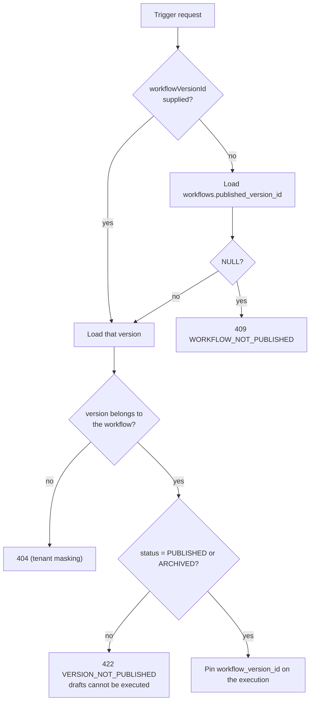
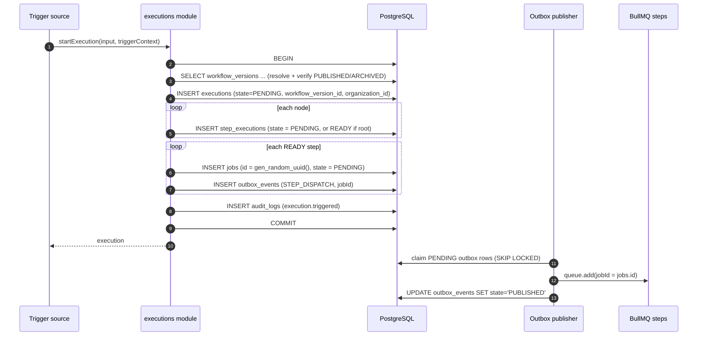
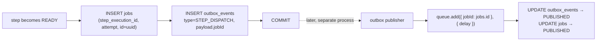
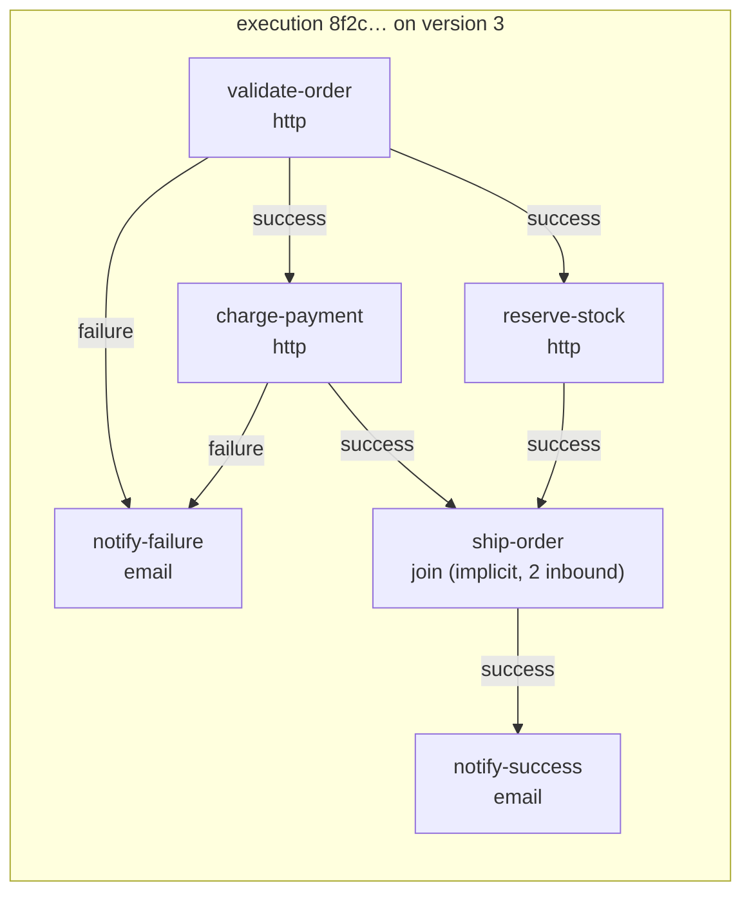
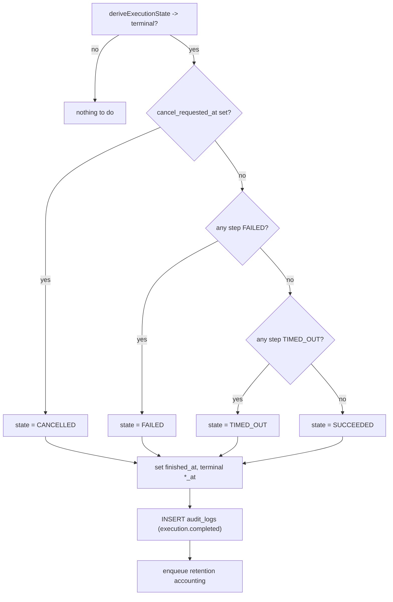
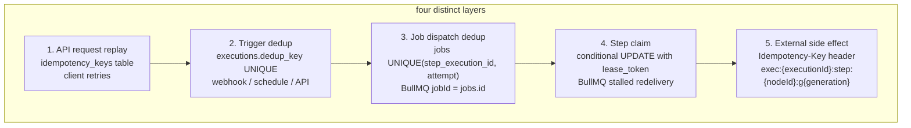
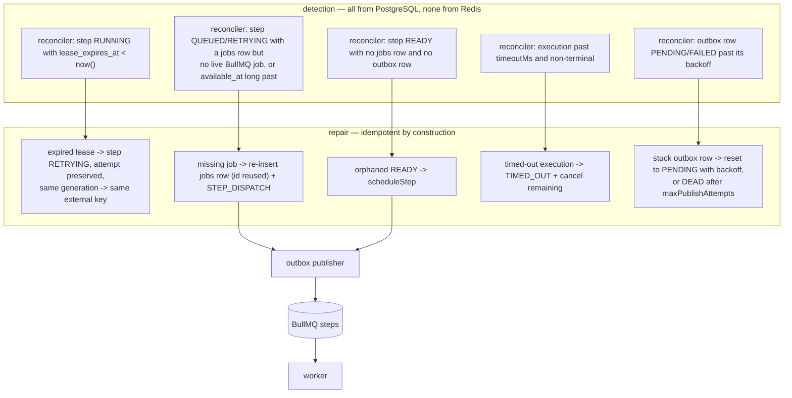

# Execution Engine

| Field | Value |
|---|---|
| Status | **Proposed** — normative description of the engine to be implemented |
| Related ADRs | [005](../adr/005-workflow-versioning.md), [006](../adr/006-transactional-outbox.md), [007](../adr/007-idempotency-strategy.md), [003](../adr/003-bullmq.md) |
| Companion docs | [system-overview.md](./system-overview.md) §7, [reliability.md](./reliability.md), [diagrams/execution-flow.md](../diagrams/execution-flow.md), [diagrams/failure-recovery.md](../diagrams/failure-recovery.md) |
| Schema | [database-erd.md](../diagrams/database-erd.md) |

This document is normative. Where it disagrees with
[system-overview.md](./system-overview.md), this document wins for execution
semantics.

---

## 1. Core rules

Five rules govern every operation below. They are stated once here and referenced
by number thereafter.

> **R1 — PostgreSQL is the only authority.** The engine's decisions are
> determined exclusively by committed rows in `executions` and `step_executions`.
> Redis state is never read to decide domain state.
>
> **R2 — The engine decides; workers act.** The engine computes what should
> happen next and records it durably. Performing the actual external work is the
> worker's job. The engine never issues an outbound HTTP request on behalf of a
> step.
>
> **R3 — No transaction spans external I/O.** A transaction opens, writes, and
> ends. The side effect happens between transactions. This is what makes crash
> recovery reason-able; see §27.
>
> **R4 — Delivery is at-least-once.** Every write path is written so that
> applying it twice is indistinguishable from applying it once, or is rejected
> by a conditional `UPDATE`. See [ADR-007](../adr/007-idempotency-strategy.md).
>
> **R5 — Every legal state transition is a compare-and-set.** Transitions are
> expressed as `UPDATE ... WHERE id = $1 AND state = $expected`. A worker that
> loses a race affects zero rows and does nothing.

## 2. Workflow definition

A published workflow version owns an immutable JSON document.

```json
{
  "errorPolicy": "fail-fast",
  "timeoutMs": 3600000,
  "nodes": [
    {
      "id": "validate-order",
      "type": "http",
      "config": {
        "method": "POST",
        "url": "https://api.example.internal/orders/validate",
        "headers": { "Content-Type": "application/json" },
        "body": { "orderId": "{{ trigger.input.orderId }}" },
        "timeoutMs": 10000,
        "retry": { "maxAttempts": 5, "baseDelayMs": 1000, "maxDelayMs": 60000, "retryOn": [408, 429, 500, 502, 503, 504] }
      },
      "timeoutMs": 15000
    },
    { "id": "charge-payment", "type": "http", "config": { "...": "..." } },
    { "id": "notify-customer", "type": "email", "config": { "...": "..." } },
    { "id": "hold-for-review", "type": "delay", "config": { "durationMs": 86400000 } }
  ],
  "edges": [
    { "source": "validate-order", "target": "charge-payment", "condition": "success" },
    { "source": "validate-order", "target": "hold-for-review", "condition": "failure" },
    { "source": "charge-payment", "target": "notify-customer", "condition": "success" }
  ]
}
```

### 2.1 Node types (v1)

| Type | Requires a worker? | Side effect | Notes |
|---|---|---|---|
| `http` | Yes | Outbound HTTP | SSRF policy mandatory (§12.4) |
| `condition` | Yes | None | Pure evaluation, so a worker is only needed for uniformity; may run inline in the engine in a future optimisation |
| `delay` | Yes, but performs no I/O | None | Enforced by a timer; `available_at` in PostgreSQL is the truth |
| `email` | Yes | Outbound email | Idempotency key forwarded where the provider supports one |

`webhook`, `database`, `transform`, `parallel`, `join` and `subworkflow` are
**Proposed**, not designed. See §16.4 for why explicit `parallel`/`join` nodes
are not needed in v1.

### 2.2 Edge conditions (v1)

| `condition` | Satisfied when the predecessor is | Meaning |
|---|---|---|
| `success` (default) | `SUCCEEDED` | Happy path |
| `failure` | `FAILED` | Compensation / cleanup path |
| `always` | `SUCCEEDED` or `FAILED` | Runs on both paths |
| `expression` | *Proposed* | A comparison over `{{ ... }}` references; v1 rejects it at validation time |

There is no user-supplied executable content. `condition` is a closed enum, and
`{{ ... }}` is resolved against stored step outputs, never against a runtime
evaluator with access to anything else.

## 3. DAG representation

- Nodes are keyed by `id`, unique within the definition. Node ids are constrained
  to `^[a-z0-9][a-z0-9-]{0,62}[a-z0-9]$` so they are safe in URLs, logs and
  idempotency keys.
- Edges are `(source, target, condition)`. Parallel edges between the same pair
  with the same condition are rejected; parallel edges with different conditions
  are allowed.
- The graph is **immutable per version**, so an execution can build its adjacency
  structure once at creation and reuse it for every advancement.
- **`workflow_versions.definition` is the only source of the graph.** The engine
  never reads `workflows` to reconstruct it, because a published version is
  immutable ([ADR-005](../adr/005-workflow-versioning.md)).

## 4. Workflow validation

Validation runs in three places, with the same rules:

| When | Purpose | Failure behaviour |
|---|---|---|
| `PUT .../draft` | Immediate authoring feedback | `422` with a per-problem list; the draft is still saved so the author does not lose work |
| `POST .../draft/validate` | Explicit check, no write | `200` with `{ valid, problems[] }` or `422` |
| `POST .../workflows/{id}/publish` | Gate for immutability | `422`; **no version is created** |

### 4.1 Structural rules

1. `nodes` is non-empty.
2. Node `id`s are unique and match the id grammar (§3).
3. Every `edge.source` and `edge.target` refers to an existing node.
4. No self-loops.
5. **The graph is acyclic** (Kahn's algorithm; cycle reported with the
   participating node ids).
6. Exactly zero or more roots. A definition with no root has an empty `nodes`
   list, which rule 1 already rejects.
7. Every node is reachable from at least one root; unreachable nodes are a
   validation **error**, not a warning, because they can never run.
8. Every node's `type` is a registered type and its `config` validates against
   that type's Zod schema.
9. Every node has a resolvable `timeoutMs` (node value, else definition default,
   else a platform maximum).
10. `http` nodes pass static SSRF checks at validation time: scheme must be
    `https` (or `http` only for hosts on the tenant allowlist), and the literal
    host must not be loopback, link-local, or a known metadata address. DNS-based
    checks happen at request time (§12.4).
11. Node count and definition size are bounded (limits **to be measured during
    performance testing**; the constants must exist in configuration).

`422` problems are machine-readable:

```json
{
  "type": "https://automia.dev/problems/workflow-invalid",
  "title": "Workflow definition is invalid",
  "status": 422,
  "detail": "3 problems found",
  "problems": [
    { "path": "/edges/2/target", "code": "UNKNOWN_NODE", "message": "edge target 'ship-order' is not a declared node" },
    { "path": "/nodes/0", "code": "CYCLE", "message": "cycle detected: a -> b -> a" },
    { "path": "/nodes/1/config/url", "code": "SSRF_BLOCKED_HOST", "message": "host resolves to a blocked address range" }
  ]
}
```

## 5. Workflow version resolution



Rules:

- An execution **always** stores a concrete `workflow_version_id`. It never
  stores only a `workflow_id`.
- A `DRAFT` version can never be executed. This is what makes drafts safe to edit
  while executions are running.
- The **latest `PUBLISHED` version is the default target**, resolved at trigger
  time. Concurrent publishes are made safe by the partial unique index
  `UNIQUE (workflow_id) WHERE status = 'PUBLISHED'`
  ([ADR-005](../adr/005-workflow-versioning.md) §6).
- Once resolved, the version is fixed for the life of the execution even if the
  workflow is republished, rolled back, or archived in the meantime.

## 6. Execution creation



Key decisions:

- **All nodes are materialised as `step_executions` up front**, in state
  `PENDING`, not lazily as they become ready. This makes every node visible to
  the API immediately, makes completion detection a single-table query, and makes
  reconciliation a pure function of the table.
- **`executions.organization_id` is denormalised** from the workflow at insert
  time. Invariant: it always equals the owning workflow's organization. Workers
  re-derive it from this column rather than trusting the job payload.
- **`executions.workflow_id` is denormalised** from the version, for cheap
  "all executions of this workflow" queries. Same invariant.
- **One `jobs` row per dispatch**, with `UNIQUE (step_execution_id, attempt)`.
  The `jobs.id` UUID is generated *before* publishing so that it can be used as
  the BullMQ `jobId` (see §8.3).

### 6.1 `startExecution()` — pseudocode

```text
startExecution(cmd):
  # cmd: { organizationId, workflowId, workflowVersionId?, input,
  #        trigger: { type, userId?, apiKeyId?, externalEventId? },
  #        dedupKey?, idempotencyKey? }

  BEGIN
    version <- resolveVersion(cmd)                  # §5; throws 404/409/422
    definition <- version.definition                # immutable

    execution <- INSERT INTO executions (
                  organization_id, workflow_id, workflow_version_id,
                  workflow_version_number, state, trigger_type,
                  triggered_by_user_id, api_key_id, trigger_metadata,
                  input, dedup_key,
                  started_at, created_at, updated_at
                )
      VALUES (..., 'PENDING', cmd.trigger.type, ...,
              cmd.dedupKey)                         # §6.2
      ON CONFLICT (dedup_key) DO NOTHING
      RETURNING *

    if execution is NULL:
      ROLLBACK
      return existingExecutionFor(cmd.dedupKey)     # duplicate trigger, not an error

    roots <- nodes(definition) with no inbound edges

    for node in nodes(definition):
      state <- node.id in roots ? 'READY' : 'PENDING'
      INSERT INTO step_executions (
        execution_id, organization_id, node_id, node_type,
        state, attempt, generation, available_at,
        definition_snapshot, created_at, updated_at
      ) VALUES (execution.id, cmd.organizationId, node.id, node.type,
                state, 0, 0, now(), node, now(), now())

    for node in roots:
      job <- INSERT INTO jobs (
              step_execution_id, execution_id, organization_id,
              queue, attempt, state, available_at
            ) VALUES (..., 'steps', 1, 'PENDING', now())
            RETURNING *                             # jobs.id == BullMQ jobId
      INSERT INTO outbox_events (
        aggregate_type, aggregate_id, organization_id,
        type, state, payload, available_at, attempts, created_at
      ) VALUES ('step_execution', stepId, cmd.organizationId,
                'STEP_DISPATCH', 'PENDING',
                jsonb_build_object('jobId', job.id,
                                   'stepExecutionId', stepId,
                                   'executionId', execution.id,
                                   'queue', 'steps',
                                   'availableAt', now()),
                now(), 0, now())

    INSERT INTO audit_logs (...)                   # execution.triggered
    COMMIT

  return execution
```

### 6.2 Trigger deduplication

`executions.dedup_key` is `UNIQUE` and nullable. It is the single mechanism that
makes retried triggers safe:

| Trigger | `dedup_key` |
|---|---|
| Manual / API-key with `Idempotency-Key` | `api:{organizationId}:{key}` |
| Inbound webhook | `hook:{webhookEndpointId}:{externalEventId}` |
| Schedule | `sched:{scheduleId}:{scheduledForIso8601}` |
| Operator retry of an execution | `retry:{parentExecutionId}:{n}` |
| Anything else | `NULL` (never deduplicated) |

The `INSERT ... ON CONFLICT DO NOTHING` in `startExecution()` is what makes
"the schedule ticker ran twice" and "the webhook provider retried" non-events.

## 7. Execution state machine

### 7.1 States

`PENDING`, `RUNNING`, `WAITING`, `RETRYING`, `SUCCEEDED`, `FAILED`, `CANCELLED`,
`TIMED_OUT`.

### 7.2 Execution states are derived, not assigned

There is exactly one terminal classification and one intermediate classification
for a given set of step rows. `deriveExecutionState()` (§20.1) is a **total,
pure function** over the execution's steps plus two execution-level flags
(`cancel_requested_at`, `error_policy`). Nothing sets `executions.state` by
hand; every writer sets it by calling the derivation after updating steps. This
removes an entire category of "state says one thing, steps say another" bugs.

```mermaid
stateDiagram-v2
    [*] --> PENDING : startExecution commits

    PENDING --> RUNNING : first step claimed or QUEUED
    RUNNING --> WAITING : nothing runnable; a future timer exists
    RUNNING --> RETRYING : nothing runnable; a step awaits retry backoff
    RUNNING --> SUCCEEDED : all steps terminal, none failed
    RUNNING --> FAILED : terminal step FAILED and errorPolicy=fail-fast
    RUNNING --> FAILED : all steps terminal and >=1 FAILED (errorPolicy=continue)
    RUNNING --> TIMED_OUT : execution timeoutMs exceeded while active
    RUNNING --> CANCELLED : cancel_requested_at set and no step active
    PENDING --> CANCELLED : cancelled before any step ran

    WAITING --> RUNNING : delayed job fires, step claimed
    RETRYING --> RUNNING : retry backoff elapses, step dispatched

    FAILED --> RUNNING : operator retries failed steps (§18)
    CANCELLED --> RUNNING : operator retries a cancelled execution (§18)
    TIMED_OUT --> RUNNING : operator retries timed-out work (§18)

    SUCCEEDED --> [*]
    FAILED --> [*]
    CANCELLED --> [*]
    TIMED_OUT --> [*]

    note right of SUCCEEDED
      Terminal. There is no automatic
      transition out of a terminal state.
      Only an explicit operator retry (§18)
      revives work.
    end note
```



Because `executions.state` is derived (§7.2), the execution-level effect of a
retry is simply the next value of the derivation: the retried step is dispatched
immediately, becomes `QUEUED`, and the execution therefore re-derives to
`RUNNING`. The *step* is what moves to `RETRYING` (§18); the execution never
passes through `PENDING` or `RETRYING` on this path. If a re-derivation instead
produced another terminal value — for example the retried step immediately
succeeded and nothing else was outstanding — the execution lands directly back
in that terminal state, which is correct.

### 7.3 Valid and invalid transitions

| From | To | Legal? | Trigger |
|---|---|---|---|
| `PENDING` | `RUNNING` | Yes | first step `QUEUED` or claimed |
| `PENDING` | `CANCELLED` | Yes | cancel before any step ran |
| `PENDING` | `SUCCEEDED` | **No** | an execution with no dispatched step has not completed |
| `RUNNING` | `WAITING` | Yes | only a `delay` timer is outstanding |
| `RUNNING` | `RETRYING` | Yes | only retry backoff is outstanding |
| `RUNNING` | `SUCCEEDED` / `FAILED` / `CANCELLED` / `TIMED_OUT` | Yes | §20.1 |
| `WAITING` | `SUCCEEDED` | **No** | a pending timer means work remains |
| `RETRYING` | `SUCCEEDED` | **No** | a retry is outstanding |
| `RETRYING` | `CANCELLED` | Yes | cancel while waiting for backoff |
| `SUCCEEDED` | `RUNNING` | **No** | `SUCCEEDED` is terminal; there is no "re-run a successful execution" operation in v1 |
| `FAILED` | `RUNNING` | Yes, operator only | `retryStep` / `retryExecution` (§18) |
| `CANCELLED` | `RUNNING` | Yes, operator only | `retryStep` / `retryExecution` (§18) |
| `TIMED_OUT` | `RUNNING` | Yes, operator only | `retryStep` / `retryExecution` (§18) |
| any | `PENDING` | **No** | `PENDING` is only ever the creation state |

### 7.4 Execution invariants

- **E1.** `executions.state` always equals `deriveExecutionState(steps, flags)`.
  Asserted in a unit test over a generated matrix of step states, and re-asserted
  by the reconciler (§26.4).
- **E2.** A terminal execution has no step in `PENDING`, `READY`, `QUEUED`,
  `RUNNING` or `RETRYING`.
- **E3.** A non-terminal execution has at least one step that is not terminal,
  **or** an outstanding dispatch in `outbox_events`/`jobs` that will produce one.
  (Without the second clause, an execution could be stranded in `PENDING` with
  all steps terminal and no work coming.)
- **E4.** `started_at` is set on the transition out of `PENDING`; `finished_at`
  is set on the transition into any terminal state and never changed afterwards
  except by an operator retry, which clears it.
- **E5.** `executions.organization_id` equals the organization of the referenced
  workflow and workflow version. Enforced by foreign keys carrying
  `organization_id` in the composite key, so a mismatch is impossible to write.
- **E6.** An execution's `definition_snapshot` on each step equals the node
  object from `workflow_versions.definition` at the same node id. Populated at
  creation; immutable thereafter.

## 8. Step state machine

### 8.1 States

`PENDING`, `READY`, `QUEUED`, `RUNNING`, `RETRYING`, `SUCCEEDED`, `FAILED`,
`SKIPPED`, `CANCELLED`, `TIMED_OUT`.

> **Documented extension to the specified model.** The task's baseline step
> model (`PENDING → READY → QUEUED → RUNNING → SUCCEEDED | FAILED → RETRYING →
> READY`) is preserved exactly. Four terminal states are added because DAG
> execution cannot be modelled without them:
>
> - `SKIPPED` — the node's branch was pruned by a `condition`/`failure` edge
>   that was not taken, or the node became unreachable. Without it, a pruned
>   branch's nodes stay `PENDING` forever and completion detection can never
>   terminate.
> - `CANCELLED` — the execution was cancelled while this step was
>   `PENDING`/`READY`/`QUEUED`.
> - `TIMED_OUT` — the node's `timeoutMs` or the execution's `timeoutMs` elapsed.
> - `PENDING` as a *reachable-blocked* state is retained (it means "waiting for
>   a predecessor"), which is what makes the join rule in §10 expressible.
>
> The additions are additive: no state in the baseline model is removed or
> redefined.

```mermaid
stateDiagram-v2
    [*] --> PENDING : row created at startExecution

    PENDING --> READY : all predecessors resolved and >=1 inbound edge satisfied
    PENDING --> SKIPPED : branch pruned / unreachable
    PENDING --> CANCELLED : execution cancelled

    READY --> QUEUED : jobs row + outbox STEP_DISPATCH committed
    READY --> SKIPPED : superseded by errorPolicy=fail-fast
    READY --> CANCELLED : execution cancelled

    QUEUED --> RUNNING : worker wins the claim (compare-and-set)
    QUEUED --> READY : dispatch lost or job expired; reconciler re-arms
    QUEUED --> CANCELLED : execution cancelled (delayed job becomes a no-op)

    RUNNING --> SUCCEEDED : side effect succeeded, outcome recorded
    RUNNING --> FAILED : definitive failure, retries exhausted or not retryable
    RUNNING --> RETRYING : failure is retryable, backoff scheduled
    RUNNING --> TIMED_OUT : node or execution timeout elapsed
    RUNNING --> CANCELLED : cancel_requested_at observed by the worker

    RETRYING --> READY : backoff elapsed; re-dispatch for the next attempt
    RETRYING --> FAILED : attempt budget exhausted
    RETRYING --> CANCELLED : execution cancelled

    SUCCEEDED --> RETRYING : operator-initiated re-run (generation++)
    FAILED --> RETRYING : operator-initiated retry (generation++)

    SUCCEEDED --> [*]
    FAILED --> [*]
    SKIPPED --> [*]
    CANCELLED --> [*]
    TIMED_OUT --> [*]
```

### 8.2 Valid and invalid step transitions

| From | To | Legal? | Notes |
|---|---|---|---|
| `PENDING` | `READY` | Yes | §10 |
| `PENDING` | `SKIPPED` | Yes | unreachable after pruning |
| `PENDING` | `QUEUED` | **No** | must pass through `READY`; `READY` is the proof a dispatch is warranted |
| `READY` | `QUEUED` | Yes | only in the transaction that creates the `jobs` + outbox rows |
| `QUEUED` | `RUNNING` | Yes | claim, §12 |
| `QUEUED` | `READY` | Yes | repair path when the dispatch is found to be missing |
| `QUEUED` | `CANCELLED` | Yes | cancel; any pending delayed job becomes a no-op |
| `RUNNING` | `SUCCEEDED` | Yes | §13 |
| `RUNNING` | `FAILED` | Yes | §14 |
| `RUNNING` | `RETRYING` | Yes | §15 |
| `RUNNING` | `TIMED_OUT` | Yes | §19 |
| `RUNNING` | `READY` | **No** | would re-enter the queue behind another attempt's backoff |
| `SUCCEEDED` | `RUNNING` | **No** | an attempt is only ever `RUNNING` after its own claim |
| `SUCCEEDED` | `RETRYING` | Yes, operator only | §18; bumps `generation` |
| `FAILED` | `RETRYING` | Yes, automatic or operator | automatic keeps `generation`; operator bumps it |
| `SKIPPED` | anything | **No** | terminal, by definition |
| `CANCELLED` | anything | **No** | terminal |
| `TIMED_OUT` | `RETRYING` | Yes, operator only | §18 |
| terminal | `QUEUED` | **No** | would be a duplicate side effect |

### 8.3 Step invariants

- **S1.** `attempt` increments by exactly one per successful claim, never
  otherwise.
- **S2.** A step in `QUEUED`, `RUNNING` or `RETRYING` has exactly one
  corresponding `jobs` row for the current `attempt`, and exactly one
  `outbox_events` row of type `STEP_DISPATCH` for that `jobs` row. Guaranteed by
  `UNIQUE (step_execution_id, attempt)` on `jobs`.
- **S3.** A step in `RUNNING` has a non-null `lease_token` and
  `lease_expires_at > now()` unless the worker is currently renewing it.
- **S4.** `generation` increments only on an operator-initiated retry. It never
  increments on automatic retry or on transport redelivery.
- **S5.** A step is `SUCCEEDED` only if a `jobs` row exists whose `finished_at`
  is set and whose outcome is `SUCCEEDED`.
- **S6.** `error` is non-null if and only if the state is `FAILED` or
  `TIMED_OUT`, and its `outcome` field distinguishes `DEFINITIVE` from
  `UNKNOWN` (§14.1).

## 9. Job lifecycle

`jobs` is our durable projection of a unit of dispatch. It exists so operators
can answer "the step says `QUEUED`, why is nothing running?" from the database.
**It is not authoritative for domain state**; `step_executions` is.

```mermaid
stateDiagram-v2
    [*] --> PENDING : created in the same tx as the outbox row
    PENDING --> PUBLISHING : publisher claimed it (SKIP LOCKED)
    PUBLISHING --> PUBLISHED : queue.add succeeded
    PUBLISHING --> FAILED : queue.add threw; backoff, attempts++
    FAILED --> PUBLISHING : retry due (available_at reached)
    PUBLISHED --> CONSUMED : worker began processing
    CONSUMED --> SUCCEEDED : step recorded SUCCEEDED
    CONSUMED --> FAILED : step recorded terminal FAILED / TIMED_OUT
    CONSUMED --> RETRYING : step recorded RETRYING; this job is done
    CONSUMED --> ABANDONED : worker died; lease expired, no redelivery came
    PENDING --> ABANDONED : dispatch cancelled before publish
    SUCCEEDED --> [*]
    FAILED --> [*]
    ABANDONED --> [*]
```



Lifecycle rules:

1. **`jobs.id` is the BullMQ `jobId`.** A UUID, so it contains no `:` (which
   BullMQ treats as a structural separator) and is not all-digits (which BullMQ
   rejects as colliding with its own auto-increment ids).
   See <https://docs.bullmq.io/guide/jobs/job-ids>.
2. **Publishing is idempotent in both directions.** Re-publishing a job whose
   BullMQ id still exists is a no-op — BullMQ ignores an `add` with a duplicate
   `jobId`. If the job was already removed by `removeOnComplete`/`removeOnFail`,
   the id is free and the `add` succeeds, creating a fresh job. Both outcomes are
   correct, which is why the reconciler can safely re-publish.
3. **A `jobs` row is created before its outbox row** so that the id is available
   to the payload. `outbox_events.payload->>'jobId'` is the join between them.
4. **A `jobs` row is never deleted while its step is non-terminal.** The
   retention sweeper deletes only `jobs` rows whose step is terminal
   (§26.5).

## 10. Dependency evaluation and ready-step determination

### 10.1 Edge satisfaction

Given an edge `e: p -> n` and the current state of `p`:

| State of `p` | `success` | `failure` | `always` |
|---|---|---|---|
| `PENDING`, `READY`, `QUEUED`, `RUNNING`, `RETRYING` | *unresolved — blocks* | *unresolved — blocks* | *unresolved — blocks* |
| `SUCCEEDED` | satisfied | not satisfied | satisfied |
| `FAILED` | not satisfied | satisfied | satisfied |
| `SKIPPED` | not satisfied | not satisfied | not satisfied |
| `CANCELLED` | *execution is cancelling; handled by §18* | | |

`SKIPPED` satisfying **nothing** is the pruning rule: a pruned branch
contributes no satisfiable edge, so a downstream join will not wait for it and
will not be triggered by it.

### 10.2 The pruning-aware join

A node with **zero** inbound edges is a root: it is `READY` at creation.
A node with **one or more** inbound edges is an implicit join:

```text
a node becomes READY  <=>  (no inbound edge is unresolved)
                     AND  (at least one inbound edge is satisfied)
```

This single rule covers all three cases:

- **Fan-out then fan-in.** Two predecessors both `SUCCEEDED` on a `success` edge
  → the join's two edges are both satisfied, neither unresolved → `READY`.
- **Conditional pruning.** `A` succeeds, `B` fails, and the join has
  `A -success-> J` and `B -failure-> J`. Both satisfied → `READY`. Had `B` also
  succeeded, `B -failure-> J` is unsatisfied but `A -success-> J` is satisfied
  and nothing is unresolved → `READY`. Correct in both cases.
- **A branch dies.** `B` is `SKIPPED`; `B -success-> J` is not satisfied, and it
  is *not* unresolved, so it does not block. If `A -success-> J` is satisfied,
  `J` runs.

This is why v1 needs no explicit `join` node type (§16.4).

### 10.3 `determineReadySteps()` — pseudocode

```text
determineReadySteps(tx, execution, graph):
  ready <- []

  for step in tx.select(step_executions
                        where execution_id = execution.id
                          and state in ('PENDING', 'RETRYING')):

    next <- 'PENDING'

    if step.state == 'RETRYING':
      # a retry only becomes dispatchable when its backoff has elapsed
      if step.available_at > tx.now():
        continue
      next <- 'READY'

    else:                                                   # PENDING
      inbound <- graph.inbound(step.node_id)
      if inbound is empty:
        next <- 'READY'                                    # root (defence in depth)
      else:
        if any(edge is unresolved for edge in inbound):
          continue                                         # still waiting
        if any(edge is satisfied for edge in inbound):
          next <- 'READY'
        else:
          # every predecessor is resolved and nothing satisfies us:
          # this branch is pruned.
          tx.update(step_executions)
            .set({ state: 'SKIPPED', skip_reason: 'no_satisfied_inbound_edge',
                   updated_at: tx.now() })
            .where(sql`id = ${step.id} and state = 'PENDING'`)
          changed <- true
          continue

    if next == 'READY' and step.state != 'READY':
      tx.update(step_executions)
        .set({ state: 'READY', updated_at: tx.now() })
        .where(sql`id = ${step.id} and state = ${step.state}`)   # R5
      ready <- ready + [step]
      changed <- true

  return (ready, changed)
```

`changed` drives a fixpoint loop in `advanceExecution()`: making a node `READY`
or `SKIPPED` can make its successors resolvable, so the pass repeats until it
converges. Convergence is guaranteed because the definition is acyclic (§4.1
rule 5): every pass strictly advances nodes closer to a terminal state, and
there are finitely many nodes.

## 11. Scheduling work



**The API, the engine and the workers never call `queue.add` directly.** Only the
outbox publisher does. If any of them did, the dual-write problem returns
([ADR-006](../adr/006-transactional-outbox.md) §2).

### 11.1 `scheduleStep()` — pseudocode

```text
scheduleStep(tx, step, availableAt):
  # Called inside the caller's transaction. Creates the durable dispatch intent.

  job <- tx.insert(jobs, {
    step_execution_id: step.id,
    execution_id:       step.execution_id,
    organization_id:    step.organization_id,
    queue:             'steps',
    attempt:           step.attempt + 1,
    state:             'PENDING',
    available_at:      availableAt,
    created_at:        now()
  })
  .onConflictDoNothing({ target: [jobs.step_execution_id, jobs.attempt] })
  .returning()

  if job is NULL:
    # A job already exists for this (step, attempt). Either the dispatch is
    # already pending, or it is being repaired. Nothing to do -- this is the
    # guarantee that a repeated advancement cannot produce duplicate work.
    return existingJob(step, step.attempt + 1)

  tx.insert(outbox_events, {
    aggregate_type: 'step_execution',
    aggregate_id:   step.id,
    organization_id: step.organization_id,
    type:           'STEP_DISPATCH',
    state:          'PENDING',
    payload: {
      jobId:           job.id,        # == the BullMQ jobId
      stepExecutionId: step.id,
      executionId:     step.execution_id,
      organizationId:  step.organization_id,
      queue:           'steps',
      availableAt:     availableAt
    },
    available_at: availableAt,        # honours backoff and delay
    attempts: 0,
    created_at: now()
  })

  tx.update(step_executions)
    .set({ state: 'QUEUED', available_at: availableAt, updated_at: now() })
    .where(sql`id = ${step.id} and state in ('READY', 'RETRYING')`)

  return job
```

Why the outbox row is delayed rather than published immediately when
`availableAt` is in the future: the publisher only claims rows where
`available_at <= now()`, so backoff and `delay` nodes need no timer of their own
and survive a Redis restart (§26.2).

## 12. Worker processing

### 12.1 Sequence

```mermaid
sequenceDiagram
    autonumber
    participant Q as BullMQ steps
    participant W as Worker
    participant DB as PostgreSQL
    participant X as External system

    Q->>W: job { jobId, stepExecutionId, executionId }
    W->>W: start lease heartbeat
    W->>DB: BEGIN
    W->>DB: SELECT step + execution FOR SHARE
    W->>DB: UPDATE step_executions SET state='RUNNING', attempt=attempt+1,<br/>lease_token=uuid, lease_expires_at=now()+leaseTtl, started_at=now()<br/>WHERE id=$1 AND state IN ('QUEUED','RETRYING') AND attempt=$expected
    alt 0 rows updated
        W->>DB: ROLLBACK
        W->>W: log duplicate_delivery; return normally (no side effect)
    else 1 row updated
        W->>DB: UPDATE jobs SET state='CONSUMED', worker_id=$w, started_at=now()
        W->>DB: COMMIT
        W->>W: resolve credential, render {{ }} refs from step outputs
        W->>X: perform side effect (idempotency key, timeout, SSRF policy)
        X-->>W: response | 4xx/5xx | timeout | socket error
        W->>DB: BEGIN
        W->>DB: record outcome (§13/§14/§15) WHERE lease_token=$mine
        W->>DB: advanceExecution() (§20)
        W->>DB: COMMIT
        W->>Q: return (job completes)
    end
```

### 12.2 The claim is the only mutual exclusion that matters

```text
UPDATE step_executions
   SET state = 'RUNNING',
       attempt = attempt + 1,
       lease_token = $token,
       lease_expires_at = now() + $leaseTtl,
       started_at = now(),
       updated_at = now()
 WHERE id = $stepId
   AND state IN ('QUEUED', 'RETRYING')
   AND attempt = $expectedAttempt
RETURNING *;
```

This is a compare-and-set, not a held lock. Consequences:

- Two workers racing for the same job produce exactly one winner. The loser sees
  zero rows and performs **no side effect**.
- A redelivered job (BullMQ stalled-job recovery) is a no-op if the original
  worker is still alive and holding the lease.
- The transaction is milliseconds long and never spans the external call (R3).

**What the claim does *not* protect against:** the worker claiming successfully,
performing the side effect, and then dying before recording it. The claim is
released by process death, and the retry is a *new* claim that will happily
perform the side effect again. That window is closed by the idempotency key
(§21), not by the claim.

### 12.3 The lease

| Property | Value | Note |
|---|---|---|
| `lease_expires_at` | `now() + leaseTtl` | `leaseTtl` is derived from the node timeout plus a margin; a single global default with a per-node override |
| Renewal | every `leaseTtl / 3` | separate timer from the step's own timeout |
| Ownership proof | `lease_token` | outcome writes include `WHERE lease_token = $mine`, so a worker that lost its lease cannot overwrite the winner's result |
| Reconciliation | expired leases are re-dispatched by the reconciler | §26.1 |

**The lease is not BullMQ's job lock.** BullMQ renews a Redis key to keep a job
`active`; the lease is a PostgreSQL column that records *our* claim. They exist
for different reasons and can disagree:

| | BullMQ job lock | Domain lease |
|---|---|---|
| Purpose | keep a job out of the waiting list | record who owns a step's side effect |
| Loss detection | Redis `lockDuration` (default 30 s check interval) | `lease_expires_at` |
| On loss | job returns to `waiting`, reprocessed | reconciler sets `RETRYING` and re-dispatches |
| Authoritative? | No | Yes, for domain state |

### 12.4 `http` step specifics

Performed by the worker, in this order:

1. Resolve the node config and interpolate `{{ ... }}` references from
   `trigger.input` and the outputs of the step's transitive predecessors.
2. Resolve the credential (if any) and decrypt it. Plaintext exists only in
   memory for the duration of the call.
3. **SSRF policy** (`security.md` §6.1): scheme allowlist; reject loopback,
   link-local, private, and reserved ranges; **resolve DNS and validate every
   resolved address**; pin the validated address for the connection to prevent
   DNS rebinding; re-validate every redirect hop; cap redirects; cap response
   size; enforce `timeoutMs` via `AbortSignal.timeout`.
4. Send the request with `Idempotency-Key: {idempotencyKey(step)}` (§21) if the
   node declares `idempotent: true` in its config.
5. Classify the outcome (§14.1) and record it.

SSRF enforcement is deliberately in the worker, not in the engine, because the
worker is the only place a socket is actually opened.

## 13. Step success

### 13.1 `handleStepSuccess()` — pseudocode

```text
handleStepSuccess(tx, step, outcome):
  updated <- tx.update(step_executions)
    .set({ state: 'SUCCEEDED',
           output: truncateOrExternalize(outcome.output),
           output_object_key: outcome.objectKey,
           finished_at: now(), updated_at: now(),
           lease_token: null, lease_expires_at: null,
           error: null })
    .where(sql`id = ${step.id}
               and state = 'RUNNING'
               and lease_token = ${outcome.leaseToken}`)     # R5 + S3
    .returning()

  if updated is EMPTY:
    return          # lease lost, or the step already reached a terminal state.
                    # Our work may still have happened; nothing further to do.

  tx.update(jobs)
    .set({ state: 'SUCCEEDED', finished_at: now(), outcome: 'SUCCEEDED' })
    .where(sql`step_execution_id = ${step.id} and attempt = ${updated.attempt}`)

  tx.insert(audit_or_event)   # optional analytics; not security-relevant

  advanceExecution(tx, step.execution_id)     # §20

  return updated
```

Two subtleties:

- **`WHERE lease_token = $mine`.** If the lease expired and a reconciler
  reassigned the step, the original worker's success write affects zero rows. We
  keep the result for the log, but we do not overwrite the new owner's state.
- **No side effect for a zero-row update.** A duplicate delivery that loses the
  claim never reaches this function at all (§12.2).

## 14. Step failure

### 14.1 Outcome classification — the most important classification in the system

| Class | Examples | Treatment |
|---|---|---|
| `DEFINITIVE` | `4xx` (except 408/429), well-formed `5xx`, DNS resolution failure *before* connect, TLS handshake failure, local validation error, connection refused | Respect the node's `retry.retryOn`; when exhausted, `FAILED` |
| `TRANSIENT` | `408`, `429`, `500`, `502`, `503`, `504`, `ECONNRESET` *before* the request was written, `EAI_AGAIN` | Retry with backoff |
| `UNKNOWN` | Timeout after the request was written, socket closed mid-response, `ECONNRESET` *after* the request was written, TLS error after handshake | **Retry, and record `outcome: UNKNOWN`** so the operator knows the side effect may already exist |
| `CANCELLED` | `cancel_requested_at` observed, worker shutting down | `CANCELLED`, not `FAILED` |
| `FATAL` | SSRF policy violation, credential revoked, payload too large, node budget exceeded | `FAILED` immediately, no retry — retrying cannot help and may be malicious |

The `UNKNOWN` class is why this system does not claim exactly-once
(§14.3, [reliability.md](./reliability.md) §3). We distinguish "we know it
failed" from "we do not know", and we surface the difference in the API rather
than pretending it is the same thing.

### 14.2 `handleStepFailure()` — pseudocode

```text
handleStepFailure(tx, step, err):
  kind <- classify(err)                                     # §14.1
  now <- tx.now()

  if kind == 'CANCELLED':
    return cancelStep(tx, step, reason = 'cancelled_by_user')     # §18

  if kind == 'UNKNOWN':
    err.outcome <- 'UNKNOWN'        # persisted; surfaced by GET /step-executions

  recordAttemptOutcome(tx, step, err)                          # append to step.attempts_log

  if kind == 'FATAL' or not isRetryable(kind, step.node.config):
    return failStep(tx, step, err)                            # §14.4

  if step.attempt >= step.node.config.retry.maxAttempts:
    return failStep(tx, step, err)                            # §14.4

  delayMs <- backoffMs(step.attempt, step.node.config.retry, err.retryAfterMs)

  updated <- tx.update(step_executions)
    .set({ state: 'RETRYING', available_at: now + delayMs,
           next_attempt_at: now + delayMs, updated_at: now })
    .where(sql`id = ${step.id} and state = 'RUNNING'
               and lease_token = ${err.leaseToken}`)
    .returning()

  if updated is EMPTY:
    return                    # lease lost; the new owner decides

  tx.update(jobs)
    .set({ state: 'RETRYING', finished_at: now, outcome: 'RETRY_FAILED' })
    .where(sql`step_execution_id = ${step.id} and attempt = ${step.attempt}`)

  scheduleStep(tx, updated, availableAt = now + delayMs)     # §11; -> QUEUED
```

Note the ordering: `scheduleStep` is called with the *same* transaction, and it
itself moves the step to `QUEUED` (§11.1). The transient `RETRYING` state is
therefore only ever visible to a concurrent reader that wins the `FOR UPDATE` on
`executions` — the state a step is in while its backoff is running *and* its
dispatch is armed.

`attempts_log` is a JSONB array on `step_executions`, appended to inside the same
transaction. It is the durable record of every attempt, including the ones that
BullMQ redelivered. Without it, a stalled job's double-processing would be
invisible.

### 14.3 Why `UNKNOWN` gets retried

Retrying an `UNKNOWN` outcome re-sends the request, which is exactly the
duplication risk. It is still the right default because:

- the alternative (treating it as failed and not retrying) silently loses work
  when the failure really was a lost response;
- the retry carries the **same** idempotency key (§21), so a provider that
  honours idempotency keys collapses the duplicate;
- the alternative (treating it as succeeded) is worse, because nothing succeeded.

The step's `error.outcome` and `attempts_log` make the residual ambiguity
visible to the operator, and `GET /executions/{id}/steps/{stepId}` reports
`outcome: UNKNOWN` explicitly.

### 14.4 `failStep()` — pseudocode

```text
failStep(tx, step, err):
  updated <- tx.update(step_executions)
    .set({ state: 'FAILED', error: toJson(err), finished_at: now(),
           lease_token: null, lease_expires_at: null, updated_at: now() })
    .where(sql`id = ${step.id} and state = 'RUNNING'
               and lease_token = ${err.leaseToken}`)
    .returning()

  if updated is EMPTY:
    return

  tx.update(jobs)
    .set({ state: 'FAILED', finished_at: now(), outcome: 'FAILED' })
    .where(sql`step_execution_id = ${step.id} and attempt = ${step.attempt}`)

  if step.execution.error_policy == 'fail-fast':
    cascadeCancel(tx, step.execution_id,
                  reason = 'fail-fast: step ' || step.node_id || ' failed')
    # -> remaining PENDING/READY/QUEUED/RETRYING steps become CANCELLED,
    #    running steps observe cancel_requested_at and abort (§18)
    return

  advanceExecution(tx, step.execution_id)      # 'continue': other branches proceed
```

## 15. Retry handling

### 15.1 Who owns retry policy

**The domain owns it. BullMQ does not.**

| Concern | Owner | Stored in |
|---|---|---|
| How many attempts a step gets | `workflow_versions.definition` node config | `workflow_versions.definition` |
| Which attempt number we are on | Domain | `step_executions.attempt` |
| When the next attempt may run | Domain | `step_executions.available_at`, `step_executions.next_attempt_at` |
| Whether an error is retryable | Domain | node config `retry.retryOn` + `classify()` |
| History of attempts | Domain | `step_executions.attempts_log` |
| Survival of a worker crash | BullMQ | `attempts` option, for transport redelivery only |

BullMQ jobs are added with `attempts: 3` and **no** domain retry backoff. That
setting exists for one reason: a job that stalls (worker died, event loop
blocked) is moved back to `waiting` and re-delivered. With `attempts: 1` a single
worker crash would permanently fail the job and the step would be stranded
without any domain record. With `attempts: 3` the redelivery happens, and our
handler in §12.2 turns it into a no-op if the original worker is alive, or a
legitimate new claim if it is not.

**BullMQ's automatic retry is never used for business retries.** If the worker
throws for a business reason, that is recorded as a domain attempt and the BullMQ
job *completes successfully*. The processor throws only when it could not record
its outcome — a database failure — which is precisely the case where transport
redelivery is the correct response.

This is the concrete form of rule R4: two different counters with two different
meanings, and the domain one is the one users can see.

### 15.2 `retryStep()` — pseudocode (automatic retry, one attempt)

```text
retryStep(tx, step, err):                                # §14.2 continuation
  # step.attempt has already been incremented by the claim.
  # The next claim will require attempt = step.attempt + 1.
  return scheduleStep(tx, step, availableAt = step.available_at)
```

### 15.3 Backoff

```text
backoffMs(attempt, retryConfig, retryAfterMs?):
  base   <- retryConfig.baseDelayMs            # default 1000
  cap    <- retryConfig.maxDelayMs             # default 300000
  # deterministic exponential envelope
  envelope <- min(cap, base * 2^(attempt - 1))
  # equal jitter: half fixed, half random, to avoid retry stampedes while
  # keeping a guaranteed minimum spacing between our own retries
  delay <- envelope/2 + random() * envelope/2
  # an explicit server instruction always wins and is never jittered
  if retryAfterMs is not null:
    delay <- max(delay, retryAfterMs)
  return delay
```

| Error | Treatment |
|---|---|
| `429` | Honour `Retry-After` (delta-seconds or HTTP-date) when present; otherwise the normal envelope. Do not count the request against the attempt budget more than once. |
| `5xx` / `ECONNRESET` / timeout | Normal envelope. |
| Persistent `429` across an entire queue | Additionally consider BullMQ's queue-level or global rate limiting to back the whole queue off, so one throttled tenant does not consume the fleet. This is a **Proposed** operational lever; the domain backoff alone is the v1 mechanism. |

**The defaults (`base 1 s`, `cap 5 min`) are starting values, not tuned
constants.** The correct values depend on the external services in play and are
**to be measured during performance testing.**

### 15.4 Retry budget and `errorPolicy`

`workflow_versions.definition.errorPolicy` decides what a terminal `FAILED` step
does to the execution:

| Policy | Behaviour | Use |
|---|---|---|
| `fail-fast` (default) | First terminal step failure cancels all remaining work; execution ends `FAILED` | Simple pipelines |
| `continue` | The failed node's `success`/`always` edges are unsatisfiable; only `failure` edges are taken; other branches keep running; the execution ends `FAILED` if any step failed terminally | Fan-out work with independent branches and compensation paths |

`continue` requires no extra engine machinery: it is the *absence* of the
cascade in `failStep`, and the existing pruning-aware join (§10.2) already
handles the consequences.

## 16. Parallel branches and joins

### 16.1 Example



Execution trace for this graph:

| t | Event | Steps touched | Execution state |
|---|---|---|---|
| 0 | `startExecution` | `validate-order` → `READY`; others `PENDING` | `PENDING` |
| 1 | dispatch + claim | `validate-order` → `QUEUED` → `RUNNING` | `RUNNING` |
| 2 | success | `validate-order` → `SUCCEEDED`; `charge-payment`, `reserve-stock` → `READY` | `RUNNING` |
| 3 | dispatch both | both → `QUEUED` | `RUNNING` |
| 4 | both claimed concurrently | both `RUNNING` | `RUNNING` |
| 5 | `reserve-stock` succeeds | → `SUCCEEDED`; `ship-order` still blocked by `charge-payment` | `RUNNING` |
| 6 | `charge-payment` fails terminally | → `FAILED`; `notify-failure` → `READY` (its `failure` edge is satisfied); `ship-order` stays `PENDING` because `reserve-stock -success-> ship-order` is satisfied but `charge-payment -success-> ship-order` is unsatisfied and not unresolved — so by §10.2 it becomes `READY` | `RUNNING` |
| 7 | `notify-failure` runs | → `SUCCEEDED`; `ship-order` → `READY`; then `notify-success` → `READY` | `RUNNING` |
| 8 | all terminal | — | `FAILED` (one step failed) |

The one subtle row is t=6, and it is worth being explicit about it.
`ship-order` is an implicit join with two inbound edges. At that moment
`reserve-stock` is `SUCCEEDED` (its `success` edge is satisfied) and
`charge-payment` is `FAILED` (its `success` edge is *unsatisfied*, but the
predecessor is **resolved**, so it does not block). No inbound edge is
unresolved and at least one is satisfied, so by §10.2 `ship-order` becomes
`READY`.

**An implicit join is therefore an "any satisfied, over resolved predecessors"
gate — not an "all" gate.** This is deliberate and it is not a bug: an `"all"`
gate would deadlock forever on a failed predecessor, because a failed step never
becomes `SUCCEEDED`. Under `errorPolicy: fail-fast` this rarely matters, because
t=6 also cascades a cancellation; under `errorPolicy: continue` it is exactly the
behaviour that lets independent branches finish.

If a genuine "all predecessors must have succeeded" gate is ever required, the
change is a `joinMode: all | any` flag on the node plus one extra clause in
`determineReadySteps` — not a structural change to the engine. This is recorded
as an open question in [ADR-004](../adr/004-modular-monolith.md) §7.

### 16.2 Concurrency of parallel branches

Independent `READY` steps are dispatched in the same transaction and are picked
up by different workers. There is no ordering guarantee between siblings, and
none is needed: the definition's edges, not timing, define the order.

### 16.3 Ordering guarantees for a single chain

For a linear chain `A -> B -> C`, `B` is dispatched only inside the transaction
that records `A`'s success. So `B`'s dispatch is *durably ordered after* `A`'s
result. It is **not** guaranteed that `A`'s side effect completed before `B`'s
side effect began, only that `A`'s outcome was committed first. That is the
correct and achievable guarantee.

### 16.4 Why no explicit `parallel` or `join` node types in v1

A DAG already expresses fan-out and fan-in: fan-out is multiple outgoing edges,
fan-in is multiple incoming edges, and §10.2 gives fan-in a precise rule. An
explicit `parallel` node would need to define a "branch scope" that the
definition format does not otherwise have; an explicit `join` node would need to
enumerate its inputs, which the target's inbound edges already do. Both would add
surface area with no new capability. Revisit when dynamic or unbounded fan-out is
required.

## 17. Cancellation

```mermaid
sequenceDiagram
    autonumber
    participant API as API
    participant DB as PostgreSQL
    participant W as Running worker
    participant REC as Reconciler
    participant Q as steps queue

    API->>DB: BEGIN
    API->>DB: SELECT execution FOR UPDATE
    API->>DB: UPDATE executions SET cancel_requested_at = now()
    alt no step in PENDING/READY/QUEUED/RUNNING/RETRYING
        API->>DB: UPDATE step_executions SET state='CANCELLED' (non-terminal ones)
        API->>DB: UPDATE executions SET state='CANCELLED', finished_at=now()
        API->>DB: COMMIT
        API-->>API: immediate cancellation
    else steps are active
        API->>DB: COMMIT
        Note over DB: cancel is a REQUEST, not a fact
    end

    W->>DB: (heartbeat / outcome write) sees cancel_requested_at
    W->>W: abort external call via AbortSignal
    W->>DB: record CANCELLED for its own step (lease-guarded)
    W->>DB: advanceExecution -> derives CANCELLED

    Q-->>W: a delayed job for a cancelled step is delivered
    W->>DB: claim affects 0 rows (state is CANCELLED)
    W->>W: no-op; the side effect is never performed
```

### 17.1 `cancelExecution()` — pseudocode

```text
cancelExecution(tx, executionId, requestedBy, reason):
  execution <- tx.select(executions where id = executionId FOR UPDATE)   # R5 lock
  if execution.state in ('SUCCEEDED', 'FAILED', 'CANCELLED', 'TIMED_OUT'):
    return { execution, changed: false }     # already terminal; 409 at the API edge

  active <- tx.select(step_executions
                       where execution_id = executionId
                         and state in ('PENDING','READY','QUEUED','RUNNING','RETRYING'))

  tx.update(executions)
    .set({ cancel_requested_at: now(), cancel_reason: reason,
           cancelled_by_user_id: requestedBy, updated_at: now() })
    .where(sql`id = ${executionId}`)

  if active is EMPTY:
    tx.update(step_executions)
      .set({ state: 'CANCELLED', finished_at: now(), updated_at: now() })
      .where(sql`execution_id = ${executionId}
                 and state in ('PENDING','READY','QUEUED','RETRYING')`)
    finalize(tx, executionId, 'CANCELLED')
    return { execution: reload(), changed: true }

  # Otherwise leave the work in place. Running workers abort on their next
  # heartbeat; the reconciler force-cancels anything still outstanding after
  # cancelGraceMs. Best-effort removal of not-yet-started jobs is a latency
  # optimisation, never a correctness requirement: a delivered job for a
  # CANCELLED step simply loses the claim and does nothing (§12.2).
  return { execution: reload(), changed: true, pending: active.length }
```

### 17.2 Cancellation guarantees and non-guarantees

**Guaranteed:**

- No step that has not yet been claimed will ever perform its side effect after
  cancellation is committed. The claim's `WHERE` clause cannot succeed for a
  `CANCELLED` step.
- The execution ends `CANCELLED`, and every step ends in a terminal state.

**Not guaranteed:**

- **An in-flight external call is not recalled.** If a worker has already sent a
  charge request when cancellation arrives, that charge may still settle. The API
  response and the execution's `cancel_requested_at` exist precisely so that
  this is explainable. Any node that must be compensatable needs a compensating
  step on a `failure`/`always` edge.
- Cancellation is **not instantaneous**. The response reports `pending` steps.

## 18. Operator retry

Retry is the only way out of a terminal execution state, and it is always
explicit.

```text
retryStep(tx, stepExecutionId, operator, opts):
  execution <- tx.select(executions where id = step.execution_id FOR UPDATE)

  if execution.state == 'CANCELLED' and not opts.allowCancelled:
    throw Conflict('EXECUTION_CANCELLED')

  step <- tx.select(step_executions where id = stepExecutionId)
  if step.state not in ('FAILED', 'SUCCEEDED', 'CANCELLED', 'TIMED_OUT'):
    throw Conflict('STEP_NOT_RETRYABLE')       # still in flight

  # Bumping `generation` is what produces a NEW external idempotency key (§21).
  # That is intentional: the operator has decided the side effect should happen
  # again, so we must not let a provider collapse it into the previous result.
  tx.update(step_executions)
    .set({ state: 'RETRYING', attempt: 0, generation: step.generation + 1,
           available_at: now(), next_attempt_at: now(),
           error: null, output: null, finished_at: null,
           started_at: null, lease_token: null, lease_expires_at: null,
           updated_at: now() })
    .where(sql`id = ${step.id} and state = ${step.state}`)     # R5

  scheduleStep(tx, step, availableAt = now())
  advanceExecution(tx, execution.id)     # re-derives; clears executions.finished_at
  INSERT audit_logs (execution.step_retried, operator, step_execution_id)
  COMMIT
```

`retryExecution` is the same operation applied to every failed/timed-out step of
an execution, in one transaction, after re-deriving the execution state. It is
idempotent per step: retrying an already-retried step affects zero rows.

Downstream consequences are handled by the ordinary rules: a retried step's
successors are `PENDING` and become `READY` again through §10; a retried step's
failure is handled by the `errorPolicy` cascade as usual.

## 19. Timeout handling

Three distinct timeouts, deliberately not conflated:

| Timeout | Owner | Enforced by | On expiry |
|---|---|---|---|
| Node `timeoutMs` | The worker | `AbortSignal.timeout` around the side effect | Step → `TIMED_OUT` (or `RETRYING` if the node is retryable and attempts remain) |
| HTTP client timeouts (connect / TLS / response) | The worker, per attempt | `undici`/client options | Classified per §14.1; connect failures are `TRANSIENT`, response timeouts are `UNKNOWN` |
| Execution `timeoutMs` | The reconciler, not the worker | Reconciler sweep on `executions` | Execution → `TIMED_OUT`; all non-terminal steps → `CANCELLED` or `TIMED_OUT` |

Why the execution timeout cannot be enforced by the worker: the worker only
exists while a step is running. An execution whose steps are all waiting on a
24-hour `delay` node has no worker to time it out. The reconciler sees every
execution and therefore owns the execution-level deadline.

An execution timeout does **not** mean the side effects stopped. It means the
platform has stopped waiting and has recorded that fact. This is stated in the
API response (`TIMED_OUT` with `timed_out_at`) so the operator is not misled.

## 20. Advancement and completion

### 20.1 `deriveExecutionState()` — the total function

```text
deriveExecutionState(execution, steps):
  stepsByState <- group(steps, .state)

  terminal      <- {'SUCCEEDED','FAILED','SKIPPED','CANCELLED','TIMED_OUT'}
  inFlight      <- {'READY','QUEUED','RUNNING'}
  pending       <- {'PENDING'}                 # blocked on a predecessor
  outstandingDispatch <- any step in {'READY','QUEUED','RETRYING'}
                        with a jobs row whose state != 'COMPLETED'

  # 1. Cancellation dominates everything.
  if execution.cancel_requested_at is not null
     and steps.every(.state in terminal):
      return 'CANCELLED'

  # 2. Everything is done. Decide which terminal state, by fixed precedence.
  if steps.every(.state in terminal):
    if any(.state == 'CANCELLED' for s in steps):  return 'CANCELLED'
    if any(.state == 'FAILED'    for s in steps):  return 'FAILED'
    if any(.state == 'TIMED_OUT' for s in steps):  return 'TIMED_OUT'
    return 'SUCCEEDED'

  # 3. Work exists but is not runnable right now. Say why.
  if not any(.state in inFlight for s in steps):
    if any(.state == 'RETRYING' for s in steps):   return 'RETRYING'
    if any(pending and s.available_at > now):     return 'WAITING'

  # 4. Normal progress, or blocked on a predecessor.
  return 'RUNNING'
```

Precedence for terminal states is fixed and total:
`CANCELLED > FAILED > TIMED_OUT > SUCCEEDED`. It is a property of the function,
not a judgement call at each call site, so the same step set always yields the
same execution state.

The `outstandingDispatch` term in E3 (§7.4) is what prevents a stranded
`PENDING`: if a step is `READY` with a live `jobs` row, or `RETRYING` with a
backoff pending, the execution is not finished even though nothing is running.

### 20.2 `advanceExecution()` — pseudocode

```text
advanceExecution(tx, executionId):
  execution <- tx.select(executions where id = executionId FOR UPDATE)  # R5
  if execution is NULL:
    return

  graph <- buildGraph(execution.workflow_version_id.definition)

  # --- cancellation fast path -------------------------------------------------
  if execution.cancel_requested_at is not null:
    active <- tx.select(step_executions
                         where execution_id = executionId
                           and state in ('PENDING','READY','QUEUED','RETRYING'))
    if active is not EMPTY:
      return                       # a worker is still finishing; it will re-enter here
    tx.update(step_executions)
      .set({ state: 'CANCELLED', finished_at: now(), updated_at: now() })
      .where(sql`execution_id = ${executionId}
                 and state in ('PENDING','READY','QUEUED','RETRYING')`)
    return setExecutionState(tx, executionId, 'CANCELLED')   # via derive

  # --- fixpoint: readiness and pruning --------------------------------------
  repeat:
    (ready, changed) <- determineReadySteps(tx, execution, graph)
    for step in ready:
      scheduleStep(tx, step, availableAt = now())     # -> QUEUED + jobs + outbox
  until not changed

  # --- derived state ---------------------------------------------------------
  steps <- tx.select(step_executions where execution_id = executionId)
  state <- deriveExecutionState(execution, steps)
  setExecutionState(tx, executionId, state)            # PENDING -> ... -> terminal
```

**`FOR UPDATE` on `executions` is the single serialisation point for the whole
engine.** All advancement for one execution is serialised; advancement for
*different* executions is fully parallel. That gives a trivially correct engine
without distributed locks and without `SERIALIZABLE`.

**Lock ordering** is fixed to prevent deadlock: always lock `executions` first,
then `step_executions` in ascending primary-key order. This is a code-review
rule and a lint target.

### 20.3 `setExecutionState()` — pseudocode

```text
setExecutionState(tx, executionId, next):
  updates <- { state: next, updated_at: now() }

  if next not in terminal:
    updates.finished_at <- NULL

  if next in {'RUNNING','QUEUED'} ... # not applicable; kept explicit for clarity
  if next == 'RUNNING' and execution.started_at is NULL:
    updates.started_at <- now()
  if next in terminal:
    updates.finished_at <- now()
    updates.<x>_at <- now()   # cancelled_at / timed_out_at per state

  tx.update(executions).set(updates)
    .where(sql`id = ${executionId} and state <> ${next}`)   # R5, idempotent write
```

### 20.4 `completeExecution()` — pseudocode



```text
completeExecution(tx, executionId):
  # Invoked by setExecutionState when the derived state is terminal.
  execution <- tx.select(executions where id = executionId FOR UPDATE)
  if execution.state in terminal:
    return                                   # already final; idempotent

  steps <- tx.select(step_executions where execution_id = executionId)
  next <- deriveExecutionState(execution, steps)
  if next not in terminal:
    return

  now <- tx.now()
  updates <- { state: next, updated_at: now, finished_at: now }
  switch next:
    case 'CANCELLED': updates.cancelled_at <- now
    case 'FAILED':    updates.failed_at    <- now
    case 'TIMED_OUT': updates.timed_out_at <- now

  tx.update(executions).set(updates)
    .where(sql`id = ${executionId} and state not in ${terminal}`)   # R5

  # Terminal state means no more work will be dispatched for this execution, so
  # the E3 clause about outstanding dispatches is satisfied. Any outbox row that
  # is still PENDING for a step of this execution will be skipped by the
  # publisher because the step is terminal -- see §26.3.
  INSERT audit_logs (event = 'execution.terminal', outcome = next,
                     execution_id, organization_id, at = now)
```

## 21. Idempotency



### 21.1 The external idempotency key

```text
idempotencyKey(step) = "exec:{executionId}:step:{nodeId}:g{generation}"
```

Concrete example: `exec:8f2c1d90-…-a3:step:charge-payment:g0`.

| Component | Why it is there |
|---|---|
| `exec:{executionId}` | Two different executions are genuinely two different business operations. Collapsing them would be wrong. |
| `step:{nodeId}` | Two different steps in one execution are different operations. |
| `g{generation}` | Bumped **only** by an operator-initiated retry (§18). Transport redelivery and automatic retry keep `g` fixed, so a duplicate caused by a crash collapses onto the same key. An operator retry is a deliberate "do it again", so it must get a fresh key. |

**Never** use this string as a BullMQ `jobId`: BullMQ treats `:` as a structural
separator in custom ids. The BullMQ id is the `jobs.id` UUID (§9).

### 21.2 What each layer actually buys

| Layer | Prevents | Does **not** prevent |
|---|---|---|
| API replay | Duplicate workflows, duplicate executions from a retried POST | Anything about a step's side effect |
| Trigger dedup | A retried webhook or a double-firing schedule creating a second execution | A second execution of the same workflow being a legitimate business event |
| Job dispatch dedup | Two BullMQ jobs for one `(step, attempt)` | Two *attempts* of a step both running |
| Step claim | Two workers running the same attempt | A crash after the side effect |
| External key | A provider honouring the key from collapsing a duplicate charge | A provider that ignores the key; a non-idempotent side effect like sending an email twice |

The last row is the honest limit. `POST /payments` with an idempotency key
collapses; `POST /send-email` usually does not. Automia therefore
**recommends** idempotent targets, exposes `node.config.idempotent`, and surfaces
`UNKNOWN` outcomes so a human can reconcile. It does not claim the problem is
solved.

## 22. Concurrency model

| Resource | Mechanism | Scope |
|---|---|---|
| Advancement of one execution | `SELECT ... FROM executions ... FOR UPDATE` | Per execution |
| Claiming one step | Conditional `UPDATE` on `state`/`attempt` | Per step attempt |
| Proving ownership of a result | `WHERE lease_token = $mine` | Per step attempt |
| One dispatch per attempt | `UNIQUE (step_execution_id, attempt)` on `jobs` | Per step attempt |
| One execution per trigger | `UNIQUE dedup_key` on `executions` | Per trigger |
| Scheduler loops | `FOR UPDATE SKIP LOCKED` | Per row |
| Whole-system work cap | BullMQ `setGlobalConcurrency` on the `steps` queue | Fleet-wide |
| Per-tenant work cap | Enforced at schedule time by counting the org's `RUNNING` steps | Per organization |

**Isolation level is the PostgreSQL default, `READ COMMITTED`.** No transaction
uses `SERIALIZABLE` or `REPEATABLE READ`. Justification: the only anomaly that
matters — two workers advancing the same execution concurrently — is eliminated
by the `FOR UPDATE` on `executions`, which under `READ COMMITTED` re-reads the
latest committed row version and blocks if another transaction holds the lock.
Higher isolation levels would add serialization-failure retries without removing
a failure mode we actually have.

**No advisory locks are used for the engine.** They are available
(<https://www.postgresql.org/docs/current/explicit-locking.html>) and are used
only for migration mutual exclusion, where a single global lock is exactly right.

## 23. Transaction boundaries

The complete list. Anything not in this table does not happen in a transaction.

| Operation | Tx | Lock | Writes | External I/O |
|---|---|---|---|---|
| `startExecution` | 1 | — (new rows) | `executions`, `step_executions`, `jobs`, `outbox_events`, `audit_logs` | none |
| `advanceExecution` | 1 | `executions FOR UPDATE`, then `step_executions` in id order | `executions`, `step_executions`, `jobs`, `outbox_events` | none |
| `claimStep` | 1 | conditional `UPDATE` on the step | `step_executions`, `jobs` | none |
| `handleStepSuccess` / `handleStepFailure` / `cancelStep` | 1 (includes `advanceExecution`) | same as `advanceExecution` | `step_executions`, `jobs`, `executions`, `outbox_events` | none |
| `retryStep` / `retryExecution` | 1 | `executions FOR UPDATE` | `step_executions`, `jobs`, `outbox_events`, `audit_logs` | none |
| `cancelExecution` | 1 | `executions FOR UPDATE` | `executions`, `step_executions` | none |
| Outbox publish batch | 1 | `outbox_events FOR UPDATE SKIP LOCKED` | `outbox_events` | **yes** — `queue.add` |
| Schedule tick (per schedule) | 1 | `schedules FOR UPDATE SKIP LOCKED` | `schedules`, `executions`, `step_executions`, `jobs`, `outbox_events` | none |
| Reconciler sweep (per batch) | 1 | `step_executions FOR UPDATE SKIP LOCKED` | `step_executions`, `jobs`, `outbox_events` | **yes** — re-publish |
| Retention sweep | 1 per batch | none (`DELETE ... WHERE` in id ranges) | deletes | none |
| **Step side effect** | **0** | — | — | **yes** — the whole point |

The two rows that touch Redis inside a database transaction are the publisher and
the reconciler. Both are acceptable and both are deliberate: they hold a *short*
claim on rows, attempt one external call, and either commit or release. Their
worst case is a duplicate publish (idempotent, §9) or a slightly delayed claim,
never data loss. The alternative — commit first, then publish — is the dual-write
problem of [ADR-006](../adr/006-transactional-outbox.md) §2 and is not available
to us.

## 24. Recovery



The reconciler is the component that makes "PostgreSQL is the source of truth"
an operational property rather than a slogan. Every one of its repairs is
idempotent, and every repair re-uses existing identifiers rather than minting
new ones — which is what keeps the external idempotency key stable across
recovery.

## 25. Transactional outbox interaction

The engine's only asynchronous hand-off is the outbox. The full pattern is in
[ADR-006](../adr/006-transactional-outbox.md); the engine-specific facts are:

| Fact | Detail |
|---|---|
| Event type in v1 | `STEP_DISPATCH` only. The outbox is a durable *job dispatcher*, not a general event bus. |
| Payload | `{ jobId, stepExecutionId, executionId, organizationId, queue, availableAt }` |
| Written by | `scheduleStep()`, inside the caller's transaction, always |
| Claimed by | the outbox publisher, `FOR UPDATE SKIP LOCKED` |
| `available_at` | equals the step's `available_at`, which carries both retry backoff and `delay` durations. A future `available_at` means the publisher simply does not claim it yet — no timer needed. |
| Never written by | the API, the workers, or the engine calling `queue.add` directly |
| Terminal-step safety | the publisher re-checks the step's state before publishing; a `STEP_DISPATCH` for a terminal step is marked `PUBLISHED` without publishing, and logged |

That last row matters: a crash between `COMMIT` of the dispatch and `queue.add`
can leave a dispatch row for a step that was subsequently cancelled. Publishing
it would be harmless (the claim fails) but noisy, so the publisher checks first.

## 26. Recovery and reconciliation

### 26.1 Expired leases

```text
SELECT id FROM step_executions
 WHERE state = 'RUNNING' AND lease_expires_at < now()
 ORDER BY id
 LIMIT $batch
 FOR UPDATE SKIP LOCKED;
```

For each: if the corresponding BullMQ job is still `active` with a live lock,
leave it alone (the worker is merely slow, and its lock renewal is independent of
our lease). Otherwise set the step to `RETRYING` with
`available_at = now() + smallJitter`, **preserving `attempt` and `generation`**,
and let `scheduleStep` re-dispatch. Preserving both is what keeps the external
idempotency key unchanged across the recovery (§21.1).

### 26.2 Lost timers

BullMQ's delayed-job mechanism is a Redis timer. If Redis loses data, delayed
jobs are lost. The repair needs no special detection: the reconciler finds steps
in `QUEUED`/`RETRYING` whose `available_at` is in the past but whose `jobs` row
is not complete, and re-dispatches them. Re-publishing with the same
`jobs.id` either finds the job still present (no-op) or recreates it
(§9.2).

### 26.3 Orphaned dispatch rows

`STEP_DISPATCH` rows for terminal steps are marked `PUBLISHED` without
publishing, with a log line, so that the outbox does not accumulate garbage that
can never be published.

### 26.4 Invariant auditing

The reconciler also runs a cheap audit query — `executions` whose `state` does
not equal `deriveExecutionState(steps)` — and, on finding any, logs loudly with
the offending ids and repairs the execution's `state` from the derivation. E1 is
a correctness property, but a self-check makes a violation of the *check itself*
visible instead of silent.

### 26.5 Retention

The retention sweeper deletes, in id-ordered batches:

- `jobs` rows whose step is terminal and older than the job retention window
- `outbox_events` in state `PUBLISHED` or `DEAD` older than the outbox retention
  window
- `step_executions.output` / `output_object_key` for terminal executions older
  than the payload retention window, keeping the row and its metadata
- `executions` older than the execution retention window (a **Proposed** product
  setting, not a fixed constant)

`audit_logs` is **not** deleted by this sweeper; audit retention is a separate,
compliance-driven decision.

## 27. Crash recovery

| Crash point | Durable state | Recovery |
|---|---|---|
| Before `startExecution` `COMMIT` | nothing | The trigger is retried by the caller; no execution exists. For a schedule, the tick re-runs and `dedup_key` is not yet present, so it creates the execution. For a webhook, the sender retries. |
| After `startExecution` `COMMIT`, before `queue.add` | `executions` + `step_executions` (`QUEUED`) + `jobs` (`PENDING`) + `outbox_events` (`PENDING`) | The publisher claims the row and publishes. No work lost. |
| After `queue.add`, before marking the outbox row `PUBLISHED` | Outbox row still `PENDING`; BullMQ has the job | The publisher re-claims and re-publishes with the same `jobId`; BullMQ ignores the duplicate. Then the row is marked `PUBLISHED`. |
| After the claim `COMMIT`, before the external call | Step `RUNNING`, lease held, no side effect | Lease expires → reconciler → `RETRYING` → re-dispatch. Same idempotency key. |
| **After the external call succeeds, before the outcome `COMMIT`** | Step `RUNNING`; the side effect **exists**; the domain does not know | Lease expires → `RETRYING` → re-dispatch → the retry carries the **same** idempotency key, so a cooperative provider collapses it. Otherwise the step runs twice and `attempts_log` shows the evidence. This is the irreducible window of §14.3. |
| After the outcome `COMMIT`, before the BullMQ job completes | Step terminal, `jobs` row `SUCCEEDED`/`FAILED`; BullMQ job `active` | BullMQ's lock expires, the job is redelivered, the claim affects zero rows, the worker exits. No duplicate side effect. |
| Mid-`advanceExecution` | Transaction rolled back; no partial advancement | The step that triggered advancement retries it. Because `deriveExecutionState` is a pure function of committed rows, there is no half-applied state to repair. |
| Redis unavailable throughout | All work intent sits in `outbox_events`/`jobs` as `PENDING`/`FAILED` | Redis returns; the publisher drains the backlog; the reconciler re-arms timers. Ordering is preserved because `available_at` is respected. |
| PostgreSQL unavailable in the worker | Step `RUNNING`, lease held, no outcome recorded | The processor **throws** (it could not record its outcome), so BullMQ redelivers after its own retry budget. If the lease also expires, the reconciler takes over. Both paths converge on the same idempotency key. |

The recurring theme: **recovery is a function of committed rows plus a
re-derivation, never of a repair log.** That is why the engine is written as a
pure derivation plus compare-and-set writes, and it is the reason there is no
"saga log" or "compensation journal" to get wrong.

## 28. Why a DB lock alone cannot prevent duplicate side effects

Because a lock is released by the *absence of a process*, and absence of a
process is indistinguishable from slowness.

```mermaid
sequenceDiagram
    autonumber
    participant W1 as Worker 1
    participant PG as PostgreSQL
    participant X as Payment provider

    W1->>PG: BEGIN; claim step (lease until T+60s); COMMIT
    W1->>X: POST /charges  (Idempotency-Key: exec:…:g0)
    X-->>W1: 201 Created
    Note over W1: process is OOM-killed here
    Note over PG: the row lock was released at COMMIT,<br/>the lease is a column, not a lock
    Note over X: the charge EXISTS
    W2->>PG: lease expired -> re-dispatch
    W2->>X: POST /charges  (Idempotency-Key: exec:…:g0)
    X-->>W2: 201 Created (provider ignored the key)
```

At the moment of the crash:

- the row lock from the claim transaction was released long ago, at `COMMIT`;
- the lease is a timestamp, not a lock — nobody is "holding" anything;
- the charge is in the provider's database, in a transaction we will never join.

A lock can prevent two *live* workers from working simultaneously. It cannot
prevent a *dead* worker's completed work from being repeated, because the lock
has already been released by the time the danger exists. Only a key that the
*external system* honours can do that. Hence the layered design in §21: the lock
narrows the window, the idempotency key closes it, and `outcome: UNKNOWN` makes
the residue visible.

## 29. Pseudocode index

| Function | Section | Transaction |
|---|---|---|
| `startExecution(cmd)` | §6.1 | one, `BEGIN`…`COMMIT` |
| `determineReadySteps(tx, execution, graph)` | §10.3 | caller's |
| `scheduleStep(tx, step, availableAt)` | §11.1 | caller's |
| `claimStep(tx, stepId, expectedAttempt)` | §12.2 | one |
| `handleStepSuccess(tx, step, outcome)` | §13.1 | one, includes advancement |
| `handleStepFailure(tx, step, err)` | §14.2 | one, includes advancement |
| `failStep(tx, step, err)` | §14.4 | one, includes advancement |
| `retryStep(tx, stepExecutionId, operator, opts)` | §18 | one |
| `cancelExecution(tx, executionId, requestedBy, reason)` | §17.1 | one |
| `advanceExecution(tx, executionId)` | §20.2 | one, the serialisation point |
| `deriveExecutionState(execution, steps)` | §20.1 | pure, none |
| `setExecutionState(tx, executionId, next)` | §20.3 | caller's |
| `completeExecution(tx, executionId)` | §20.4 | caller's |
| `classify(err)` | §14.1 | pure, none |
| `backoffMs(attempt, retryConfig, retryAfterMs)` | §15.3 | pure, none |
| `idempotencyKey(step)` | §21.1 | pure, none |
| outbox publisher claim/publish | §25, [ADR-006](../adr/006-transactional-outbox.md) | one per batch |
| reconciler sweeps | §26 | one per batch |

## 30. Test strategy for the engine

| Level | What is under test | Real dependencies |
|---|---|---|
| Unit | `deriveExecutionState` over a generated matrix of step-state combinations; `determineReadySteps` on hand-built graphs; `classify`; `backoffMs`; `idempotencyKey`; `buildGraph`; the validator | none |
| Property | The derivation is total; a fixpoint loop converges; no execution can be `SUCCEEDED` with a non-terminal step; `idempotencyKey` changes iff `generation` changes | none |
| Integration | Every transition in §7.3 and §8.2 against a real PostgreSQL, including the illegal transitions asserting zero rows updated | PostgreSQL (Testcontainers) |
| Concurrency | N workers claiming the same step: exactly one wins; N workers advancing the same execution: no lost update, E1 always holds | PostgreSQL |
| Crash injection | Kill a worker at each of the seven points in §27 and assert the recovery outcome | PostgreSQL, Redis |
| End-to-end | A workflow with parallel branches, a failure path, a `delay`, a retry, and a cancellation | PostgreSQL, Redis |

The engine's dependency-free core is a direct dividend of the module boundaries
in [ADR-004](../adr/004-modular-monolith.md) §4: the state machines are
importable without a database connection, which is what makes the matrix tests
above cheap enough to run on every commit.

## References

- PostgreSQL explicit locking, `FOR UPDATE`, `SKIP LOCKED` —
  <https://www.postgresql.org/docs/current/explicit-locking.html>
- PostgreSQL transaction isolation levels —
  <https://www.postgresql.org/docs/current/transaction-iso.html>
- PostgreSQL `INSERT ... ON CONFLICT` —
  <https://www.postgresql.org/docs/current/sql-insert.html>
- PostgreSQL `jsonb` — <https://www.postgresql.org/docs/current/datatype-json.html>
- BullMQ retries and backoff — <https://docs.bullmq.io/guide/retrying-failing-jobs>
- BullMQ stalled jobs — <https://docs.bullmq.io/guide/jobs/stalled>
- BullMQ job ids (duplicate `add`, `:` and all-digit restrictions) —
  <https://docs.bullmq.io/guide/jobs/job-ids>
- BullMQ delayed jobs — <https://docs.bullmq.io/guide/jobs/delayed>
- BullMQ global concurrency — <https://docs.bullmq.io/guide/queues/global-concurrency>
- BullMQ idempotent jobs pattern —
  <https://docs.bullmq.io/patterns/idempotent-jobs>
- BullMQ timeout jobs (no native job timeout; `AbortController` in the processor)
  — <https://docs.bullmq.io/patterns/timeout-jobs>
- BullMQ graceful shutdown — <https://docs.bullmq.io/guide/workers/graceful-shutdown>
- BullMQ production guidance (Redis reconnect, `maxRetriesPerRequest: null` for
  workers) — <https://docs.bullmq.io/guide/going-to-production>
