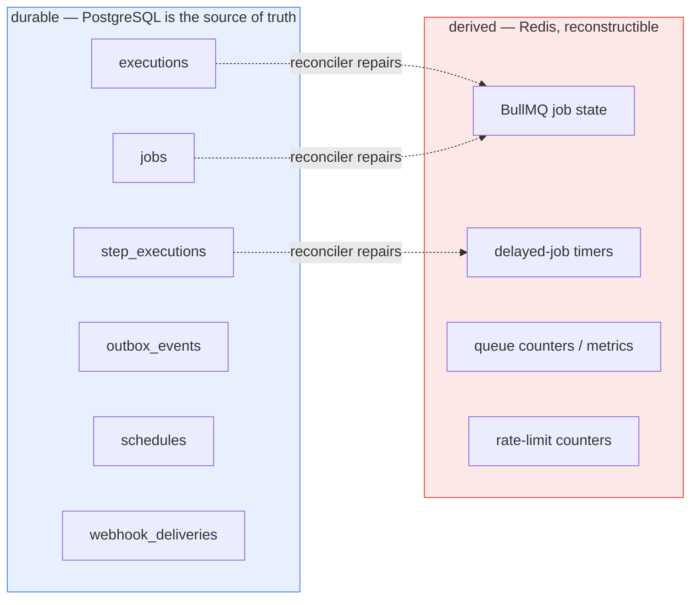
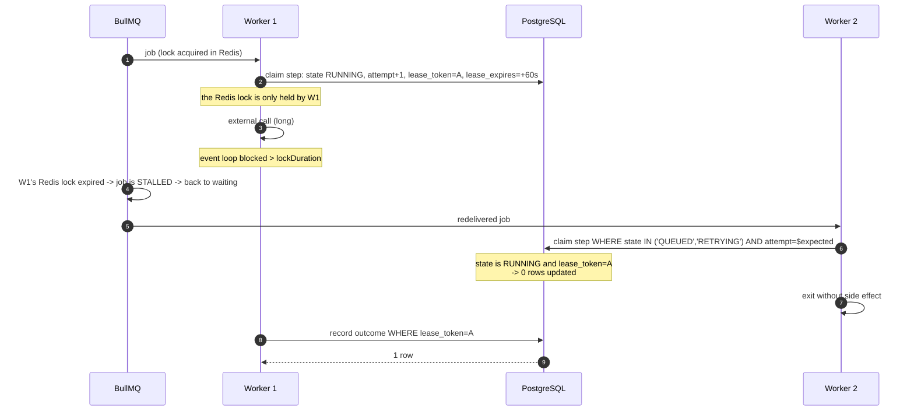
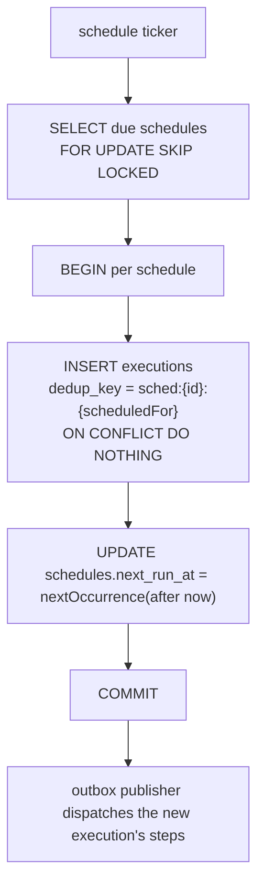

# Reliability

| Field | Value |
|---|---|
| Status | **Proposed** |
| Related ADRs | [002](../adr/002-postgresql.md), [003](../adr/003-bullmq.md), [006](../adr/006-transactional-outbox.md), [007](../adr/007-idempotency-strategy.md) |
| Companion docs | [system-overview.md](./system-overview.md) §24, [execution-engine.md](./execution-engine.md) §22–§28, [diagrams/failure-recovery.md](../diagrams/failure-recovery.md) |

---

## 1. Reliability model in one paragraph

Every execution of a workflow step is delivered **at least once**, processed
against **durable state in PostgreSQL**, and made **idempotent** by a
deterministic operation identity, with **recovery** driven by a PostgreSQL-driven
reconciler rather than by any in-memory or Redis-resident bookkeeping. The
combination is what makes the system reliable. Any one of the four alone is
insufficient: at-least-once without idempotency duplicates side effects;
idempotency without durability loses work; durability without recovery strands
work. See §3 for why "exactly once" is not on the table.

## 2. Failure model

We classify every failure by **what state it leaves behind**, because that
determines the recovery.

| Class | Definition | Example | Durable residue |
|---|---|---|---|
| **Transient infrastructure** | The dependency will plausibly recover on its own | Redis connection reset, PostgreSQL failover, pod eviction | Request failed; nothing committed |
| **Transient remote** | The remote dependency failed in a way that a retry can fix | `503`, `429`, connection refused | Nothing committed |
| **Definitive remote failure** | The remote dependency rejected the work and will reject it again | `400`, `404`, schema violation | Outcome recorded as a failed attempt |
| **Unknown outcome** | The request may or may not have taken effect | Timeout after write, socket closed mid-response | Outcome recorded as `UNKNOWN`; the effect may exist |
| **Worker death** | The process executing work stopped existing | OOM kill, node drain, `SIGKILL` | Lease expires; BullMQ lock expires |
| **Poison message** | The work can never succeed, however many times it is retried | Malformed definition, revoked credential, SSRF block | Job fails permanently; needs an operator |
| **Dependency loss** | A stateful dependency is unavailable | Redis down, PostgreSQL down | Work intent accumulates as rows in PostgreSQL |

Two facts about this table drive everything else:

- **"Unknown outcome" is not a failure.** Treating it as one silently loses work;
  treating it as success silently invents work. It must be recorded as its own
  class and surfaced. See [execution-engine.md](./execution-engine.md) §14.1.
- **Dependency loss is only recoverable for the dependency that is not the source
  of truth.** PostgreSQL loss is catastrophic by definition. Redis loss is a
  delay, because every piece of work intent is already a PostgreSQL row.

## 3. Why exactly-once is not a safe assumption

The phrase "exactly-once" is used for at least four different things, and only
one of them is achievable here.

| Claim | Achievable? | Why |
|---|---|---|
| "The database transaction commits exactly once" | **Yes** | PostgreSQL ACID |
| "The outbox publisher publishes each event exactly once to Redis" | **No** | A crash between `queue.add` and marking the row `PUBLISHED` forces a re-publish; we make re-publish a no-op instead of pretending it cannot happen |
| "Each job is processed by exactly one worker" | **No** | BullMQ explicitly documents at-least-once, and a job whose lock is not renewed is moved back to `waiting` and processed again |
| "Each external side effect happens exactly once" | **No** | We do not own the remote transaction and cannot enlist it |

### 3.1 The four reasons, concretely

1. **The side effect is outside our transaction.** Charging a card, sending an
   email, calling a partner API: none of these can be made atomic with a
   PostgreSQL `COMMIT`. Distributed transactions across heterogeneous systems are
   not available, and even XA does not span an HTTP call to a third party.

2. **The uncertainty window is irreducible.** If we send a request and the
   socket closes before the response arrives, the remote system may have acted.
   No local retry policy, lock, or transaction can distinguish "did not happen"
   from "happened, answer lost". We must treat it as unknown. Any system that
   claims otherwise is guessing.

3. **Leases cannot distinguish slow from dead.** Every lock with a timeout makes
   the same trade: either a slow worker loses its lock (and its work is redone),
   or a dead worker's lock is held until the process is manually cleaned up. We
   choose the former and pay for it with idempotency.

4. **Producers are outside our control.** A customer retries a `POST` because
   their network timed out. A webhook provider redelivers. A scheduler runs twice
   during a failover. The consumer cannot opt out of these.

### 3.2 What we promise instead

```text
at-least-once delivery
        +
durable state
        +
idempotent processing
        +
recovery
```

This yields **at-least-once processing with effectively-once observable effect for
side effects whose target supports an idempotency key**, and **at-least-once
effect with explicit operator-visible ambiguity** for those that do not. The
`http` node config therefore has an `idempotent: true` flag, and steps whose last
attempt ended in `UNKNOWN` are reported as such by the API. We do not paper over
the difference.

## 4. Delivery semantics

| Boundary | Semantics | Mechanism |
|---|---|---|
| API request → handler | At-least-once (client may retry) | `Idempotency-Key` + `idempotency_keys` |
| Trigger → `startExecution` | At-least-once, effectively once | `executions.dedup_key` UNIQUE |
| PostgreSQL → BullMQ | At-least-once publish, effectively once | Transactional outbox + deterministic `jobId` |
| BullMQ → worker | **At-least-once** (documented by BullMQ) | `jobId` uniqueness, `attempts` for redelivery |
| Worker → step execution | Effectively once per `(step, attempt)` | Conditional `UPDATE` claim on `state` + `attempt` |
| Worker → external system | At-least-once | `Idempotency-Key` header, provider-dependent |
| Reconciler → anything | At-least-once, idempotent | `FOR UPDATE SKIP LOCKED`, `UNIQUE` constraints |

The engine's own transitions are **exactly-once in effect** because every one is
a compare-and-set: `UPDATE ... WHERE state = $expected`. A transition either
happens once or affects zero rows; there is no window in which it happens twice.
That is the strongest guarantee available without distributed consensus, and it
is sufficient.

## 5. Durable state

Everything required to reconstruct in-flight work lives in PostgreSQL:

| Table | Durable fact it holds |
|---|---|
| `executions` | What is running, and what state it is in |
| `step_executions` | Attempt number, generation, `available_at`, lease, outcome, error class |
| `jobs` | A dispatch was intended, for which `(step, attempt)`, with which stable id |
| `outbox_events` | A publish was intended, and whether it has happened |
| `schedules` | When the next fire is due |
| `webhook_deliveries` | Which external event ids have already been accepted |
| `idempotency_keys` | What an API call returned last time |
| `audit_logs` | What happened, and who did it |

The rule: **if it is not in one of these tables, the system does not know it, and
losing it must be acceptable.** BullMQ job state, Redis delayed-job timers,
in-memory worker state and cache entries are all reconstructible, and all of them
are treated as caches of the above.



## 6. Transactional outbox

The full rationale is in [ADR-006](../adr/006-transactional-outbox.md). The
operational properties:

- **Event states:** `PENDING` → `PUBLISHING` → `PUBLISHED`, with `FAILED` (retry
  with backoff) and `DEAD` (exhausted `max_publish_attempts`).
- **Claiming:** `SELECT ... FOR UPDATE SKIP LOCKED` in batches, so multiple
  publisher instances are safe and no leader election is needed.
- **Duplicate publication** is expected and harmless: the BullMQ `jobId` is the
  `jobs.id` UUID, so a duplicate `add` is ignored.
- **Monitoring:** age of the oldest `PENDING` row, count by state, count of
  `DEAD` rows (must be zero), publish latency histogram.
- **Cleanup:** `PUBLISHED`/`DEAD` rows older than the retention window are
  deleted in id-ordered batches by the retention sweeper.
- **Alert:** any `DEAD` row, or the oldest `PENDING` row older than the publish
  objective.

## 7. Idempotency

Four layers, each preventing a different duplication. Full treatment in
[ADR-007](../adr/007-idempotency-strategy.md); the reliability-relevant summary:

| Layer | Key | Prevents |
|---|---|---|
| API | `Idempotency-Key` header → `idempotency_keys` | Duplicate executions created by a retried `POST` |
| Trigger | `executions.dedup_key` | Duplicate executions from webhook redelivery or a double-firing schedule |
| Dispatch | `jobs` UNIQUE `(step_execution_id, attempt)` + BullMQ `jobId = jobs.id` | Two queue jobs for one attempt |
| Claim | Conditional `UPDATE` on `state` + `attempt` + `lease_token` | Two workers performing one attempt |
| External | `Idempotency-Key: exec:{executionId}:step:{nodeId}:g{generation}` | A duplicate side effect, *if the target honours it* |

`generation` increments **only** on operator-initiated retry. Transport
redelivery and automatic retry keep it fixed, so a crash-induced duplicate
collapses onto the same external key, while a deliberate "do it again" gets a
fresh one.

## 8. Retries, backoff and jitter

Three independent retry loops, deliberately:

| Loop | Owns | Backoff | Stored in |
|---|---|---|---|
| Domain step retry | How many attempts a step gets, and when | `min(cap, base * 2^(attempt-1))` with equal jitter, `Retry-After` honoured | `step_executions.attempt`, `available_at` |
| Outbox publish retry | How many times a publish is retried | Same shape, separate counters | `outbox_events.attempts`, `available_at` |
| BullMQ transport retry | Surviving a stalled job | Immediate; `attempts: 3` for redelivery only | Redis |

**Jitter is not optional.** Without it, every step that failed during a provider
outage retries at the same instant when the provider recovers, converting a
recovery into a second outage. Equal jitter (`delay/2 + random() * delay/2`)
keeps a guaranteed minimum spacing between our own attempts while still
spreading a fleet's attempts.

**`Retry-After` always wins** and is never jittered, because it is an explicit
instruction from the server we are talking to.

Constants (`base 1 s`, `cap 5 min`, `maxAttempts 5`) are **starting values to be
measured during performance testing**, not tuned constants.

## 9. Timeouts

| Timeout | Where | Notes |
|---|---|---|
| HTTP connect / TLS / response | Worker, per attempt | Connect failure is `TRANSIENT`; response timeout is `UNKNOWN` |
| Node `timeoutMs` | Worker, via `AbortSignal` | BullMQ has no native job timeout; the processor enforces it |
| Execution `timeoutMs` | Reconciler | The only place that can see an execution with no active worker |
| Lease TTL | Worker, renewed every TTL/3 | Must exceed the node timeout plus a margin |
| API request | Fastify | Plus a body size limit |
| Graceful shutdown | Worker, on `SIGTERM` | `worker.close()` with a deadline |

Two BullMQ connection settings are load-bearing and easy to get wrong
(<https://docs.bullmq.io/guide/going-to-production>):

- `maxRetriesPerRequest: null` on **worker** connections, so a transient Redis
  error surfaces as a thrown command error rather than a fast failure that can
  break worker bookkeeping.
- A `retryStrategy` with exponential backoff between roughly 1 s and 20 s, so a
  Redis restart is survived without human intervention.

## 10. Leases and locks

The system uses three distinct mechanisms. Confusing them is a common source of
bugs, so they are named here.

| Mechanism | Where | Protects against | Released by |
|---|---|---|---|
| **PostgreSQL row lock** (`FOR UPDATE`) | `executions` row | Concurrent advancement of one execution | End of transaction |
| **Domain lease** (`lease_token`, `lease_expires_at`) | `step_executions` | Two live workers performing one attempt | Expiry, or the owner's outcome write |
| **BullMQ job lock** | Redis key | The same job being dequeued by two workers | Lock renewal, or expiry → stalled |



The diagram is the whole argument for the design: **BullMQ's lock can be lost
while our domain lease is still valid, and the domain claim still protects the
side effect.** The reverse is also true — our lease can expire while BullMQ's
lock is fine, in which case the reconciler re-dispatches and the original
worker's outcome write is rejected by the `lease_token` check. Both directions
are safe because the claim is a compare-and-set and outcomes are lease-guarded.

## 11. Duplicate jobs and stuck jobs

| Symptom | Detection | Response |
|---|---|---|
| Duplicate BullMQ job for the same `jobId` | BullMQ ignores the `add`; the `deduplicated` event fires for dedup-keyed adds | None needed. Log at debug. |
| Two workers processing the same step | The loser's claim affects 0 rows | None needed. Log `duplicate_delivery`. |
| Job `active` forever with no worker | BullMQ lock expiry → `stalled` event → redelivery | Listen for `stalled` and alert; a burst means CPU-bound steps (see below) |
| Job failed permanently | BullMQ `failed` set | Operator triage; `retryExecution` re-dispatches from PostgreSQL |
| Step `QUEUED`, no live job | Reconciler: `available_at` long past with an incomplete `jobs` row | Re-dispatch with the same `jobs.id` |
| Step `READY`, no `jobs` row | Reconciler | `scheduleStep` |
| Step `RUNNING`, lease expired | Reconciler | `RETRYING`, preserving `attempt` and `generation`, then re-dispatch |
| Step `PENDING` forever | Reconciler: execution non-terminal but nothing runnable | Re-derive; log loudly — this indicates an engine bug, and the log is the point |

**Stall prevention.** BullMQ renews the job lock on a timer that requires the
Node.js event loop. A CPU-bound step that blocks the loop for longer than
`lockDuration` will be declared stalled and reprocessed. Keep step executors
I/O-bound. If a genuinely CPU-bound node type is added later, it must either
yield periodically or run in a sandboxed process — a constraint to record in the
node-type contract, not a surprise to discover in production.

## 12. Worker crashes and graceful shutdown

**Graceful shutdown** on `SIGTERM` and `SIGINT`
(<https://docs.bullmq.io/guide/workers/graceful-shutdown>):

1. Stop accepting new jobs (`worker.pause()` where appropriate).
2. `await worker.close()` with a deadline shorter than the orchestrator's
   termination grace period, so a slow step is abandoned rather than the process
   being `SIGKILL`ed mid-transaction.
3. Stop lease renewal; let in-flight steps be reclaimed by lease expiry.
4. Exit 0.

Graceful shutdown **reduces** stalls; it does not eliminate them, because a step
may legitimately outlive the grace period. The lease and the `stalled` mechanism
are the actual safety net. Deployment strategy is therefore *stop-before-drain*:
scale down worker replicas only after the queue depth reaches zero or a maximum
wait elapses, and prefer `SIGTERM` with a generous grace period over hard kills.

**Crash (unplanned).** The process disappears. Recovery is entirely via lease
expiry plus the reconciler, and the recovery path is the one analysed in
[execution-engine.md](./execution-engine.md) §27.

## 13. Queue failure (Redis down)

| Actor | Behaviour |
|---|---|
| API | Unaffected. It writes to PostgreSQL only. Triggers create executions and outbox rows normally; `outbox_events` accumulates. |
| Outbox publisher | `queue.add` throws. The row moves to `FAILED` with backoff up to `max_publish_attempts`, then `DEAD` with an alert. |
| Workers | Cannot fetch jobs. In-flight jobs stall; leases expire; the reconciler re-dispatches into PostgreSQL, adding outbox rows that also cannot publish. |
| Reconciler | Repairs PostgreSQL-side state; its Redis calls fail and are retried. |
| Scheduler | Unaffected (PostgreSQL-driven), except the same accumulation. |
| On recovery | Redis returns; the publisher drains the backlog in `available_at` order; workers resume; the reconciler re-arms any timers Redis lost. |

The important property: **during a Redis outage, no work is lost and no work is
performed twice.** Work is *late*, and it becomes late in a controlled order
because `available_at` is respected.

**Deliberate non-mechanism:** we do not fail API requests when Redis is down, and
we do not attempt a fallback synchronous execution path. Both would trade a
latency problem for a correctness problem.

**Redis durability caveat.** Redis is configured with persistence (AOF) and
replication. If Redis loses data anyway, the reconciler rebuilds it from
PostgreSQL (§11). Redis durability is a latency optimisation, not a correctness
requirement.

## 14. Database failure (PostgreSQL down)

| Actor | Behaviour |
|---|---|
| API | Rejects writes with `503`. Read-only queries may still succeed on a replica if one is configured. |
| Workers | Cannot claim a step or record an outcome. The processor **throws** (it could not record its outcome), which is the one condition that should trigger BullMQ's transport redelivery. |
| Outbox publisher | Cannot claim rows. No data loss; publishing pauses. |
| Reconciler | Cannot claim rows. Pauses. |
| Scheduler | Cannot tick. Two distinct cases: a `SCHEDULE_FIRE` outbox row that was **already committed** before the outage still publishes on recovery, each deduped by `dedup_key`. A slot that came due **entirely while the ticker was down** is *not* replayed — `next_run_at` is recomputed from `now()` and the skip is counted in `schedules.missed`. |

The engine's design choice that makes this survivable: **workers never hold a
transaction across external I/O** (R3). So a database outage cannot leave a
partially applied state machine, and a worker process does not accumulate
in-flight transactions that will all fail at commit.

PostgreSQL loss itself is not survivable by application design. Mitigations are
infrastructure: managed high availability, point-in-time recovery, and tested
restore procedures. We do not claim an application-level answer.

## 15. External service failure

| Response | Classification | Treatment |
|---|---|---|
| `2xx` | success | Record output |
| `400`, `401`, `403`, `404`, `409`, `422` | `DEFINITIVE` | Do not retry (except where the node's `retryOn` says otherwise). Fail the step. |
| `408`, `429` | `TRANSIENT` | Retry with backoff; honour `Retry-After` |
| `5xx` | `TRANSIENT` | Retry with backoff |
| DNS failure before connect | `TRANSIENT` | Retry |
| Connect refused / TLS handshake failure | `TRANSIENT` | Retry |
| Timeout after the request was written | `UNKNOWN` | Retry **and** record `outcome: UNKNOWN` |
| Socket closed mid-response | `UNKNOWN` | Retry **and** record `outcome: UNKNOWN` |
| SSRF policy violation, revoked credential | `FATAL` | Fail immediately, no retry — retrying is pointless and possibly malicious |

Circuit breaking per external host is **Proposed**, not implemented in v1. Domain
backoff plus BullMQ's global rate limiting are the v1 mechanisms. Revisit when
the number of distinct external hosts makes per-host state worthwhile.

## 16. Rate limits

Three distinct layers, and confusing them causes real incidents:

| Layer | Scope | Mechanism |
|---|---|---|
| Inbound API | Per principal (user, API key, or IP for unauthenticated) | Redis token bucket, per-route cost |
| Inbound webhook | Per endpoint, and per source IP | Redis token bucket, tighter limits, body size cap |
| Outbound `http` step | Per target host, and globally | Node `retryOn`/`Retry-After`; BullMQ queue-level and global rate limiting as backpressure |

Outbound rate limiting is the one that protects *us* from being blocked. BullMQ
offers both a worker-level `limiter` and a queue-level global rate limit
(<https://docs.bullmq.io/guide/queues/global-rate-limit>); the global setting is
the right lever because it applies across all worker replicas. A `429` from a
target also pauses that specific step via `Retry-After`, so a single throttled
tenant does not consume the fleet's capacity.

**Rate-limit counters live in Redis and are therefore not durable.** That is
acceptable: a counter reset during a Redis outage grants slightly more requests
for a moment, which is a far smaller problem than rate limiting becoming a
correctness dependency.

## 17. Backpressure and concurrency limits

| Limit | Where enforced | Effect when hit |
|---|---|---|
| Per-worker concurrency | BullMQ `concurrency` on the `Worker` | Jobs wait in `waiting` |
| Fleet-wide concurrency | BullMQ `setGlobalConcurrency` on the `steps` queue | Jobs wait in `waiting` |
| Per-organization concurrency | Engine, at schedule time: count the org's `RUNNING` steps before dispatching | New steps stay `READY`; the reconciler dispatches them as capacity frees |
| Node timeout | Worker | The step is abandoned and retried |
| API body size | Fastify | `413` |
| Step output size | Worker | Truncated inline, spilled to object storage beyond the threshold |
| Workflow definition size | Validation | `422` |

Adding `READY` steps without dispatching them is safe: `READY` is a durable
intent, and the reconciler will dispatch them. This is how backpressure is
expressed without a second queue and without losing work.

**Connections.** Worker concurrency is bounded by the PostgreSQL pool, not by
CPU. `pool_size >= worker_concurrency + 2` per process is the working constraint;
exceeding it turns concurrency into a queue inside the driver and inflates
latency invisibly.

## 18. Dead-letter strategy

There is no separate dead-letter queue. Three mechanisms cover the cases:

| Case | Mechanism | Operator action |
|---|---|---|
| A step exhausted its attempts | `step_executions.state = FAILED` with full `attempts_log`; execution derives `FAILED` | `POST /executions/{id}/retry` |
| A step is unrunnable (revoked credential, SSRF block) | `FAILED` with `error.class = FATAL`, so the log distinguishes "will never work" from "ran out of luck" | Fix the cause, then retry |
| An outbox row could not be published | `outbox_events.state = DEAD` after `max_publish_attempts` | Investigate; the row is retained, not deleted |

A separate dead-letter queue would be a second source of truth about work that
PostgreSQL already records, and it would have to be reconciled with the
`step_executions` rows anyway. `step_executions` **is** the dead-letter queue,
with the advantage that it is queryable with the same tenant filters as
everything else.

## 19. Scheduler reliability



Four properties, and why each is necessary:

1. **`SKIP LOCKED` instead of leader election.** Multiple ticker instances are
   safe, and a dead instance needs no failover mechanism. There is no leader to
   lose.
2. **`next_run_at` is computed from `now()`, not from the previous value.**
   After a long outage the ticker does not try to replay every missed slot; it
   computes the next occurrence from the current time. Missed slots are visible in
   metrics as `schedules.missed`, not as a thundering herd.
3. **`dedup_key` makes firing idempotent.** If the transaction commits and the
   process dies before `next_run_at` is observable elsewhere, the next tick
   re-evaluates the same schedule. If `next_run_at` was also committed, the slot
   has advanced. If it was not, the `ON CONFLICT DO NOTHING` absorbs the
   duplicate. Either way exactly one execution exists per slot.
4. **Schedules live in PostgreSQL, not in Redis.** BullMQ's Job Schedulers
   (`upsertJobScheduler`) are a Redis-resident cron registry. A Redis flush would
   silently delete every schedule. Using them would make Redis authoritative for
   a product feature, which contradicts ADR-003. We may *mirror* schedules to
   BullMQ delayed jobs purely for timer precision — a **Proposed** optimisation
   whose correctness never depends on the mirror existing.

**`next_run_at` and DST.** Times are stored as `timestamptz`; the schedule's cron
is evaluated in its configured IANA timezone. Ambiguous local times during a
fall-back transition follow a documented rule (fire once, at the earlier UTC
instant). This is a specification decision to be confirmed by tests before
implementation, not an implementation detail to be discovered.

## 20. Webhook reliability

| Property | Mechanism |
|---|---|
| At-least-once from the sender | Assumed. Providers redeliver. |
| Effectively-once acceptance | `webhook_deliveries` UNIQUE `(webhook_endpoint_id, external_event_id)`; the accept path is a single transaction, so a duplicate hits the constraint and returns `200` without creating a second execution |
| No lost accepts | The execution, its steps and its outbox rows commit in the same transaction as the delivery record |
| No lost work after acceptance | Standard outbox path |
| Rejected requests are cheap | Signature verification happens before any database write, so an unsigned flood costs only a hash |
| Poison payloads | A payload that passes signature verification but fails schema validation is recorded with `outcome = REJECTED_INVALID_PAYLOAD` and never retried by us |
| Slow provider | Respond `202` after commit, never after execution completes. The provider's timeout must not be able to cause a duplicate accept, which `dedup_key` handles. |

If a provider omits a stable event id, we fall back to a hash of the request body
within a short window and record the weaker guarantee in the delivery row. A
provider with no event id and no stable body has an unavoidable replay exposure,
and this is stated to the user when the endpoint is created rather than hidden.

## 21. Failure matrix

| # | Failure | Detection | Recovery | Data risk | Duplicate risk |
|---|---|---|---|---|---|
| 1 | Worker crashes before the external call | Lease expiry (reconciler) | Re-dispatch; same idempotency key | None | None (nothing happened) |
| 2 | Worker crashes after the external call, before recording | Lease expiry | Re-dispatch; same idempotency key | None | **Real** if the target ignores idempotency keys — surfaced as `UNKNOWN` |
| 3 | Same job delivered to two workers | BullMQ `stalled` event; loser's claim affects 0 rows | None needed | None | None (claim is a compare-and-set) |
| 4 | PostgreSQL commits, BullMQ publish fails | `outbox_events` row stays `PENDING`/`FAILED` | Publisher retries with backoff; reconciler resets stuck rows | None | None (duplicate publish is a no-op) |
| 5 | Publisher crashes between `queue.add` and marking `PUBLISHED` | Row remains `PENDING` | Re-publish with the same `jobId`; BullMQ ignores the duplicate | None | None |
| 6 | Redis unavailable | Client errors; metrics; stalled jobs | Work intent accumulates in PostgreSQL; drains on recovery, in `available_at` order | None | None |
| 7 | Redis loses data (flush, failover without persistence) | Reconciler finds `QUEUED`/`RETRYING` steps with no live job | Re-dispatch from `jobs.id` | None | None (claim prevents double work) |
| 8 | PostgreSQL unavailable | Connection errors; `503` from API | Infrastructure-level failover; workers throw so BullMQ redelivers | **None if HA is configured; total loss if the primary is lost unrecoverably** | None (no transaction spans I/O) |
| 9 | External service times out after the request was written | `UNKNOWN` classification | Retried with the same idempotency key; `UNKNOWN` surfaced to the operator | None | **Real** if the target ignores idempotency keys |
| 10 | External service returns `429` | Response classification | Honour `Retry-After`; queue-level/global rate limiting as backpressure | None | None |
| 11 | External service down for a long period | Attempt budget exhausts | Step `FAILED`; execution derives `FAILED` | None | None |
| 12 | Worker deployment while jobs are in flight | `SIGTERM` handling; `stalled` events on hard kill | `worker.close()` with a deadline; otherwise lease expiry | None | None |
| 13 | Stale lock: worker owns a lease then dies | `lease_expires_at` in the past | Reconciler reassigns, preserving `attempt` and `generation` | None | **Real** for external effects, same as #2 |
| 14 | Scheduler restarts mid-tick | Transaction either committed or did not | `SKIP LOCKED` + `dedup_key` | None | None |
| 15 | Scheduler down for hours | `schedules.missed` metric | Next tick computes from `now()`; missed slots reported, not replayed | None | None |
| 16 | Webhook redelivered by the provider | Unique `(endpoint, external_event_id)` violation | Return `200`, no second execution | None | None |
| 17 | Webhook replayed by an attacker with a captured body | Signature is valid; timestamp window and event-id dedup apply | Accepted once as a duplicate, then deduped | None | None |
| 18 | API request retried by the client | `Idempotency-Key` lookup | Replay the stored response | None | None |
| 19 | Outbox row permanently unpublishable | `state = DEAD`, alert | Operator intervention; row retained | None | None |
| 20 | Poison job (malformed definition, revoked credential) | `FAILED` with `FATAL` class | No automatic retry; operator fixes and retries | None | None |
| 21 | Clock skew between API, worker and scheduler | NTP monitoring; lease and `available_at` anomalies | Bounded impact: an early `available_at` fires slightly early, a late one slightly late | None | None (`dedup_key` still holds) |
| 22 | Execution exceeds `timeoutMs` with no active worker | Reconciler sweep | Execution `TIMED_OUT`; remaining steps terminal | None | None — but in-flight side effects are **not** recalled |

Two rows deserve emphasis. **#2/#9/#13 are the same failure** — a crash between
an external effect and its durable record — and they are the only rows in this
table with a genuine duplicate risk. **#8 is the only row with a data risk**,
because it is the only dependency we cannot rebuild from.

## 22. Recovery procedures

Operational runbooks. Each is a sequence, not a hope.

### 22.1 Executions appear stuck in `RUNNING`

1. Check `executions` in `RUNNING` with `updated_at` older than the maximum
   expected step duration.
2. Check for steps in `RUNNING` with `lease_expires_at` in the past. If present,
   the reconciler is not running or is failing — check the `scheduler` process.
3. Check the reconciler's `sweep` metrics for errors and for zero iterations.
4. Check for `STEP_DISPATCH` outbox rows stuck in `PENDING` beyond the publish
   objective. If present, the publisher is failing — most likely Redis.
5. Check BullMQ queue depth: a large `waiting` backlog with no `active` jobs means
   no worker replicas are consuming.
6. **Do not** manually flip step states. Force the reconciler to run, or restart
   the `scheduler` process. Manual state edits break invariant E1 and will be
   overwritten on the next sweep.

### 22.2 Redis outage

1. Confirm the blast radius: is it Redis, or the network path to it?
2. Confirm the API is still serving writes (it should be) and that
   `outbox_events` pending count is growing rather than flat.
3. Do **not** restart the API or workers "to fix it". Workers will thrash on
   reconnection.
4. When Redis returns, watch the publisher drain rate and the `waiting` backlog.
5. If the backlog does not drain, the likely cause is insufficient worker
   concurrency, not the publisher. Scale workers.
6. Verify no `DEAD` outbox rows accumulated; if any did, they represent work that
   will never run until someone resets them.

### 22.3 A step is stuck in `QUEUED` with nothing running

1. Find the step's `jobs` row and note its `id` and `available_at`.
2. Check whether a BullMQ job with that `jobId` exists, in which state, and when
   it was last processed.
3. If it is `waiting` and no worker is active: no workers are consuming. Check
   worker process health and BullMQ global concurrency.
4. If it is `delayed` and `available_at` is in the past: the delayed-job timer was
   lost. The reconciler will re-dispatch; if it does not within one sweep
   interval, investigate the reconciler.
5. If it is `failed` in BullMQ but the step is `QUEUED`: the worker's outcome
   write failed. This is the interesting case — check the worker's logs for a
   database error, and check whether the step's lease has since expired.
6. If the job does not exist at all: Redis lost it. The reconciler re-dispatches.

### 22.4 Mass failure of executions (a bad workflow version)

1. Identify the affected `workflow_version_id` and the time window.
2. Decide whether to stop the bleeding: disable the offending `schedules`, or
   cancel the affected executions in batches. Both are API operations; both are
   auditable.
3. Fix the definition by creating a new version. Never edit a published version
   ([ADR-005](../adr/005-workflow-versioning.md)).
4. Use `retryExecution` on affected executions after the fix, or leave them
   failed if the work should not be repeated.

### 22.5 Verifying the system is healthy

A healthy system satisfies all of these continuously:

- oldest `PENDING` `outbox_events` row age below the publish objective
- zero `DEAD` outbox rows
- zero steps in `RUNNING` with an expired lease, beyond one sweep interval
- BullMQ `waiting` depth not monotonically increasing
- `outbox_events` `PENDING` count not monotonically increasing
- executions in `RUNNING` with `updated_at` older than the maximum execution
  timeout: zero
- reconciler sweep iteration count increasing

## 23. Observability for reliability

Every item is a metric or a log field, not a dashboard decoration.

| Signal | Query / field | Alert condition |
|---|---|---|
| Outbox lag | `max(now() - created_at)` over `outbox_events` where `state = 'PENDING'` | Above the publish objective |
| Dead outbox rows | `count` where `state = 'DEAD'` | `> 0` |
| Publish failures | `count` where `state = 'FAILED'` | Rate above baseline |
| Expired leases | `count` of `step_executions` where `state = 'RUNNING'` and `lease_expires_at < now()` | `> 0` beyond one sweep interval |
| Stuck steps | `count` of `step_executions` where `state in ('QUEUED','RETRYING')` and `available_at` far in the past | `> 0` |
| Stranded executions | `count` of non-terminal executions with no non-terminal step and no live dispatch | `> 0` — this is an engine bug signal |
| BullMQ stalls | `stalled` event rate | Any sustained rate |
| BullMQ `failed` | queue `failed` count | Increasing |
| Worker saturation | `active` / global concurrency | Sustained `>= 1` |
| `UNKNOWN` outcomes | `count` of steps whose last `error.outcome = 'UNKNOWN'` | Sudden increase for one workflow version |
| Schedules missed | `schedules.missed` counter | `> 0` |
| Reconciler liveness | sweep iteration counter | Flat |

## 24. Known limitations

Stated plainly, because a reliability document that claims completeness is lying.

1. **Duplicate external side effects remain possible** for targets that do not
   support idempotency keys, within the crash window of matrix rows #2/#9/#13.
   Mitigated by the deterministic key, by `UNKNOWN` reporting, and by the
   `idempotent: true` node flag — not eliminated.
2. **No cross-region failover.** One region, one primary. A regional failure is a
   data-availability event handled by infrastructure, not by the application.
3. **Reconciliation is periodic, not continuous.** Detection latency for a stuck
   step is up to one sweep interval. That interval is a
   **latency/load trade-off to be measured**, not a constant to assert.
4. **No circuit breaker per external host** in v1 (§15).
5. **Delivery ordering is not guaranteed between sibling steps.** Only
   "predecessor's outcome committed before successor's dispatch" is guaranteed
   ([execution-engine.md](./execution-engine.md) §16.3).
6. **Exactly-once is not offered**, and no configuration flag will change that.
7. **Backlog drain time after a long outage is unbounded** from our side; it
   depends on external service capacity. `available_at` ordering means we do not
   create a thundering herd, but we also do not drop stale work. A backlog-age
   based drop policy is a **Proposed** future feature with product implications
   (it changes what "delivered" means) and is deliberately not designed here.
8. **BullMQ v6 also ships a PostgreSQL backend.** It is not used: it is
   documented as roughly 1.5–2× lower throughput than Redis, and Redis remains
   the option BullMQ describes as the default and most battle-tested. See
   [ADR-003](../adr/003-bullmq.md) §4.

## References

- BullMQ — what it is and its delivery guarantee wording —
  <https://docs.bullmq.io>
- BullMQ retries, backoff, custom strategies, jitter —
  <https://docs.bullmq.io/guide/retrying-failing-jobs>
- BullMQ stalled jobs and `maxStalledCount` — <https://docs.bullmq.io/guide/jobs/stalled>
- BullMQ job ids and duplicate `add` semantics —
  <https://docs.bullmq.io/guide/jobs/job-ids>
- BullMQ deduplication — <https://docs.bullmq.io/guide/jobs/deduplication>
- BullMQ delayed jobs — <https://docs.bullmq.io/guide/jobs/delayed>
- BullMQ global concurrency — <https://docs.bullmq.io/guide/queues/global-concurrency>
- BullMQ global rate limit — <https://docs.bullmq.io/guide/queues/global-rate-limit>
- BullMQ graceful shutdown — <https://docs.bullmq.io/guide/workers/graceful-shutdown>
- BullMQ concurrency — <https://docs.bullmq.io/guide/workers/concurrency>
- BullMQ "Going to production" (Redis reconnect, `maxRetriesPerRequest`,
  job retention) — <https://docs.bullmq.io/guide/going-to-production>
- BullMQ timeout jobs — <https://docs.bullmq.io/patterns/timeout-jobs>
- BullMQ idempotent jobs — <https://docs.bullmq.io/patterns/idempotent-jobs>
- BullMQ Job Schedulers — <https://docs.bullmq.io/guide/job-schedulers/>
- BullMQ PostgreSQL backend — <https://docs.bullmq.io/guide/postgresql>
- Redis command reference (`SET` with `NX`/`PX`) —
  <https://redis.io/docs/latest/commands/set/>
- PostgreSQL explicit locking, `SKIP LOCKED` —
  <https://www.postgresql.org/docs/current/explicit-locking.html>
- PostgreSQL transaction isolation — <https://www.postgresql.org/docs/current/transaction-iso.html>
- PostgreSQL `ON CONFLICT` — <https://www.postgresql.org/docs/current/sql-insert.html>
- Google SRE Workbook, *Handling Overload* and *Addressing Cascading Failures* —
  <https://sre.google/workbook/table-of-contents/>
- AWS Builders' Library, *Timeouts, retries and backoff with jitter* —
  <https://aws.amazon.com/builders-library/timeouts-retries-and-backoff-with-jitter/>
- Marc Brooker, *Fixing retries with token buckets and circuit breakers* —
  <https://aws.amazon.com/builders-library/fixing-retries-with-token-buckets-and-circuit-breakers/>
