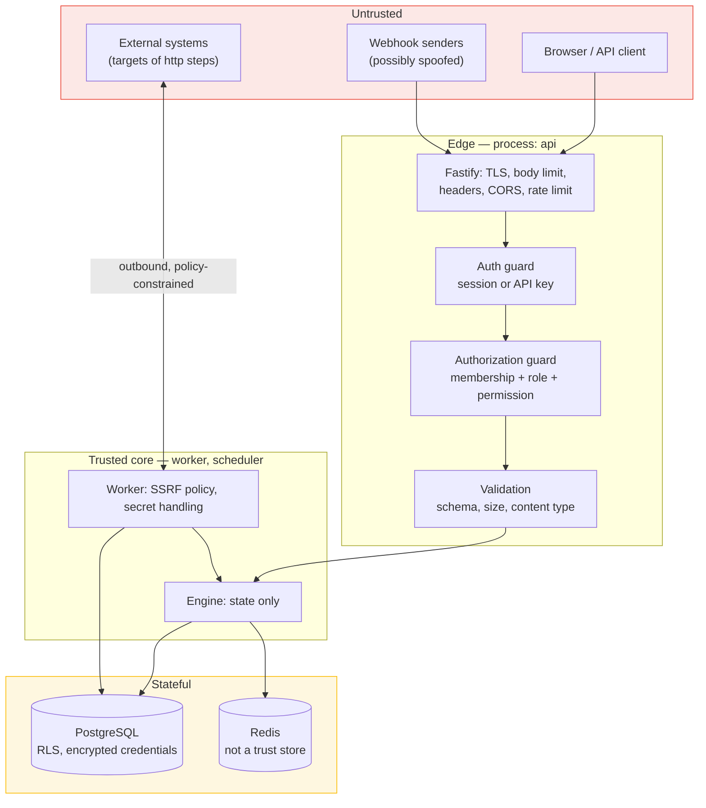
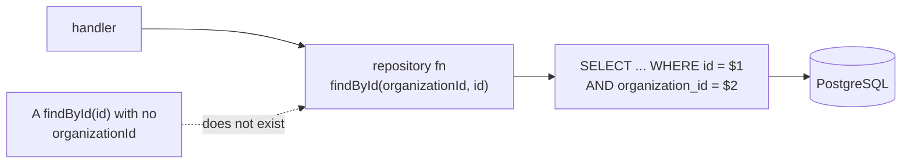
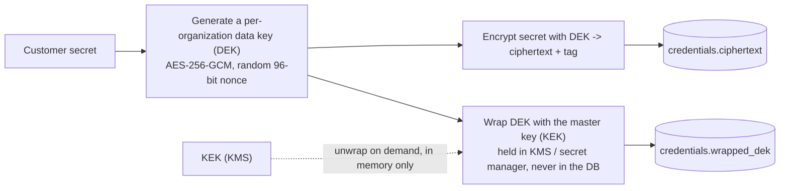
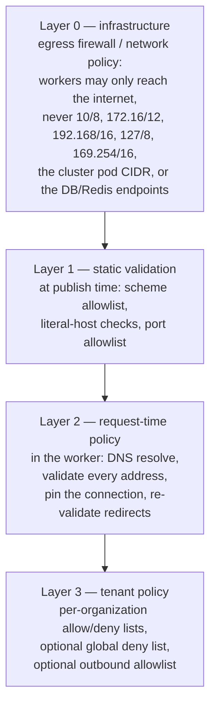
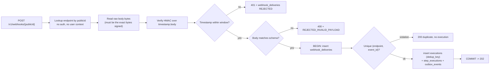

# Security Architecture

| Field | Value |
|---|---|
| Status | **Proposed** |
| Related ADRs | [001](../adr/001-authentication-strategy.md), [007](../adr/007-idempotency-strategy.md) |
| Companion docs | [system-overview.md](./system-overview.md) §18–§22, [execution-engine.md](./execution-engine.md) §12.4, [openapi.yaml](../api/openapi.yaml) |
| Scope | Application security. Physical, network and cloud-provider controls are out of scope and belong in infrastructure documentation. |

---

## 1. Threat model

### 1.1 Assumptions

Automia is internet-facing, multi-tenant, and executes **user-authored
instructions that make outbound network requests on the platform's behalf**.
That last property dominates the threat model: any customer can attempt to make
the platform reach an address it should not.

| Assumption | Consequence |
|---|---|
| The platform is internet-facing | Every endpoint is hostile input until proven otherwise |
| Any authenticated user may author a workflow | SSRF is a *designed-for* attack, not an accident |
| Workflow authors may be tenants we do not know | We cannot trust their intent, only constrain it |
| The platform holds customer secrets (API keys for third parties) | Credential theft is a high-value target |
| Execution is asynchronous and retried | An attacker can gain **repeated** attempts at something a single request would not allow |
| Third-party providers redeliver webhooks | Replay is a normal operational event, and therefore a normal attack |
| Any authenticated user may be a malicious tenant | Horizontal privilege escalation between tenants is the single most important confidentiality risk |

Explicitly out of threat scope: physical security, hypervisor escape, supply
chain of base images, and denial of service at a scale beyond what rate limiting
and capacity planning address. Those are infrastructure concerns.

### 1.2 Trust boundaries



Every arrow from `T0` into `T1` crosses a control. There is no path from
untrusted input to a database write, to an outbound socket, or to a secret that
does not pass through at least one of: authentication, authorization, validation,
or the SSRF policy.

### 1.3 Threat table

| # | Threat | Attack | Impact | Mitigation | Where |
|---|---|---|---|---|---|
| T1 | Credential theft | Steal a session cookie (XSS, network, shared device) | Account takeover, tenant compromise | `HttpOnly`, `Secure`, `SameSite=Lax`, `__Host-` prefix, short idle timeout, absolute expiry, server-side revocation, rotation on privilege change | §2.3 |
| T2 | CSRF | Cross-site form post to a state-changing endpoint | Unauthorized execution trigger, workflow mutation | `SameSite=Lax` cookies + mandatory `Origin`/`Referer` check on unsafe methods + no cookie auth on the webhook path | §3.5 |
| T3 | Cross-tenant read | Change `organizationId` in a path | Read another tenant's workflows and executions | `organizationId` derived from the authenticated membership only; repository signatures require it; `404` masking | §4.2–§4.4 |
| T4 | Privilege escalation | Member of an org calls an admin-only endpoint | Publish workflows, rotate credentials, manage members | Explicit permission per operation; server-side role mapping; no client-supplied role | §4.5 |
| T5 | IDOR | Enumerate `/executions/{id}` with a valid id from another tenant | Same as T3 | Tenant predicate in the query itself, not a post-filter | §4.3 |
| T6 | **SSRF** | Author an `http` step targeting `169.254.169.254`, `127.0.0.1`, an internal service, or a Redis/PostgreSQL port | Cloud credential theft, internal service access, network scanning | Scheme allowlist, reserved-range blocking, DNS resolution then per-address validation, DNS pinning, redirect re-validation, egress network policy | §6 |
| T7 | DNS rebinding | A hostname resolves to a public IP at validation and to an internal IP at connect time | Bypass of a naive SSRF check | Resolve once, validate **every** returned address, pin the validated address for the connection | §6.3 |
| T8 | Redirect-based SSRF | Public URL responds `302` to `http://169.254.169.254/` | Bypass of a naive SSRF check | Validate every hop; cap redirect count; never forward credentials across an origin change | §6.4 |
| T9 | Webhook forgery | POST to a webhook URL with a guessed or leaked secret | Trigger arbitrary executions | HMAC-SHA256 over `timestamp.body` with a per-endpoint secret, constant-time compare | §7.2 |
| T10 | Webhook replay | Replay a captured signed request | Trigger the same execution many times | Timestamp window (±5 min, **to be confirmed by tests**), `event_id` uniqueness, provider-specific idempotency headers | §7.3–§7.4 |
| T11 | Credential exfiltration via workflow | Author an `http` step to an attacker-controlled host, referencing a stored credential | Theft of customer third-party secrets | Credentials are bound to an explicit `credentialRef` per node, are **not** auto-attached to arbitrary hosts, and are scoped per organization; a node cannot reference a credential from another organization | §5.4 |
| T12 | Secret leakage in logs | A request/response or error object containing a secret is logged | Credential disclosure to anyone with log access | Structured logging with an explicit redaction list; a test that fails if a known canary secret appears in output | §5.5 |
| T13 | Secret at rest | Database dump | Bulk credential theft | Envelope encryption with a KMS-held key-encryption key; per-organization data key; `ciphertext` only in the database | §5.2 |
| T14 | Injection | SQL injection via a filter or sort parameter | Data breach | Parameterised queries only; Drizzle builds the SQL; no string interpolation; allowlisted sort columns | §3.2 |
| T15 | Malicious workflow definition | Resource exhaustion: 10 000 nodes, a cycle, a self-referential condition | CPU and memory exhaustion of the engine | Validation (acyclicity, node count, definition size), fixpoint bounded by node count, per-request timeouts | §3.2, [execution-engine.md](./execution-engine.md) §4 |
| T16 | Denial of service via unbounded fan-out | Trigger a workflow with wide fan-out across a large tenant | Starves other tenants | Per-organization concurrency budget, fleet-wide BullMQ global concurrency, per-tenant rate limits, workflow node-count bound | §3.4, [reliability.md](./reliability.md) §17 |
| T17 | API key brute force | Guess a key prefix and secret | Account compromise | 256-bit secrets, high-entropy generation, `timingSafeEqual`, per-key rate limit, `last_used_at` for detection, rotation | §3.3 |
| T18 | Mass assignment | Client sends `role: OWNER` when updating a membership | Privilege escalation | Explicit allowlisted update DTOs; never bind a request body to an entity | §4.5 |
| T19 | Information disclosure via errors | Stack traces, SQL text, or internal hostnames in responses | Reconnaissance | RFC 9457 problem documents with a stable `code`; internal detail only in correlated server logs | §3.6 |
| T20 | Unauthenticated enumeration | Walk `webhook_endpoints` or user ids | Reconnaissance | Webhook endpoints are keyed by an unguessable `publicId`; users are addressable only by id, with `404` masking | §7.1 |
| T21 | Audit tampering | Delete or alter `audit_logs` | Loss of accountability | Append-only in application code; separate DB role with `INSERT`/`SELECT` only; no `UPDATE`/`DELETE` grant | §8.2 |
| T22 | Malicious idempotency replay | Reuse an `Idempotency-Key` with a *different* body | Execute a different operation under a previously approved key | The key is bound to a hash of the canonical request; a mismatch returns `422` | §3.6 |
| T23 | Credential revocation race | A revoked credential is still used by an in-flight step | One extra side effect after revocation | Revocation is checked immediately before each use; a revoked credential makes the step `FATAL`, not retried | §5.3 |
| T24 | Subworkflow escape | A future `subworkflow` node references another tenant's workflow | Cross-tenant execution | Not in v1. When added, the reference is resolved within the same `organization_id` and enforced by a composite FK | §6.6 |
| T25 | Unbounded redirect / response | A target streams gigabytes, or redirects forever | Worker memory exhaustion, worker death | Redirect cap, response size cap, per-attempt timeout, streaming size enforcement | §6.4 |

### 1.4 OWASP mapping

| OWASP concept | Where addressed |
|---|---|
| A01 Broken Access Control | §4 in full; T3, T4, T5, T18, T24 |
| A02 Cryptographic Failures | §5 (envelope encryption, key management); T13 |
| A03 Injection | §3.2 (parameterised queries, no string-built SQL), §4.3 (no dynamic filters), §5.2 (credential handling); T14, T11 |
| A04 Insecure Design | §1 (threat model), §6 (SSRF as a designed-for attack), §3.4 (rate limits) |
| A05 Security Misconfiguration | §3.7 (headers, CORS), §5.6 (no default credentials, no debug endpoints) |
| A06 Vulnerable and Outdated Components | Dependency scanning in CI; lockfile-pinned versions |
| A07 Identification and Authentication Failures | §2; T1, T17 |
| A08 Software and Data Integrity Failures | §5.2 (integrity on credential ciphertext), [ADR-006](../adr/006-transactional-outbox.md) (no unauthenticated internal message channel) |
| A09 Security Logging and Monitoring Failures | §8; audit is transactional, not best-effort |
| A10 Server-Side Request Forgery | §6 in full; T6, T7, T8 |
| API risks (OWASP API Security Top 10) | API1 BOLA → §4.3; API2 broken auth → §2; API3 broken property-level auth → §4.5; API4 resource consumption → §3.4; API5 function-level auth → §4.5; API8 misconfiguration → §3.7; API10 unsafe consumption → §6, §7 |

---

## 2. Identity and authentication

### 2.1 Division of responsibility

This is the most important structural decision in the security model, and it is
fixed by [ADR-001](../adr/001-authentication-strategy.md):

| Concern | Owner | Notes |
|---|---|---|
| Password hashing and verification | **Better Auth** | OWASP parameters; never re-implemented |
| OAuth 2.0 / OIDC flows, `state`, PKCE | **Better Auth** | Protocols are not re-implemented |
| Session creation, validation, expiry, revocation | **Better Auth** | Server-side session records |
| 2FA (TOTP), passkeys, backup codes | **Better Auth** (opt-in plugins) | |
| Who the user is | **Better Auth** → `users` | |
| Which organizations they belong to | **Automia** | `organizations`, `memberships` |
| What they may do in an organization | **Automia** | Roles, permissions, guards |
| API key issuance, storage and verification | **Automia** | `api_keys` |
| Step credential storage and use | **Automia** | `credentials` |

**Authentication answers "who is this?". Authorization answers "may they do this,
here?"** They are different systems with different storage, different code, and
different failure modes. Conflating them is how platforms end up with a
`session.organizationId` that a stale cookie can influence.

### 2.2 Sign-in methods

| Method | Enabled in v1 | Notes |
|---|---|---|
| Google OAuth | Yes | OIDC; verified email asserted by the provider |
| GitHub OAuth | Yes | `user:email` scope; GitHub does not always assert a verified primary email, so **verified-email-only account linking is enforced** (§2.6) |
| Email + password | Yes | Hashed by Better Auth at OWASP parameters (Argon2id, or scrypt `N=2^17, r=8, p=1`); a pepper is held in configuration, not the database |
| TOTP 2FA | **Proposed** | Better Auth's 2FA plugin; enable for `ADMIN`/`OWNER` first |
| Passkeys | **Proposed** | |
| SAML / OIDC SSO for enterprise tenants | **Proposed, not designed** | Would be a *tenant-level* IdP config, which is why it is deliberately deferred |

### 2.3 Sessions

| Property | Value | Rationale |
|---|---|---|
| Storage | Server-side, in PostgreSQL (`sessions`) | Revocable; a JWT would not be, without a denylist that is a session store anyway |
| Cookie name | `__Host-sid` | The `__Host-` prefix forces `Secure`, forbids `Domain`, and requires `Path=/` — a browser-enforced floor against subdomain cookie injection |
| Attributes | `HttpOnly`, `Secure`, `SameSite=Lax`, `Path=/` | `HttpOnly` defeats T1; `SameSite=Lax` is the primary CSRF defence |
| Token | Opaque, 256-bit, random | No claims to tamper with; the session table is the authority |
| Idle timeout | Short; **to be measured**, starting point 12 h | |
| Absolute timeout | Longer; **to be measured**, starting point 30 days | Bounds the value of a stolen token |
| Update age | Refresh the stored expiry on activity, at most every N hours | Avoids a write per request |
| Revocation | Delete the `sessions` row | Immediate and auditable |
| Rotation on privilege change | Revoke all sessions of the affected user when role, password, or linked-account set changes | Limits blast radius of a compromised session |
| LocalStorage | **Never** store session tokens in `localStorage` | Any XSS becomes full account takeover |

Session tokens are never logged. The Pino redaction list (§5.5) includes the
`cookie` and `authorization` headers by name.

### 2.4 OAuth / OIDC integration

The flow is brokered by Better Auth; our responsibility is configuration and the
surrounding checks.

- **OIDC** is the protocol (an identity layer on OAuth 2.0); Google is
  implemented as an OpenID Connect provider. References:
  [OpenID Connect Core 1.0](https://openid.net/specs/openid-connect-core-1_0.html),
  [RFC 6749](https://www.rfc-editor.org/rfc/rfc6749).
- **PKCE (RFC 7636)** is used for the authorization-code flow. A confidential
  client with a registered redirect URI also gets the client secret, but PKCE is
  not optional for us.
- **`state` is verified** on callback. A missing or mismatched `state` fails the
  sign-in; it is never logged and retried automatically.
- **Redirect URI allowlist** is exact-match, configured per environment. There is
  no prefix or pattern matching, and no open redirect via a `redirectTo`
  parameter that is not itself allowlisted.
- **Client secrets** come from configuration/secret manager, never from the
  database and never from a client-supplied value.
- **Tokens received from providers** are validated for issuer, audience,
  signature and expiry by Better Auth. We do not parse `id_token` claims
  ourselves.

### 2.5 API keys

There is **no IETF standard** for API key format or transport. The transport is
standardised as a bearer token by [RFC 6750](https://www.rfc-editor.org/rfc/rfc6750);
everything else follows established practice, which both Better Auth's API-key
plugin and mainstream providers converge on.

```text
ak_live_7Kf3nQ2xR9wZ4mB8cV1        <- presented by the client
        |         |
        |         +-- 32 chars, ~190 bits of entropy from a CSPRNG
        +------------ 8 chars, indexed, safe to log and to show in a UI
```

| Property | Implementation |
|---|---|
| Storage | `api_keys.key_prefix` (indexed, plaintext) and `api_keys.secret_hash` (Argon2id of the secret, with a per-row salt) |
| Presentation | `Authorization: Bearer ak_live_{prefix}_{secret}` |
| Verification | Look up by prefix (O(1)), then `crypto.timingSafeEqual` on the hash comparison; constant-time throughout |
| Why a prefix | A database read must not yield a usable credential, and a prefix makes lookup possible without scanning hashes. A prefix is not a secret and is safe to display. |
| Display | Shown once at creation, never retrievable afterwards |
| Scope | Bound to one `organization_id` and to a subset of that organization's permissions |
| Revocation | Delete the row; immediate, because verification is a read |
| Metadata | `name`, `created_by_user_id`, `expires_at`, `last_used_at`, `revoked_at` |
| Detection | Anomalous `last_used_at` patterns and per-key rate limits |
| Rotation | Issue a new key, deploy, revoke the old one. Two active keys during rotation is the intended workflow. |

A key carries the *organization's* authority as constrained by its own
permission set — never a user's full authority. A key cannot be used to change
the membership that authorises it, and API-key-authenticated requests produce
audit entries attributed to the key, not to a user.

### 2.6 Account linking

Linking a Google account to an existing Automia user is a
**security-relevant** operation, because it is an account-takeover vector.

| Rule | Reason |
|---|---|
| Link only when the provider asserts a **verified** email | An unverified provider email is attacker-chosen |
| Never link on email match alone for providers where verification is not guaranteed (GitHub) | Prevents `attacker@github-alias.example` account takeover |
| Require the user to be **signed in** to link a new provider | Otherwise anyone could attach their provider to someone else's account |
| Show a confirmation step listing what is being linked | User-visible consent |
| Unlinking the **last** remaining sign-in method is refused | Prevents lockout |
| Record every link and unlink in `audit_logs` | Detection and forensics |
| Rate-limit link attempts | Brute-force and enumeration resistance |

Better Auth's `accountLinking` configuration enforces the first two; the rest are
Automia policy expressed in the UI and the audit trail.

---

## 3. API security

### 3.1 Transport and edge

| Control | Implementation |
|---|---|
| TLS | Terminated at the ingress; HSTS with `max-age` and `includeSubDomains`; HTTP redirected to HTTPS |
| Request body size | Fastify `bodyLimit`, per-route where smaller is appropriate. **Values to be measured**; the workflow-definition route has a distinct, larger limit |
| Content type | Enforced; `application/json` only except the webhook route, which needs a permissive parser for provider-specific payloads |
| Header size | Fastify default, plus explicit caps on `Idempotency-Key` and any custom header |
| URL length | Bounded by the ingress and by Fastify |
| Request timeout | Global request timeout, distinct from the per-node step timeout |
| Response size | Bounded; large step outputs are spilled to object storage and served as a reference |

### 3.2 Input validation

Three layers, in order:

1. **Transport:** Fastify schema validation on the raw request. Rejects
   malformed JSON, wrong types, oversized bodies, and unexpected content types
   before any business code runs.
2. **Contract:** every DTO is a schema (`packages/contracts`, Zod — **Proposed**)
   with `.strict()` on request bodies, so unknown properties are an error rather
   than silently ignored. This is what closes T18 (mass assignment).
3. **Domain:** invariants that a schema cannot express — DAG acyclicity, node
   uniqueness, referenced credential ownership, version publishability,
   organization ownership. Enforced in the domain layer
   ([execution-engine.md](./execution-engine.md) §4).

Rules:

- **No string-built SQL, ever.** Drizzle builds parameterised statements. There is
  no `sql.raw` in request-handling code, and a lint rule bans it outside
  migrations.
- **No dynamic sort or filter columns** from user input. An allowlist maps an
  external name to a column; unknown names return `422`. This is T14.
- **No expression evaluation** on user input. Workflow conditions are a closed
  enum (§2.2 of [execution-engine.md](./execution-engine.md)); there is no `eval`,
  no `Function`, and no user-supplied regular expression against untrusted input
  in a hot path. User-supplied regex, if ever needed for matching, must be
  length-capped and run with a timeout.
- **Every `id` in a path is validated as a UUID** before it reaches a query, so
  malformed input cannot become a query plan.

### 3.3 Rate limiting

| Scope | Key | Rationale |
|---|---|---|
| Unauthenticated (auth endpoints) | Source IP | Brute-force sign-in, OAuth abuse |
| Authenticated API | `api_key.id`, else `user.id` | Prevents one user degrading the service for others |
| Expensive reads (execution list) | Principal, lower limit | Query cost varies |
| Mutation endpoints (publish, trigger) | Principal + organization | Triggering executions is the expensive operation |
| Webhook ingress | `webhook_endpoint_id`, plus per-source-IP | One provider cannot exhaust the platform |
| Outbound `http` | Per target host, and globally (BullMQ) | Protects us from being blocked, and from overloading a partner |

Implementation: Redis token bucket, fail **closed** for mutations when Redis is
unavailable and fail **open** for reads. Rationale: refusing a mutation during a
Redis outage is a small availability cost; allowing unlimited writes during an
outage is an availability and abuse risk. Rate-limit keys embed `organizationId`
so a noisy tenant cannot consume a shared bucket.

### 3.4 Resource limits

| Limit | Where | Class |
|---|---|---|
| Request body size | Fastify | Abuse, memory |
| Workflow node count and definition size | Validation | Engine CPU (§T15) |
| Step output inline size | Worker, spills to object storage | Database bloat |
| Object storage payload size | Worker | Storage cost |
| Per-organization concurrent `RUNNING` steps | Engine, at schedule time | Head-of-line blocking across tenants (T16) |
| Per-organization execution creation rate | Rate limit + engine | Cost abuse |
| Execution `timeoutMs` | Reconciler | Runaway executions |
| Node `timeoutMs` | Worker | Runaway steps |
| Attempts per step | Node config, capped by a platform maximum | Retry storms |
| Webhook payload size | Fastify, per route | Abuse |
| `Idempotency-Key` length | Header cap | Storage abuse |

### 3.5 CORS and CSRF

**CORS** is an explicit origin allowlist, never `*`, and never reflected
origin-with-credentials. Only the dashboard origins are allowed. Preflight is
answered from the allowlist. CORS is a browser-enforced control and is **not** an
authorization mechanism; the guard is.

**CSRF applicability** is limited but not zero, because session cookies *are* used
for browser traffic:

| Method | Cookie-authenticated? | CSRF protection |
|---|---|---|
| `GET`, `HEAD`, `OPTIONS` | Yes | Not needed (must be safe) |
| `POST`, `PUT`, `PATCH`, `DELETE` | Yes | `SameSite=Lax` cookie **plus** mandatory `Origin` (falling back to `Referer`) validation against the allowlist |
| Any | API key | Not applicable; a browser cannot be made to attach an `Authorization` header cross-origin |
| Webhook ingress | HMAC signature, no cookie | Not applicable |

Belt and braces deliberately: `SameSite=Lax` alone would be sufficient against
most CSRF, and the `Origin` check catches the rest, including clients that
misconfigure cookies. Requests with **no** `Origin` and no `Referer` on an unsafe
method are rejected, not allowed.

### 3.6 Error handling and information disclosure

Errors are [RFC 9457](https://www.rfc-editor.org/rfc/rfc9457) Problem Documents
(`application/problem+json`) with a **stable machine-readable `code`**, a
human-readable `title`, and a `detail` written for an API consumer:

```json
{
  "type": "https://automia.dev/problems/execution-not-terminal",
  "title": "Execution is not in a retryable state",
  "status": 409,
  "code": "EXECUTION_NOT_RETRYABLE",
  "detail": "Execution 8f2c1d90-… is SUCCEEDED. Only FAILED, CANCELLED and TIMED_OUT executions can be retried.",
  "traceId": "4bf92f3577b34da6a3ce929d0e0e4736"
}
```

Rules:

- No stack traces, SQL text, file paths, or internal hostnames in a response.
- `traceId` is returned so a user-reported error can be found in the logs. This
  is the supported support path, and it replaces the need to leak internals.
- `404` for both "does not exist" and "exists in another tenant" (§4.4).
- `409` for state conflicts, with a `code` that names the precondition.
- Unexpected exceptions become an opaque `500` with a `traceId`; the detail is
  logged, correlated, and never returned.
- `Idempotency-Key` reuse with a **different** request body returns `422`
  `IDEMPOTENCY_KEY_MISMATCH` (T22) — never silently executing the new body under
  the old key.

---

## 4. Authorization

### 4.1 Model

Role-based, with permissions attached to roles, evaluated per request against the
organization named in the path.

| Role | Purpose |
|---|---|
| `OWNER` | Single per organization. Billing, ownership transfer, organization deletion. Cannot be removed by anyone but themselves or another `OWNER`. |
| `ADMIN` | Everything except ownership transfer and organization deletion. Can manage members, credentials, API keys. |
| `DEVELOPER` | Author, validate and publish workflows; manage webhook endpoints and schedules; trigger and inspect executions. Cannot manage members or credentials. |
| `OPERATOR` | Trigger, inspect, retry and cancel executions. Cannot change workflow definitions. |
| `VIEWER` | Read-only access to workflows, versions and executions. |

Roles are a **convenience for humans**. The guards check **permissions**, not
role names, so adding a role later does not require touching call sites.

| Permission | Grants |
|---|---|
| `organization:read` / `organization:update` / `organization:delete` | Organization settings |
| `membership:read` / `membership:write` | Members and invitations |
| `workflow:read` / `workflow:write` / `workflow:publish` / `workflow:delete` | Definition authoring and publishing |
| `execution:read` / `execution:trigger` / `execution:operate` | Inspect, trigger, retry/cancel |
| `credential:read` / `credential:write` | Stored third-party credentials |
| `apikey:read` / `apikey:write` | API keys |
| `webhook:read` / `webhook:write` | Inbound trigger endpoints |
| `schedule:read` / `schedule:write` | Scheduled triggers |
| `audit:read` | Audit log |
| `execution:secret-read` | Reveal step outputs that may contain sensitive data; **not** granted to `VIEWER` by default |

`workflow:publish` is a separate permission from `workflow:write` on purpose:
publishing creates an immutable artefact that real executions run against, which
is a materially stronger act than editing a draft.

### 4.2 Request context

One guard produces the authorisation context, and nothing else may:

```text
Request
  -> SessionGuard        (or ApiKeyGuard)  -> principal { kind, userId?, apiKeyId? }
  -> OrganizationGuard   (path orgId)      -> membership + role
  -> PermissionGuard     (@RequirePermissions) -> context.permissions
  -> handler             (reads only from context)
```

Rules:

- `organizationId` is taken from the **authenticated membership**, never from a
  body field, query parameter, or client-supplied header.
- A request that names an organization the principal does not belong to yields
  `404`, not `403` (§4.4).
- The context is immutable and typed; handlers cannot widen it.
- A user with memberships in ten organizations has ten distinct contexts, one per
  request. There is no "current organization" ambient state, which is a
  cross-tenant bug waiting to happen.

### 4.3 Tenant isolation in the data layer



- **The tenant predicate is in the query, not a post-filter.** Fetching by id and
  then checking the owner in application code is a T5 waiting to happen.
- **Every tenant-owned table has `organization_id`** — including `executions`,
  `step_executions`, `jobs` and `outbox_events` — so the predicate is a single
  indexed column rather than a join. This denormalisation is a deliberate cost
  paid for isolation reliability.
- **Composite foreign keys carry `organization_id`.** For example
  `executions (organization_id, workflow_version_id)` references
  `workflow_versions (organization_id, id)`. A cross-tenant reference is therefore
  *unrepresentable*, not merely forbidden by application code. This is the
  strongest isolation control available in a shared schema and it is enforced by
  the database.
- **No repository method omits `organizationId`.** The signature makes the
  omission a compile error. A `findById(id)` overload does not exist.
- **PostgreSQL row-level security is defence in depth**, **Proposed**: a
  non-superuser application role with `SET LOCAL app.organization_id` per
  transaction and a policy on each tenant table. RLS is not the primary control —
  application-level scoping is — but it turns a forgotten `WHERE` clause into a
  zero-row result rather than a data breach.
- **Cross-tenant tests are mandatory.** For every tenant-owned read and write
  endpoint, a test asserts that a principal from organization B gets `404` for
  organization A's resource. A CI check fails if a new tenant-owned endpoint lacks
  one.

### 4.4 `404` rather than `403` for cross-tenant access

| Situation | Response | Reason |
|---|---|---|
| Resource does not exist | `404` | — |
| Resource exists in another tenant | `404` | A `403` confirms existence, turning ids into an enumeration oracle (T5, T20) |
| Principal lacks the permission **within its own tenant** | `403` | The client already knows the resource exists; hiding it is unhelpful |
| Endpoint requires authentication and there is none | `401` | — |

The debugging cost is real and is paid deliberately: server-side logs
distinguish "wrong tenant" from "insufficient permission" via a distinct `code`,
so support can diagnose from the logs without the API leaking existence.

### 4.5 Resource-level and field-level checks

Beyond tenant scoping:

- **Ownership checks** for resources with an owner (`api_keys.created_by_user_id`
  for `apikey:write`; only an `OWNER`/`ADMIN` may revoke another member's key).
- **Immutability checks** — a `PUBLISHED` version rejects `PATCH` and `DELETE`
  with `409`; this is authorization-adjacent because it protects the integrity
  guarantee, not just the row.
- **Field-level redaction** — `credentials.ciphertext` has no serialiser that can
  emit it; the read DTO has no such property, so no controller can leak it by
  accident. `execution:secret-read` gates step outputs.
- **No client-supplied authority fields.** Update DTOs are explicit allowlists
  with `.strict()` (T18). A `PATCH` body containing `role`, `organization_id` or
  `user_id` is rejected.
- **Webhook `publicId` is unguessable** (128 bits) and is separate from the
  internal `id`, so the public surface cannot be enumerated.
- **Invitations** are single-use, time-limited, bound to an email address, and
  revoked on acceptance. Accepting one is authorized by the token alone, which is
  why the token is stored hashed and is high-entropy.

---

## 5. Secrets

### 5.1 Classification

| Class | Examples | Handling |
|---|---|---|
| **Credential** (customer third-party secret) | Payment API key, SMTP password, OAuth client secret for a customer's integration | Envelope-encrypted in `credentials.ciphertext`; never returned by the API; redacted from logs |
| **Configuration secret** (ours) | Database URL, Redis URL, session secret, cookie signing key, KMS key id, OAuth client secrets | Secret manager / environment; never in the database; never in the repository |
| **Derived secret** | Password hash, session token hash, API key hash, `api_keys.key_prefix` | Stored as designed; not reversible |
| **Not a secret** | Organization id, workflow id, execution id, webhook `publicId` | Logged freely |

### 5.2 Envelope encryption



| Property | Decision | Rationale |
|---|---|---|
| Algorithm | AES-256-GCM (or XChaCha20-Poly1305) | AEAD: confidentiality and integrity in one primitive; authentication is a hard requirement (T13, A08) |
| Nonce | Random per encryption, never reused with the same key | GCM nonce reuse is catastrophic |
| AAD | The `credential_id` and `organization_id` | Binds ciphertext to its row, so a ciphertext cannot be moved between rows |
| Key hierarchy | KEK in KMS; DEKs per organization, wrapped | Compromise of one organization's keys does not expose others; bulk decryption requires KMS |
| Rotation | Re-wrap DEKs on a schedule; re-encrypt on credential update | Key rotation without re-encrypting data |
| In memory | Plaintext exists only for the duration of one request or one step attempt | Never cached, never logged, zeroed where practical |
| Backups | Ciphertext only | A database backup alone is not a credential breach |

"Proposed" where the concrete key-rotation cadence and KMS provider are concerned;
the mechanism is decided, the parameters are not.

### 5.3 Credential use and revocation

- A step references a credential **explicitly** by `credentialRef`. Credentials
  are never auto-attached based on host matching, because that would let a
  workflow author route a stored secret to a host they control (T11).
- `credentialRef` is resolved **within the step's `organization_id`**, and the
  reference is validated at **publish** time, so a workflow cannot be published
  referencing another tenant's credential.
- The credential is re-read and re-checked (`revoked_at IS NULL`,
  `expires_at > now()`) **immediately before each use**, closing the
  in-flight revocation window (T23). A revoked credential makes the step `FATAL`,
  which is not retried — retrying cannot help and suggests a bug or an attack.
- Credentials are scoped per organization; a `DEVELOPER` without
  `credential:read` can still author a step that uses a credential, but cannot
  read its value. This is a deliberate split: using a secret you cannot read is
  the normal case for an execution platform, and it means workflow authors are
  never given raw secrets.

### 5.4 Secrets in workflow definitions

A workflow definition may contain a literal in an `http` node's headers or body.
This is a real leak vector, because definitions are readable by every member with
`workflow:read` and are returned by the API.

Controls:

- **Validation warns and the API flags it.** A `secretsDetected` field is
  returned on draft reads, listing the JSON paths that look like credentials, so
  the UI can warn.
- **The API never returns a definition containing a secret it did not store.**
  Nothing is stored; the flag is the mitigation.
- **The recommended pattern is `credentialRef`**, documented in the API schema
  descriptions.
- **History**: because published versions are immutable
  ([ADR-005](../adr/005-workflow-versioning.md)), a secret pasted into a
  definition is retained until the retention sweeper removes the version. There
  is no "scrub a published version" operation, by design. This is a reason not to
  paste secrets, and the documentation says so.

### 5.5 Log and trace hygiene

Pino redaction, configured centrally so it cannot be forgotten per call site:

```text
redact:
  paths:
    - 'req.headers.authorization'
    - 'req.headers.cookie'
    - 'req.headers["x-api-key"]'
    - 'res.headers["set-cookie"]'
    - 'req.headers["idempotency-key"]'
    - '*.password'
    - '*.token'
    - '*.secret'
    - '*.ciphertext'
    - '*.wrappedDek'
    - '*.apiKey'
  censor: '[REDACTED]'
```

Additional rules:

- **Never log request or response bodies for `http` steps.** They may contain
  customer data and credentials. Log the URL host, the method, the status, the
  duration, and the body **size** instead.
- **Never log step `output` in full.** Log a size and a hash.
- **Canary test:** a CI test asserts that a known canary secret never appears in
  captured log output for a representative request (T12). This is the control
  that keeps the redaction list honest as code changes.
- **Audit logs are not logs.** `audit_logs` records *that* an action occurred and
  *who* did it, never payloads.

### 5.6 Secret rotation

| Secret | Rotation |
|---|---|
| Session/cookie signing secret | Overlapped rotation: the verifier accepts the current and previous key for a window. Requires a restart, so it is a planned operation. |
| KEK (KMS) | Re-wrap all DEKs; no re-encryption of data |
| OAuth client secrets | Rotate at the provider, then deploy |
| Customer credentials | Customer-initiated; the platform re-encrypts on update and records `credential.updated` in the audit log |
| API keys | Issue new, deploy, revoke old (two-key overlap by design) |

There is no session-invalidation-on-KEK-rotation requirement, because sessions do
not depend on the KEK.

---

## 6. SSRF and outbound request policy

This is the largest single risk in the product, because **authoring an `http`
node is a first-class feature and the platform makes the request**.

### 6.1 Defence in depth

No single control is trusted. Four independent layers:



**Layer 0 is the one that cannot be bypassed by an application bug.** A
misconfigured DNS resolver or a TOCTOU flaw in layer 2 is still contained by the
network. It requires infrastructure work and is therefore specified here as a
**requirement**, with the application layers implemented first.

### 6.2 Blocked address ranges

Blocked at validation *and* at request time. Derived from the IANA special-purpose
address registries rather than from a hand-written list.

| Range | CIDR | Why |
|---|---|---|
| Loopback | `127.0.0.0/8`, `::1/128` | The worker itself, and any sidecar |
| Link-local | `169.254.0.0/16`, `fe80::/10` | **Cloud metadata** (`169.254.169.254`), and neighbour discovery |
| Private | `10.0.0.0/8`, `172.16.0.0/12`, `192.168.0.0/16`, `fc00::/7` | Internal services |
| CGNAT | `100.64.0.0/10` | Overlapping with some cloud internals |
| Benchmarking | `198.18.0.0/15` | Test ranges sometimes routed internally |
| Documentation | `192.0.2.0/24`, `198.51.100.0/24`, `203.0.113.0/24` | Should never be a real target |
| Multicast | `224.0.0.0/4`, `ff00::/8` | Not a legitimate HTTP target |
| Reserved / "this network" | `0.0.0.0/8`, `240.0.0.0/4` | Includes `0.0.0.0`, a classic localhost alias |
| IPv4-mapped IPv6 | `::ffff:0:0/96` | **Must be unwrapped before checking**, or `::ffff:127.0.0.1` bypasses the loopback rule |
| NAT64 | `64:ff9b::/96` | Must be unwrapped and the embedded IPv4 checked |
| 6to4 / Teredo | `2002::/16`, `2001::/32` | Encapsulate IPv4; check the embedded address |
| Unique local | `fc00::/7` | IPv6 private |
| Unspecified | `::/128` | |
| AWS metadata | `169.254.169.254`, and the ECS task endpoint `169.254.170.2` | Explicit, in addition to link-local |
| GCP metadata | `metadata.google.internal` (resolves to link-local) and `metadata` | Explicit, because it is a hostname |
| Azure IMDS | `169.254.169.254` with header `Metadata: true` | Explicit |

The IPv6 unwrapping rules are the ones most often missed. A check that only looks
at the string form of the address is trivially bypassed.

### 6.3 DNS resolution and rebinding

```mermaid
sequenceDiagram
    autonumber
    participant W as Worker
    participant V as Validator
    participant D as DNS
    participant T as Target

    W->>D: resolve attacker.example
    D-->>W: [93.184.216.34, 2606:2800:220:1::1]
    W->>V: validate every address
    V-->>W: both public -> allowed
    Note over W: pin the connection to one<br/>validated address; do not re-resolve
    W->>T: connect to the pinned address<br/>with TLS SNI/Host = attacker.example
    Note over W: the second resolution (which might<br/>return 169.254.169.254) never happens
```

Rules:

1. Resolve the hostname **ourselves**. Do not let the HTTP client resolve it and
   validate the result afterwards.
2. Validate **every** address in the answer. If *any* is blocked, reject the whole
   request — a round-robin answer must not be usable to smuggle an internal
   address past the check.
3. **Connect to a validated, pinned address.** Use a custom `lookup` function (or
   an equivalent agent-level pin) that returns only the already-validated
   address. This closes the TOCTOU window that makes naive
   "resolve, then check, then fetch" vulnerable (T7).
4. **TLS is still verified against the hostname**, not the pinned IP. Pinning the
   address must not weaken certificate validation — otherwise the pin becomes a
   downgrade vector.
5. Do not follow redirects implicitly (§6.4).
6. **Resolution failures are `TRANSIENT`; policy blocks are `FATAL`** and are
   never retried ([reliability.md](./reliability.md) §15). A workflow author
   probing the internal network should not be able to turn a policy block into a
   retry amplifier.

### 6.4 Redirects, ports and response size

| Control | Rule |
|---|---|
| Redirects | Disabled by default (`maxRedirects: 0`). If a node opts in, cap at 3 **and** re-run the full §6.2/§6.3 validation on **every** hop |
| Credentials across redirects | Never forward `Authorization` or `Cookie` to a different origin. Strip on origin change |
| Ports | Allowlist (`443`, and `80` only for tenants that opt in). Blocks `22`, `6379`, `5432`, `9200` and similar |
| Method on redirect | `303` semantics; never re-send a body on `307`/`308` to a different origin |
| Response size | Hard cap, enforced while streaming, not after buffering. Exceeding it is `FATAL`, not retried (T25) |
| Request size | Capped from the node config and the platform maximum |
| Timeouts | Separate connect, TLS handshake and response timeouts, all bounded (T25, [reliability.md](./reliability.md) §9) |
| Compression bombs | If decompressing, cap the decompressed size, not the compressed size |

### 6.5 Authentication material and outbound requests

- `Authorization` headers are set **only** from a `credentialRef` the node
  explicitly names, and only to the origin the credential is bound to. A
  credential bound to `api.stripe.com` is never sent to another host — this
  prevents both T11 and credential leakage via redirect.
- Credentials bound to an origin record the **scheme, host and port**. A
  mismatch is a `FATAL` configuration error, not a warning.
- Query-string secrets are discouraged and, if a node places a secret in a query
  string, the URL host is still logged but the query string is not.

### 6.6 Other outbound vectors

| Vector | Control |
|---|---|
| Email step | Not an SSRF vector, but the recipient must come from `trigger.input` or a prior step's output and not from an unbounded user list. Recipient count capped. |
| DNS as a covert channel | A workflow may not perform arbitrary DNS lookups; only `http` triggers resolution, and only for its target. |
| Timing as a covert channel | Response timing is not exposed to workflow authors as a comparable value. `duration_ms` is recorded for operators but is not a workflow output. |
| `subworkflow` node (**Proposed**) | Reference resolution is constrained to the same `organization_id`, enforced by a composite FK (T24) |
| `webhook` node (**Proposed**) | Same SSRF policy as `http` |
| `database` node (**Proposed**) | Must not accept a connection string from the definition. If added, it may only run a pre-registered query against the platform's own database, as a named, parameterised operation |

### 6.7 Reporting

A blocked outbound attempt is:

- recorded as an `audit_logs` entry with the resolved address and the policy
  rule that matched (so a tenant can see *why* their step failed);
- surfaced on the step as `error.class = FATAL`, `error.code = SSRF_BLOCKED`;
- rate-limited and alerted if one organization generates a burst of blocks,
  because a burst is the signature of SSRF probing rather than a misconfiguration.

---

## 7. Webhook security

### 7.1 Endpoint model



The public identifier is a 128-bit random value, distinct from the internal
`id`, and the endpoint's HMAC secret is shown once. There is no
"webhook by organization slug" lookup, so endpoints cannot be enumerated (T20).

### 7.2 Signature scheme

HMAC-SHA256 over a canonical string that binds the payload to the endpoint and
the time:

```text
signed_payload = "{t}.{v1}.{raw_body_bytes}"
signature      = hex( HMAC-SHA256( endpoint_secret, signed_payload ) )

headers:
  X-Automia-Id:      <delivery id, stable across provider retries>
  X-Automia-Timestamp: <unix seconds>
  X-Automia-Signature: v1=<hex signature>
```

| Property | Requirement | Reason |
|---|---|---|
| Algorithm | HMAC-SHA256 | Standard, constant-time comparable. SHA-1 variants are not offered. |
| Covers the body | Yes, the **raw** bytes | A re-serialised JSON body would break the signature, so the raw body is parsed only after verification |
| Covers the timestamp | Yes | Otherwise a captured request is valid forever |
| Covers the endpoint | Implicitly, via a per-endpoint secret | A signature for endpoint A cannot be replayed on endpoint B |
| Comparison | `crypto.timingSafeEqual` on equal-length buffers | T9 |
| Secret storage | Encrypted at rest like any credential; never returned after creation | |
| Rotation | Two secrets accepted during a rotation window (`current`, `previous` with an expiry), then the old one is dropped | Avoids downtime during rotation |
| Algorithm agility | The `v1` prefix exists so a future `v2` can be introduced | |

### 7.3 Replay protection

Three independent mechanisms:

| Mechanism | Window | Prevents |
|---|---|---|
| Timestamp window | ±5 minutes, **to be confirmed by tests** against clock skew | Replay long after the fact |
| `event_id` uniqueness | Forever (per endpoint) | Replay within the window, and provider redelivery |
| Nonce equivalence | `X-Automia-Id` is treated as the `event_id` when the provider supplies a stable one | Provider retries with a new transport id |

A request inside the window with a **new** `event_id` is a *new* event and is
accepted — that is correct, not a vulnerability. What is prevented is the same
event producing more than one execution.

For providers that supply no stable event id, we fall back to a hash of the
canonical body within the timestamp window, and the delivery row records
`dedup_strategy = 'body_hash'` so the weaker guarantee is visible. The UI states
this when the endpoint is created.

### 7.4 Webhook ingress hardening

| Control | Requirement |
|---|---|
| Signature verification before any database write | Yes — an unsigned flood must cost only a hash |
| Body size cap | Small and specific to the webhook route |
| Per-endpoint rate limit | Yes, plus per-source-IP |
| Response timing | Verify, commit, then respond `202`. **Never** wait for the execution |
| Response body | Minimal; leaks nothing about the workflow or tenant |
| Provider-specific idempotency headers | Honoured where documented (for example, a provider's own delivery-id header is preferred as `event_id`) |
| Secret comparison timing | Constant-time |
| Endpoint status | `ACTIVE`/`DISABLED`; disabled endpoints reject before signature verification, cheaply |
| Rotation of the endpoint secret | Two-secret window (§7.2) |
| Log hygiene | Log the endpoint id, the verdict and the delivery id. **Never** log the body or the signature |
| Rejected attempts | Recorded (rate-limited volume) and alerted on a spike, which indicates a rotated secret, an attacker, or a provider change |

---

## 8. Audit

### 8.1 Principles

- **Audit records are written in the same transaction as the action.** An audit
  log fed by a queue can lose exactly the entries that matter most, when the
  system is already degraded. This is the same reasoning as
  [ADR-006](../adr/006-transactional-outbox.md), applied to accountability
  instead of work.
- **Audit is not application logging.** Logs are sampled, rotated and aggregated;
  audit is durable, complete and queryable with tenant filters.
- **Audit records facts, not payloads.** Never secrets, never full request
  bodies, never step outputs.

### 8.2 Schema and tamper resistance

| Property | Implementation |
|---|---|
| Columns | `id`, `organization_id`, `actor_type`, `actor_id`, `action`, `target_type`, `target_id`, `ip`, `user_agent`, `metadata` (JSONB, non-sensitive), `created_at` |
| Tamper resistance | The application connects with a role granted `INSERT` and `SELECT` on `audit_logs` only — no `UPDATE`, no `DELETE`. Retries append; nothing revises. |
| Immutability of the record | No update path exists in application code |
| Retention | Separate from operational retention; a compliance decision, not a sweeper constant |
| Query surface | `GET /v1/organizations/{org}/audit-logs`, gated by `audit:read` (T21) |
| Indexes | `(organization_id, created_at DESC)` for the tenant timeline; `(actor_id, created_at DESC)` for investigations |

### 8.3 Events audited

| Category | Events |
|---|---|
| Authentication | `auth.sign_in`, `auth.sign_out`, `auth.sign_in_failed`, `auth.session_revoked`, `auth.password_changed`, `auth.account_linked`, `auth.account_unlinked`, `auth.mfa_enrolled` |
| Authorization | `membership.role_changed`, `membership.member_removed`, `membership.invitation_created`, `membership.invitation_revoked` |
| Organization | `organization.created`, `organization.updated`, `organization.deleted`, `organization.ownership_transferred` |
| Workflow | `workflow.created`, `workflow.updated`, `workflow.deleted`, `workflow.draft_validated`, `workflow.version_published`, `workflow.version_rolled_back` |
| Execution | `execution.triggered`, `execution.cancelled`, `execution.retried`, `execution.step_retried` |
| Credentials | `credential.created`, `credential.updated`, `credential.deleted`, `credential.used` (metadata only: which workflow, which node) |
| API keys | `apikey.created`, `apikey.revoked` |
| Webhooks | `webhook_endpoint.created`, `webhook_endpoint.updated`, `webhook_endpoint.secret_rotated`, `webhook_endpoint.disabled`, `webhook.rejected` |
| Schedules | `schedule.created`, `schedule.updated`, `schedule.deleted` |
| Security | `security.ssrf_blocked`, `security.rate_limit_exceeded`, `security.cross_tenant_denied`, `security.invalid_signature` |
| System | `outbox.dead_letter`, `reconciler.invariant_violation` |

`execution.triggered` records the principal (`user_id` or `api_key_id`), the
trigger type, and the `dedup_key` — which is what makes "why did this run
twice?" answerable.

`security.cross_tenant_denied` is the highest-signal event in the list: a
legitimate application never produces it, so volume should be near zero, and any
sustained rate is either a probing attacker or a bug in a client.

### 8.4 What is deliberately not audited

Listing executions, viewing step outputs and reading workflow definitions are
high-volume read operations. Auditing each one would make the audit table a
write-amplification problem and would bury the security-relevant entries. The
`audit:read` permission plus access logs cover the accountability need for reads.
Any future requirement to audit reads specifically (for example, revealing
`execution:secret-read` output) is a **Proposed** addition scoped to that one
permission.

---

## 9. Secrets never in these documents

Reinforcing §5.5 for the documentation set itself:

- No real hostnames, tenant names, or ids.
- No real credentials, tokens, or connection strings. Every example value is
  obviously synthetic.
- No internal infrastructure hostnames or CIDR ranges beyond the publicly
  documented special-purpose ranges in §6.2, which are public knowledge.
- No claims of certification, compliance coverage, or audit results. The platform
  is designed against published guidance; it has not been certified against
  anything.

---

## 10. Known limitations and open questions

Stated rather than omitted.

1. **Duplicate external side effects remain possible** within the crash window,
   for targets without idempotency keys. Documented in
   [ADR-007](../adr/007-idempotency-strategy.md) §9 and
   [reliability.md](./reliability.md) §24. Not solvable in the platform.
2. **PostgreSQL row-level security is `Proposed`.** Application-level scoping
   plus composite foreign keys are the shipped controls; RLS is defence in depth
   that requires per-transaction `SET LOCAL`, which interacts with connection
   pooling and must be designed carefully rather than bolted on.
3. **Egress network policy (layer 0) requires infrastructure work** and is not
   implementable inside the application.
4. **MFA and passkeys are `Proposed`**, not implemented. Until then, a
   compromised password is a full account compromise.
5. **Enterprise SSO is not designed.** It is a tenant-level IdP configuration and
   raises questions (per-tenant keys? claim mapping? JIT provisioning?) that
   should be answered by a real requirement, not a guess.
6. **No formal external security review has been performed.** The threat model
   in §1 is an engineering artifact, not an assurance.
7. **Data-subject rights** (erasure, export) are not designed. They interact with
   the immutability guarantee: what does "erase my data" mean for a published
   workflow version, or for the audit log? This needs a product decision before a
   technical one.
8. **Secret scanning in CI** and dependency scanning are specified as
   requirements but their tooling is not chosen here.
9. **The `expression` edge condition is `Proposed`** and would introduce an
   evaluator. Its design must include a hard rule: no arbitrary code, bounded
   evaluation cost, and no access to anything beyond resolved step outputs.

## References

- OWASP Top 10 — <https://owasp.org/www-project-top-ten/>
- OWASP API Security Top 10 — <https://owasp.org/API-Security/editions/2023/en/0x11-t10/>
- OWASP Authentication Cheat Sheet —
  <https://cheatsheetseries.owasp.org/cheatsheets/Authentication_Cheat_Sheet.html>
- OWASP Authorization Cheat Sheet —
  <https://cheatsheetseries.owasp.org/cheatsheets/Authorization_Cheat_Sheet.html>
- OWASP Session Management Cheat Sheet —
  <https://cheatsheetseries.owasp.org/cheatsheets/Session_Management_Cheat_Sheet.html>
- OWASP Password Storage Cheat Sheet —
  <https://cheatsheetseries.owasp.org/cheatsheets/Password_Storage_Cheat_Sheet.html>
- OWASP REST Security Cheat Sheet —
  <https://cheatsheetseries.owasp.org/cheatsheets/REST_Security_Cheat_Sheet.html>
- OWASP CSRF Prevention Cheat Sheet —
  <https://cheatsheetseries.owasp.org/cheatsheets/Cross-Site_Request_Forgery_Prevention_Cheat_Sheet.html>
- OWASP SSRF Prevention Cheat Sheet —
  <https://cheatsheetseries.owasp.org/cheatsheets/Server_Side_Request_Forgery_Prevention_Cheat_Sheet.html>
- OWASP Logging Cheat Sheet —
  <https://cheatsheetseries.owasp.org/cheatsheets/Logging_Cheat_Sheet.html>
- OWASP Secrets Management Cheat Sheet —
  <https://cheatsheetseries.owasp.org/cheatsheets/Secrets_Management_Cheat_Sheet.html>
- OWASP File Upload Cheat Sheet (payload and redirect handling) —
  <https://cheatsheetseries.owasp.org/cheatsheets/File_Upload_Cheat_Sheet.html>
- IANA IPv4 Special-Purpose Address Registry —
  <https://www.iana.org/assignments/iana-ipv4-special-registry/>
- IANA IPv6 Special-Purpose Address Registry —
  <https://www.iana.org/assignments/iana-ipv6-special-registry/>
- RFC 9457 Problem Details for HTTP APIs —
  <https://www.rfc-editor.org/rfc/rfc9457>
- RFC 6750 Bearer Token Usage — <https://www.rfc-editor.org/rfc/rfc6750>
- RFC 6749 OAuth 2.0 — <https://www.rfc-editor.org/rfc/rfc6749>
- RFC 7636 PKCE — <https://www.rfc-editor.org/rfc/rfc7636>
- RFC 2104 HMAC — <https://www.rfc-editor.org/rfc/rfc2104>
- RFC 8446 TLS 1.3 — <https://www.rfc-editor.org/rfc/rfc8446>
- RFC 6234 HMAC-SHA-256 — <https://www.rfc-editor.org/rfc/rfc6234>
- NIST SP 800-38D GCM — <https://csrc.nist.gov/publications/detail/sp/800-38d/final>
- OpenID Connect Core 1.0 — <https://openid.net/specs/openid-connect-core-1_0.html>
- Better Auth documentation — <https://www.better-auth.com/docs>
- NestJS guards and decorators — <https://docs.nestjs.com/security/guards>
- Fastify (`@nestjs/platform-fastify`) — <https://docs.nestjs.com/techniques/platform-fastify>
- Pino redaction — <https://github.com/pinojs/pino/blob/main/docs/redaction.md>
- PostgreSQL row-level security — <https://www.postgresql.org/docs/current/ddl-rowsecurity.html>
- Cloud Security Alliance, *Serverless Security* guidance on egress filtering —
  <https://cloudsecurityalliance.org/artifacts/serverless-security-and-management>
