# System Overview

| Field | Value |
|---|---|
| Status | **Proposed** — target architecture, implementation not yet present in this repository |
| Scope | Whole system |
| Related ADRs | [001](../adr/001-authentication-strategy.md), [002](../adr/002-postgresql.md), [003](../adr/003-bullmq.md), [004](../adr/004-modular-monolith.md), [005](../adr/005-workflow-versioning.md), [006](../adr/006-transactional-outbox.md), [007](../adr/007-idempotency-strategy.md) |
| Companion docs | [execution-engine.md](./execution-engine.md), [reliability.md](./reliability.md), [security.md](./security.md) |
| Diagrams | [architecture.md](../diagrams/architecture.md), [execution-flow.md](../diagrams/execution-flow.md), [failure-recovery.md](../diagrams/failure-recovery.md), [database-erd.md](../diagrams/database-erd.md) |
| API contract | [openapi.yaml](../api/openapi.yaml) |

---

## 1. Product overview

Automia is a multi-tenant workflow orchestration platform. Users belong to
organizations. Organizations own workflows. A workflow is a directed acyclic
graph (DAG) of typed nodes. Publishing a workflow produces an immutable version.
Triggering a version produces an execution, and the platform advances that
execution asynchronously through a pool of workers that perform the real side
effects (HTTP calls, email sends, waits).

The product surface is deliberately narrow in v1:

- author, validate and publish workflows
- trigger executions manually, by webhook, or by schedule
- inspect execution and step-level state
- retry failed work, cancel in-flight executions
- store per-organization credentials and API keys

### 1.1 The single most important architectural idea

There are two kinds of state in this system, and confusing them is the primary
architectural risk:

| | Domain state | Infrastructure state |
|---|---|---|
| Lives in | PostgreSQL | Redis (BullMQ) |
| Examples | `executions`, `step_executions` | BullMQ jobs, delayed-job timers, queue counters |
| Authoritative? | **Yes** | **No** |
| If lost | Unacceptable — data loss | Acceptable — rebuilt by a reconciler |
| Read by | API responses, engine logic, reconciliation | Worker dispatch only |

`StepExecution` is *domain* state: "attempt 2 of `charge-payment` failed with a
503". A BullMQ `Job` is *infrastructure* state: "a unit of work was handed to
worker `worker-7`". A job exists because a step exists; a step does not exist
because a job exists. Every reliability mechanism in
[reliability.md](./reliability.md) exists to preserve this asymmetry.

---

## 2. Goals

1. **Correctness under at-least-once delivery.** Every processing path must
   tolerate duplicate delivery. We never claim exactly-once execution; we claim
   durable state plus idempotent processing. See
   [ADR-007](../adr/007-idempotency-strategy.md).
2. **Reproducible executions.** An execution pinned to workflow version *N*
   must behave identically when re-read six months later, even after version *N*
   is no longer the current version. See
   [ADR-005](../adr/005-workflow-versioning.md).
3. **No lost work.** A committed state transition that implies asynchronous work
   must result in that work being delivered, even across a queue outage. See
   [ADR-006](../adr/006-transactional-outbox.md).
4. **Tenant isolation by construction.** Every authenticated request resolves to
   exactly one organization, and every query is scoped by it. See
   [security.md](./security.md).
5. **Operational simplicity.** Three runtime process types, two stateful
   dependencies, one object store. No premature microservices. See
   [ADR-004](../adr/004-modular-monolith.md).
6. **Diagnosability.** An on-call engineer must be able to answer "why is this
   execution stuck?" from durable state and metrics alone, without attaching a
   debugger.

## 3. Non-goals

Explicitly out of scope, so that they are not smuggled in later:

- **Exactly-once execution or exactly-once delivery.** Not achievable across an
  HTTP boundary we do not control. See §22.
- **A general-purpose programming language for workflow authors.** The DAG is
  declarative JSON. No user-supplied JavaScript, no `eval`, no sandboxed VM. See
  §5.4 and [execution-engine.md](./execution-engine.md) §11.
- **Microservices.** We ship a modular monolith with three process entry points.
  Extraction criteria are defined in [ADR-004](../adr/004-modular-monolith.md) §7.
- **Multi-region active-active.** One region, one primary PostgreSQL. Outbound
  webhook delivery and runbooks are not designed for cross-region.
- **A visual workflow designer UI.** Out of scope for the backend documentation
  set; the API is the contract.
- **Outbound notification webhooks** ("tell this URL when execution X
  finishes"). Excluded from v1 to avoid inventing undelivered subsystems. Revisit
  condition recorded in [ADR-004](../adr/004-modular-monolith.md) §7.
- **BILLING.** Not modelled in the domain.
- **Human-in-the-loop approval steps** as a first-class node type. `delay` plus
  an API call to an external system is the v1 workaround; revisit when a real
  requirement exists.
- **Exactly-once semantics for third-party side effects** that the third party
  does not itself support. We mitigate, we cannot eliminate. See
  [ADR-007](../adr/007-idempotency-strategy.md) §9.

## 4. Actors

| Actor | Description | Primary surfaces |
|---|---|---|
| **Dashboard user** | Signed-in human, member of one or more organizations | REST API via a Next.js dashboard (`apps/web`, *Proposed*) |
| **API client** | Server-to-server integration, authenticated by API key | REST API, `Authorization: Bearer ak_*` |
| **Workflow author** | A dashboard user with `workflow:write` on the organization | Workflow draft, validate, publish |
| **Workflow operator** | A dashboard user with `execution:operate` | Retry steps, cancel executions |
| **External system** | The target of `http` / `email` steps, or the source of an inbound webhook | HTTP, inbound to `/v1/webhooks/{publicId}` |
| **Scheduler** | An Automia process, not a human | Reads `schedules`, creates executions |
| **Worker** | An Automia process | Consumes the `steps` BullMQ queue |
| **Outbox publisher** | An Automia process | Reads `outbox_events`, publishes to BullMQ |
| **Reconciler** | An Automia process | Repairs Redis from PostgreSQL; enforces timeouts |
| **Operator** | SRE / on-call | Metrics, logs, traces, `docs/` |

## 5. System boundaries

### 5.1 Inside the boundary

- The NestJS/Fastify API, the workflow domain model, the execution engine
- The outbox publisher, the reconciler, the schedule ticker
- BullMQ workers that perform step side effects
- Schema migrations and the Drizzle data-access layer
- Audit logging for security-relevant actions

### 5.2 Outside the boundary

- **Customer-managed external systems.** We call them; we do not own their
  availability, rate limits, or idempotency behaviour.
- **Identity provider.** Google and GitHub are external; Better Auth brokers the
  protocol, we never implement it ([ADR-001](../adr/001-authentication-strategy.md)).
- **Object storage.** S3-compatible / MinIO holds oversized step payloads. It is
  not a source of truth; PostgreSQL holds the pointer.
- **The customer's DNS and TLS.**

### 5.3 Trust boundaries

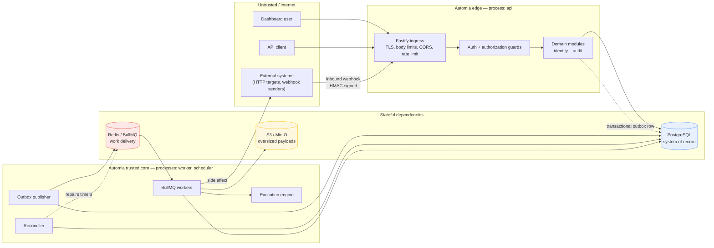

Note the two arrows that make the system survive a Redis outage: `Pub` and
`Rec` both drive Redis *from* PostgreSQL. Neither depends on Redis being up in
order to decide what should happen. That is the whole reason the outbox is
durable in PostgreSQL rather than being a Redis-native feature.

### 5.4 The workflow definition boundary

A workflow definition is **data**, never code. It is JSON validated against a
versioned schema. Conditions are a closed set of operators over
`{{ ... }}`-style references to step outputs. There is no user-supplied
executable content anywhere in the system, which removes an entire class of
remote-code-execution risk from the platform itself.

## 6. Control plane

The control plane is everything a human does synchronously over HTTP:

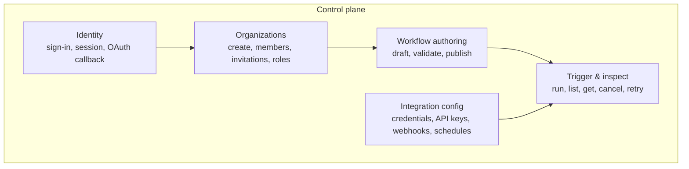

Control-plane requests are synchronous, transactional, and return the committed
result. They do **not** perform step side effects and they do **not** wait for an
execution to progress. A control-plane request that implies asynchronous work
writes an `outbox_events` row in the same transaction
([ADR-006](../adr/006-transactional-outbox.md)).

## 7. Execution plane

The execution plane is everything that advances a running execution:

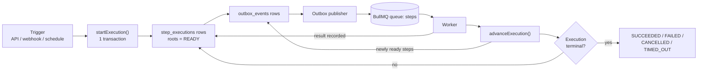

The full mechanics, including pseudocode for every operation, are in
[execution-engine.md](./execution-engine.md). Two rules govern the whole plane:

1. **The engine decides; workers act.** The engine computes *what should happen
   next* and records it. Workers perform the actual external work. The engine
   process never issues an outbound HTTP request on behalf of a step.
2. **No database transaction spans an external call.** Transactions are opened,
   state is written, and the transaction is committed or rolled back. Only then
   does the worker talk to the outside world, and it reconciles results in a
   *second* short transaction. This is what makes crash recovery tractable.

## 8. Integration plane

The integration plane is the set of surfaces where the outside world touches
Automia:

| Surface | Direction | Auth model | Notes |
|---|---|---|---|
| REST API | Inbound | Session cookie or API key | Organization-scoped ([openapi.yaml](../api/openapi.yaml)) |
| Auth endpoints | Inbound | None / provider redirect | Brokered by Better Auth, not our authorization model |
| Inbound webhook | Inbound | HMAC-SHA256 signature + timestamp + event id | Rate limited per endpoint, replay-protected |
| Outbound `http` step | Outbound | Per-node credential | SSRF policy mandatory, see [security.md](./security.md) §6 |
| Outbound `email` step | Outbound | SMTP/API credential | Idempotency key forwarded where the provider supports it |

Every inbound surface shares one rule: **authenticate the request, then derive
the organization from it.** An organization id supplied in the path or body is a
*target*; it is never an authorization grant.

## 9. Runtime components

Three process types, one codebase. All three are NestJS applications; they
differ only in which modules they bootstrap.

| Process | Entry point | Bootstraps | Scales by | Notes |
|---|---|---|---|---|
| `api` | `apps/api` | HTTP server, all read/write domain modules, auth | Horizontal, stateless | Session affinity not required |
| `worker` | `apps/worker` | BullMQ `Worker` on the `steps` queue | Horizontal, stateless | Concurrency bounded per process and globally per queue |
| `scheduler` | `apps/scheduler` | Outbox publisher, schedule ticker, reconciler, retention sweeper | Vertical, or leader-elected | Singleton per logical responsibility, enforced by `FOR UPDATE SKIP LOCKED` |

```mermaid
flowchart TB
    subgraph proc_api["process: api (N replicas)"]
        A1["HTTP / Fastify"]
        A2["identity"]
        A3["organizations"]
        A4["workflows"]
        A5["executions (commands + queries)"]
        A6["webhooks (config + ingress)"]
        A7["schedules (config)"]
        A8["credentials"]
        A9["audit"]
    end

    subgraph proc_worker["process: worker (N replicas)"]
        W1["BullMQ Worker: steps"]
        W2["step executors<br/>http / condition / delay / email"]
        W3["engine: advanceExecution"]
        W4["engine: completion detection"]
    end

    subgraph proc_sched["process: scheduler (singleton responsibilities)"]
        S1["outbox publisher"]
        S2["schedule ticker"]
        S3["reconciler<br/>leases, timers, timeouts"]
        S4["retention sweeper"]
    end

    A5 -.->|"writes outbox row"| PG[("PostgreSQL")]
    S1 --> PG
    S1 --> Q[("Redis / BullMQ")]
    S3 --> PG
    S3 -.->|repair| Q
    S2 --> PG
    W1 --> Q
    W3 --> PG
    W1 --> PG
    A2 --> PG
    A4 --> PG
    A6 --> PG
    A7 --> PG
    A8 --> PG
    A9 --> PG
```

`apps/api`, `apps/worker` and `apps/scheduler` are separate pnpm workspace
packages that import shared domain code from `packages/*`, not from each other.
See [ADR-004](../adr/004-modular-monolith.md) §5.

## 10. API architecture

- **REST over HTTP/1.1+**, served by Fastify through NestJS.
- **Contract-first**: `docs/api/openapi.yaml` is the contract; request and
  response bodies are validated at the edge by a schema derived from the same
  definitions (`packages/contracts`).
- **Organization-scoped paths**: `/v1/organizations/{organizationId}/...` for
  everything tenant-owned. Membership and role live on the path's organization.
- **Errors** use RFC 9457 Problem Details (`application/problem+json`) so that
  clients can parse failures generically.
- **Pagination** is cursor-based (`limit` + `cursor`), because execution and
  audit tables are append-heavy and offset pagination degrades on them.
- **Idempotent creates** accept an `Idempotency-Key` header. See
  [ADR-007](../adr/007-idempotency-strategy.md) §3.
- **Cross-tenant access returns `404`, not `403`**, to avoid confirming that a
  resource exists in another tenant. See [security.md](./security.md) §4.4.
- **Auth endpoints are brokered.** `/v1/auth/*` is owned by Better Auth's
  contract, not by our authorization model. We do not restate its semantics as
  if they were ours.

## 11. Domain architecture

The domain is organised into nine modules. Each owns its tables, exposes use
cases, and depends only on other modules through explicit ports.

| Module | Owns | Public use cases |
|---|---|---|
| `identity` | `users`, `sessions`, `accounts`, `verifications` | Who is calling |
| `organizations` | `organizations`, `memberships`, `membership_invitations` | Which tenant, at which role |
| `workflows` | `workflows`, `workflow_versions` | Definition authoring, validation, publishing |
| `executions` | `executions`, `step_executions` | Start, advance, cancel, retry, complete |
| `jobs` | `jobs`, `outbox_events` | Dispatch bookkeeping; the DB→queue bridge |
| `webhooks` | `webhook_endpoints`, `webhook_deliveries` | Inbound triggers, signature verification, dedup |
| `schedules` | `schedules` | Cron definitions and their firing |
| `credentials` | `credentials`, `api_keys` | Secrets and programmatic access |
| `audit` | `audit_logs`, `idempotency_keys` | Accountability and request replay |

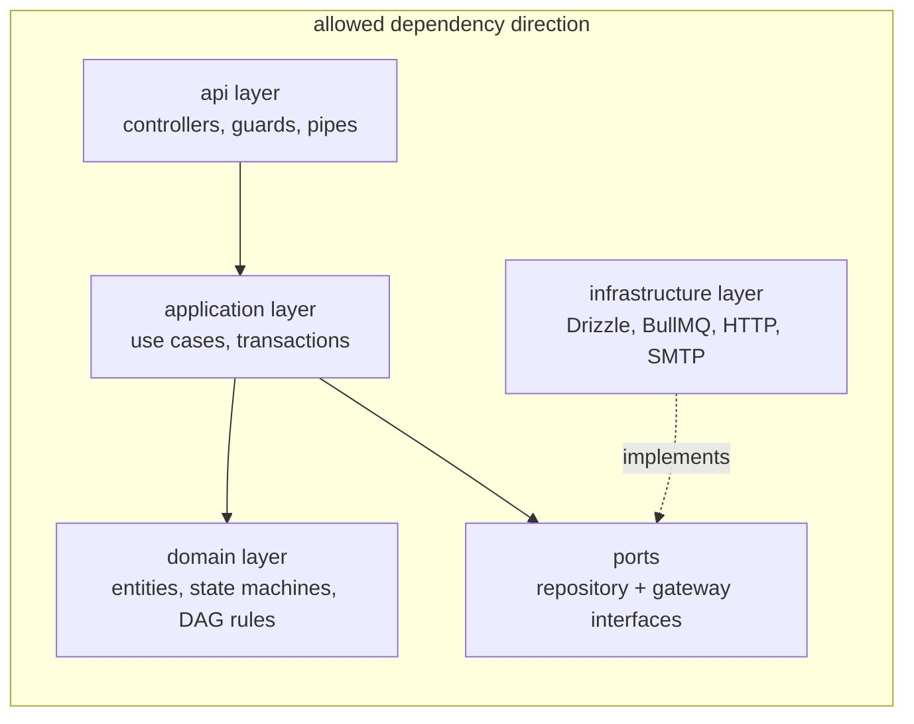

`domain` has no imports from `infrastructure`, no database client, no HTTP
client, and no logger. This is what makes the execution state machines in
[execution-engine.md](./execution-engine.md) testable as pure functions and
makes future service extraction a packaging change rather than a rewrite
([ADR-004](../adr/004-modular-monolith.md) §7).

## 12. Database architecture

PostgreSQL is the system of record ([ADR-002](../adr/002-postgresql.md)).

**The central schema invariant:** the only way a row becomes visible is by
committing a transaction. Any transaction that changes domain state and implies
asynchronous work *must* also insert the corresponding `outbox_events` row. There
is no second code path.

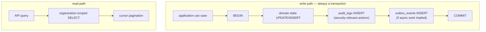

Key characteristics:

- **Relational integrity is enforced by constraints**, not by application
  discipline. `UNIQUE (workflow_id, version) WHERE status = 'DRAFT'` guarantees
  one draft per workflow; `UNIQUE (workflow_id, version)` guarantees version
  numbers are never reused.
- **`jsonb` for open payloads only.** Step inputs/outputs, workflow definitions
  and node configs are `jsonb`; anything the engine must join, filter, sort or
  enforce is a real column. See [ADR-002](../adr/002-postgresql.md) §4.
- **Read committed (the PostgreSQL default) plus explicit row locks.** All
  execution advancement is serialised on `SELECT ... FROM executions ... FOR
  UPDATE`. We do not use `SERIALIZABLE`; serialisation comes from the
  application-level lock, which is easier to reason about and to observe.
- **Every tenant-owned table carries `organization_id`**, including
  `executions` and `step_executions`, so that a tenant filter is a single
  indexed predicate rather than a join.
- **Cursors, not offsets**, for `executions`, `step_executions` and
  `audit_logs`.
- **Migrations are generated by `drizzle-kit` and applied by a startup step**
  behind an advisory lock, so that concurrent replicas do not race.

The full physical schema is in [database-erd.md](../diagrams/database-erd.md).

## 13. Queue architecture

One BullMQ queue exists in v1.

| Queue | Producer | Consumer | Job payload |
|---|---|---|---|
| `steps` | Outbox publisher only | `worker` process | `{ jobId, stepExecutionId, executionId, availableAt }` |

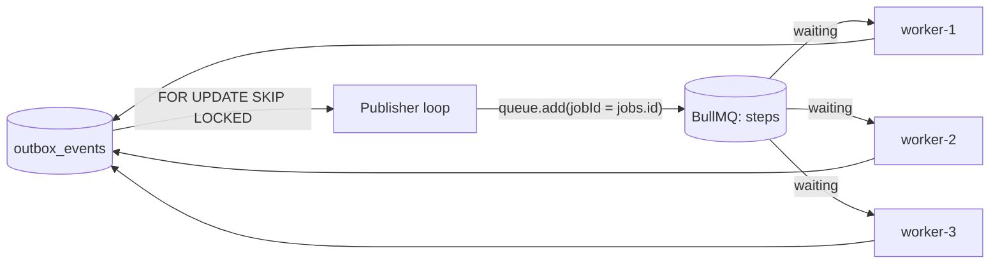

Design constraints, all justified in [ADR-003](../adr/003-bullmq.md):

- **The publisher is the only producer.** API requests and workers never call
  `queue.add` directly. If they did, the dual-write problem in
  [ADR-006](../adr/006-transactional-outbox.md) §2 would return.
- **`jobId` is the durable `jobs.id` UUID**, never a colon-containing composite
  string. BullMQ treats `:` specially in custom job ids and rejects
  all-digit ids; a UUID sidesteps both. The human-readable
  `exec:{executionId}:step:{nodeId}:g{generation}` key is an *external* provider
  idempotency key and is never used as a BullMQ `jobId`.
- **`jobs` is a durable projection, not the source of truth.** It exists so
  operators can answer "the row says QUEUED but nothing is running" without
  reading Redis internals.
- **Domain retry policy lives in PostgreSQL** (`step_executions.attempt`).
  BullMQ's `attempts` is configured to tolerate *transport* redelivery after a
  stall, and nothing more. See [execution-engine.md](./execution-engine.md) §15.
- **Delayed timers are hints, not truth.** `delay` nodes and retry backoff store
  `available_at` in PostgreSQL; BullMQ's delayed-job mechanism provides
  precision, and the reconciler repairs the gap if Redis loses it.

## 14. Worker architecture

A worker is a BullMQ `Worker` on the `steps` queue plus the execution engine's
step-execution half. Per job:

```mermaid
sequenceDiagram
    autonumber
    participant Q as BullMQ queue
    participant W as Worker
    participant DB as PostgreSQL
    participant X as External system

    Q->>W: job(stepExecutionId)
    W->>DB: claim step (conditional UPDATE, expect 1 row)
    alt 0 rows
        W->>W: another worker owns it; exit without side effect
    else 1 row
        W->>W: start lease renewal
        W->>X: perform side effect with idempotency key
        X-->>W: result / error
        W->>DB: record attempt outcome (2nd short transaction)
        W->>DB: advanceExecution() -> outbox rows for newly ready steps
        W->>Q: job completes
    end
```

Non-negotiable worker rules:

1. **Claim before acting.** The claim is a conditional `UPDATE` whose `WHERE`
   clause encodes the legal source states. Losing the race means doing nothing.
2. **Never hold a transaction across the external call.** The claim transaction
   commits before the HTTP request is made.
3. **Renew a lease while working.** A worker that dies stops renewing; the
   reconciler reclaims the step. The lease is domain state and is deliberately
   *separate* from BullMQ's job lock — see [reliability.md](./reliability.md) §10.
4. **Distinguish "definitely failed" from "unknown".** A `503` is a decision; a
   socket reset after the request was written is not. Only the former is recorded
   as a failed domain attempt.
5. **Return control to the event loop.** A CPU-bound step blocks lock renewal and
   gets the job declared stalled, which means it will be processed again. Keep
   step executors I/O-bound; `transform`-style CPU work is a future node type
   with an explicit budget.

## 15. Scheduler architecture

The `scheduler` process is a set of independent loops over PostgreSQL. Each loop
claims work with `FOR UPDATE SKIP LOCKED`, so adding replicas does not create
duplicate work, and there is no leader-election service to run.

| Loop | Reads | Writes | Cadence |
|---|---|---|---|
| Outbox publisher | `outbox_events` where `state = 'PENDING'` or due `FAILED` | `outbox_events.state`, Redis | Continuous, with a short poll interval |
| Schedule ticker | `schedules` where `enabled` and `next_run_at <= now()` | `executions`, `schedules.next_run_at` | Continuous |
| Reconciler | `step_executions` with expired leases; `step_executions` where `available_at <= now()` and not yet dispatched; timed-out executions | `step_executions`, `outbox_events` | Continuous, slower cadence |
| Retention sweeper | Terminal `executions` / `step_executions` / `outbox_events` older than retention | Deletes rows | Periodic |

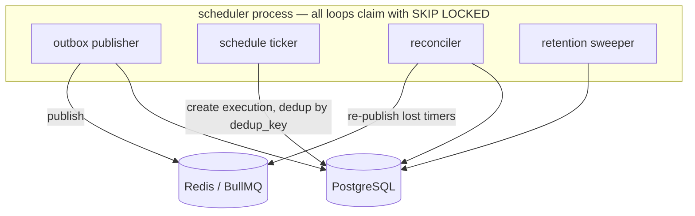

Two consequences worth stating explicitly:

- **The publisher cannot be a BullMQ job.** If dispatching depended on Redis, a
  Redis outage would stop the recovery mechanism that fixes Redis outages. The
  publisher is a PostgreSQL-driven loop.
- **BullMQ Job Schedulers are not used for `schedules`.** Cron definitions live
  in `schedules` in PostgreSQL, and firing is deduped by a unique `dedup_key`
  of the form `sched:{scheduleId}:{scheduledFor}`. A restarted scheduler
  therefore cannot double-fire, which a Redis-resident repeatable job could not
  guarantee. Reasoning in [ADR-003](../adr/003-bullmq.md) §8.

## 16. External integrations

| Integration | Direction | Credential source | Reliability treatment | Security treatment |
|---|---|---|---|---|
| Google / GitHub OAuth | Inbound (identity) | OAuth client secret from config | Redirect failure is a user-visible error, no retry loop | Brokered by Better Auth; `state` and PKCE ([ADR-001](../adr/001-authentication-strategy.md)) |
| `http` step | Outbound | `credentials` row, decrypted per attempt | Timeout, bounded retries, jittered backoff, `Retry-After` honoured | SSRF allow/deny policy, redirect re-validation ([security.md](./security.md) §6) |
| `email` step | Outbound | `credentials` row | Same as `http`; delivery failure is retryable | Provider key forwarded as idempotency key where supported |
| Inbound webhook | Inbound | Per-endpoint HMAC secret | Rejected requests are not retried by us; accepted ones are deduped | Signature, timestamp window, event-id dedup ([security.md](./security.md) §7) |
| Object storage | Bidirectional | Storage credentials from config | Payload is a cache of `jsonb`; re-derivable | Separate bucket, no public ACL, per-tenant key prefix |

## 17. Data flow

### 17.1 Manual trigger

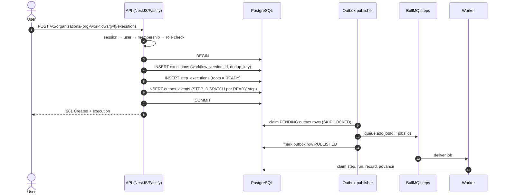

### 17.2 Inbound webhook trigger

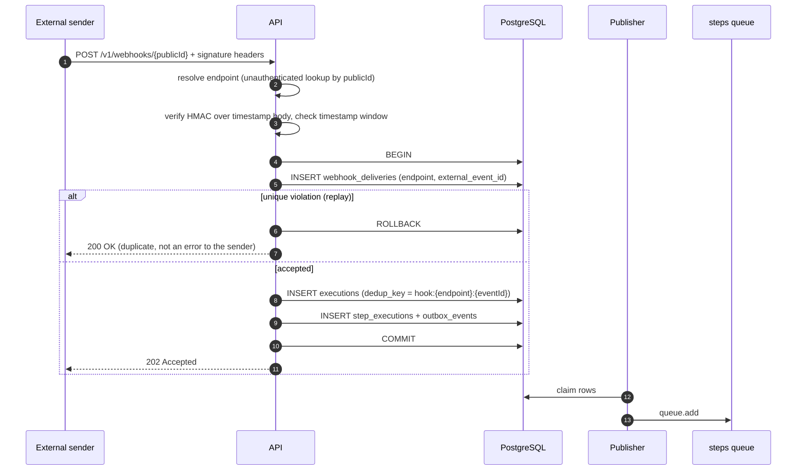

### 17.3 Scheduled trigger

```mermaid
sequenceDiagram
    autonumber
    participant SCH as Schedule ticker
    participant PG as PostgreSQL
    participant PUB as Publisher
    participant Q as steps queue

    SCH->>PG: SELECT due schedules FOR UPDATE SKIP LOCKED
    SCH->>PG: BEGIN; INSERT executions (dedup_key = sched:{id}:{scheduledFor}) ON CONFLICT DO NOTHING
    SCH->>PG: UPDATE schedules.next_run_at
    SCH->>PG: COMMIT
    Note over PG: dedup_key UNIQUE ⇒ restart cannot double-fire
    PUB->>Q: queue.add for each READY step
```

## 18. Multi-tenancy

**Model:** shared schema, shared tables, `organization_id` discriminator. No
schema-per-tenant, no database-per-tenant.

**Enforcement layers** (all required; see [security.md](./security.md) §4):

1. **Request scope.** A guard resolves the caller's membership for the requested
   organization and attaches `{ userId, organizationId, role, permissions }` to
   the request context. Handlers cannot read an organization id from anywhere
   else.
2. **Repository scope.** Data-access functions take the resolved
   `organizationId` as a required argument. There is no "get by id" repository
   method for tenant-owned aggregates; the only signature is
   `findById(organizationId, id)`.
3. **Query predicate.** Every tenant-owned table is indexed on `organization_id`
   as a leading or near-leading column, so the tenant filter is index-backed.
4. **Not-found masking.** A row in another tenant is reported as `404`.
5. **Worker scope.** A step job carries `executionId`; the worker re-derives
   `organizationId` from the execution row rather than trusting the payload.

**Why shared schema:** a SaaS product with unpredictable tenant count cannot
provision per-tenant databases economically, and cross-tenant reporting
(internal ops) becomes possible. The isolation cost is discipline at layers 1–2
plus automated tests that assert cross-tenant access is denied.

## 19. Authentication and authorization overview

Full treatment in [security.md](./security.md) and
[ADR-001](../adr/001-authentication-strategy.md). Summary:

- **Authentication** is delegated to Better Auth: password hashing, OAuth/OIDC
  with Google and GitHub, session lifecycle, optional TOTP/passkeys. We do not
  implement cryptographic authentication protocols.
- **Authorization** is ours: `organizations`, `memberships`, roles
  (`OWNER`, `ADMIN`, `DEVELOPER`, `OPERATOR`, `VIEWER`), a permission table, and
  a per-request guard.
- **API keys** are Automia-owned, organization-scoped, stored as
  `key_prefix` + Argon2id hash of the secret, presented as
  `Authorization: Bearer ak_{prefix}_{secret}`. The prefix enables O(1) lookup;
  the hash prevents a database read from yielding usable credentials.
- **No role data lives in the identity provider.** Sessions answer "who"; the
  database answers "what may they do here".

## 20. Deployment architecture

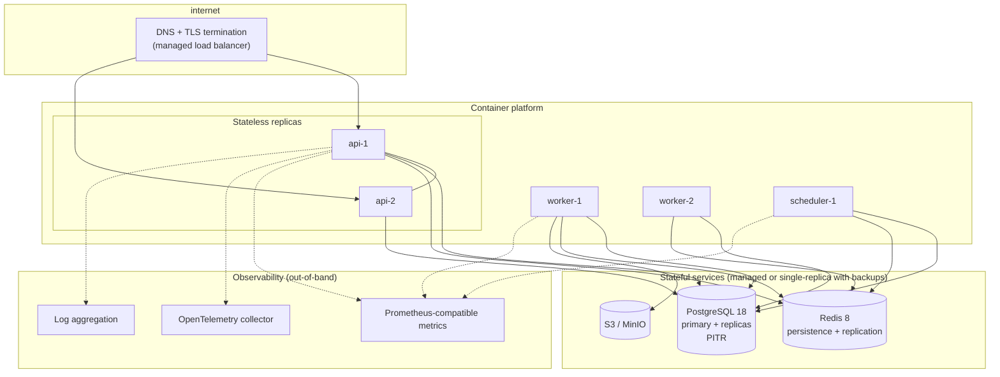

Local development uses Docker Compose for PostgreSQL, Redis and MinIO; the three
Automia processes run on the host or in containers. CI uses the same Compose
services for integration tests. Compose v2 syntax (`docker compose`, no dash) is
the standard.

## 21. Scaling strategy

Scaling is a *sequence*, applied only when measurement demands it. Thresholds are
hypotheses until load-tested.

| Stage | Trigger (to be measured) | Action |
|---|---|---|
| 0. Baseline | — | One `api` replica, one `worker` replica, one `scheduler` |
| 1. Read scale | API CPU saturated at expected load | Add `api` replicas; it is stateless |
| 2. Work scale | `steps` waiting depth grows | Add `worker` replicas; raise BullMQ global concurrency |
| 3. DB scale | PostgreSQL CPU or lock contention on `executions` | Read replicas for query endpoints; partition `step_executions` and `audit_logs` by month |
| 4. Scheduler scale | Publisher lag grows | Run multiple publisher loops; `SKIP LOCKED` already makes this safe |
| 5. Isolation | One tenant's load harms others | Per-organization concurrency budget (already modelled) and per-tenant queues (**Proposed**) |
| 6. Extraction | Criteria in [ADR-004](../adr/004-modular-monolith.md) §7 met | Extract a module into its own deployable |

Explicitly **not** a scaling strategy: increasing per-process BullMQ concurrency
without bound. Worker concurrency is a function of downstream external services
and PostgreSQL connection count, not of available CPU.

## 22. Security boundaries

Summarised here; specified in [security.md](./security.md).

| Boundary | Control |
|---|---|
| Internet → API | TLS, security headers, body size limit, per-principal rate limit, CORS allowlist |
| Unauthenticated → tenant data | Session or API key required; every route organization-scoped |
| Tenant A → Tenant B | `organizationId` from the request context only; `404` masking; repository signatures require it |
| API → identity provider | Delegated to Better Auth; `state` + PKCE; redirect allowlist |
| Platform → external network | SSRF policy: deny loopback, link-local, private ranges and cloud metadata; re-validate every redirect hop and after DNS resolution |
| Platform → secrets | `credentials.ciphertext` encrypted with envelope encryption; plaintext never logged, never returned by the API, `pino` redaction on known paths |
| Internet → webhook endpoint | HMAC-SHA256 over `timestamp.body`, timestamp window, unique `(endpoint_id, external_event_id)`, per-endpoint rate limit |
| Platform → operator | Audit log of every security-relevant action; metrics endpoint not publicly exposed |

## 23. Observability

| Signal | Content | Notes |
|---|---|---|
| **Logs** (Pino, JSON) | Structured events with `trace_id`, `execution_id`, `step_execution_id`, `job_id` | Redaction list configured centrally; never log credential plaintext or `Authorization` headers |
| **Metrics** (Prometheus-compatible) | HTTP rate/latency/error, `executions` by state, `step_executions` by state and age, `outbox_events` pending age, `jobs` by state, BullMQ waiting/active/delayed/failed counts, worker concurrency saturation, reconciler lag | BullMQ exposes its own queue metrics; we do not re-derive them |
| **Traces** (OpenTelemetry) | Inbound HTTP span, per-step span, per-external-call span, outbox publish span, all correlated | HTTP attributes follow OpenTelemetry semantic conventions (`http.request.method`, not the deprecated `http.method`) |
| **Audit** (database) | Security-relevant actions, written transactionally | Durable, queryable, not a log stream |

The four signals answer four different questions. Metrics tell you *that*
something is wrong. Traces tell you *where*. Logs tell you *what happened to
this specific execution*. The audit log tells you *who did what*. Collapsing
audit into logs is a mistake: logs are sampled and rotated, audit is not.

Key derived alerts (thresholds **to be measured**, not asserted here):

- oldest `outbox_events` row in `PENDING` older than the publish SLO
- `step_executions` in `RUNNING` with `lease_expires_at` in the past (reconciler
  not keeping up, or workers wedged)
- executions in `RUNNING` beyond the maximum execution timeout
- BullMQ `failed` count growing for the `steps` queue
- `webhook_deliveries` rejection rate spiking (credential rotation, attacker, or
  provider change)

## 24. Failure boundaries

The system is designed so that each dependency fails *independently recoverably*.

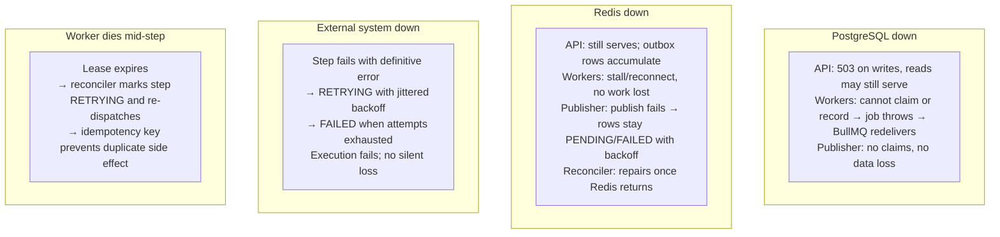

PostgreSQL is the only dependency whose loss is *not* recoverable, which is why
every other mechanism is designed to degrade to "rows in PostgreSQL waiting"
rather than "work in Redis in flight". See
[reliability.md](./reliability.md) for the full failure matrix.

## 25. Technology choices

Versions below were current when this document was written. Pin exact versions
in the lockfile; do not treat this table as a version source of truth.

| Area | Choice | Version at time of writing | Rationale |
|---|---|---|---|
| Language | TypeScript | 7.x (per root `package.json`) | Discriminated unions model the state machines directly |
| Runtime | Node.js | `>=24` (per root `engines`) | Matches the existing workspace constraint |
| Framework | NestJS | 12.x | DI and module boundaries match the domain decomposition; large ecosystem |
| HTTP | Fastify (`@nestjs/platform-fastify`) | 12.x | Lower overhead than Express; schema-based validation/routing |
| API style | REST | — | Simple, cacheable, trivially proxied; the domain does not need streaming or subscriptions |
| API contract | OpenAPI | 3.1.x (see [openapi.yaml](../api/openapi.yaml)) | JSON-Schema-2020-12 compatible, so Drizzle/Zod-derived schemas validate directly |
| Database | PostgreSQL | 18.x | See [ADR-002](../adr/002-postgresql.md) |
| DB toolkit | Drizzle ORM + `drizzle-kit` | 0.45.x (1.0 in beta) | SQL-shaped, type-safe, explicit migrations |
| Queue | BullMQ | 6.3.x | See [ADR-003](../adr/003-bullmq.md) |
| Queue backend | Redis | 8.x | See [ADR-003](../adr/003-bullmq.md) §4 for the licensing note |
| Cache | Redis | 8.x | Rate-limit counters and short-lived response cache only; never authoritative |
| Object storage | S3-compatible / MinIO | — | Already in scope; stores oversized step payloads |
| Logging | Pino | 10.x | Fastest structured JSON logger in this ecosystem; explicit redaction |
| Metrics | Prometheus client (`prom-client`) | 15.x | Ecosystem-standard exposition format |
| Tracing | OpenTelemetry JS | `@opentelemetry/sdk-node` 0.2xx | Vendor-neutral; avoids lock-in |
| Auth | Better Auth | 1.7.x | See [ADR-001](../adr/001-authentication-strategy.md) |
| Validation | Zod (**Proposed**) | — | One schema definition feeding Fastify validation, OpenAPI and the domain types |
| Testing | Vitest | 5.x | Fast, native TS/ESM, good watch mode |
| Integration testing | Testcontainers | 12.x | Real PostgreSQL and Redis, no mock fidelity gap |
| Package manager | pnpm | 11.x (per `packageManager`) | Already in the workspace |
| Monorepo | Turborepo | ^2.11 (per root `devDependencies`) | Already in the workspace; task graph and caching |
| Containers | Docker + Docker Compose | Compose v2+ syntax | Local PostgreSQL/Redis/MinIO and CI parity |
| CI/CD | GitHub Actions | — | Already implied by the workspace layout |

## 26. Architectural tradeoffs

| # | Tradeoff | Chosen | Accepted cost | Mitigated by |
|---|---|---|---|---|
| 1 | Strong consistency vs. availability during a PostgreSQL outage | Strong consistency: fail writes | Lower availability | Clients retry; reads may still serve |
| 2 | At-least-once vs. exactly-once | At-least-once + idempotency | Possible duplicate external effects | Deterministic idempotency keys, [ADR-007](../adr/007-idempotency-strategy.md) |
| 3 | Shared schema vs. per-tenant isolation | Shared schema | Isolation depends on application discipline | Required `organizationId` in repository signatures, cross-tenant tests |
| 4 | Modular monolith vs. microservices | Monolith | Scaling and blast radius per module | Three independent process types already; extraction criteria defined |
| 5 | One queue vs. per-type queues | One `steps` queue | Noisy-neighbour between step types | BullMQ global concurrency + per-org budget + node-type concurrency |
| 6 | Postgres-driven timers vs. Redis-native scheduling | Postgres `available_at` + repair | Slight timer imprecision; extra writes | Reconciler re-dispatches; BullMQ delay still used for precision |
| 7 | Domain retries in DB vs. BullMQ `attempts` | DB | More rows, more explicit | Every intermediate attempt is durable and inspectable |
| 8 | Implicit joins vs. explicit `join` node | Implicit (all inbound edges) | Cannot express "any of" joins | `condition` nodes express alternatives; revisit when required |
| 9 | Denormalised `organization_id` on `executions` | Yes | Redundant data | Written in the same transaction from the version row; invariant tested |
| 10 | Cross-tenant `404` instead of `403` | `404` | Harder to debug "permission bug" vs. "wrong tenant" | Structured server-side logs distinguish them |
| 11 | `jsonb` for step payloads | Yes | No cross-row constraints on payload internals | Payload is validated on write and by a Zod schema per node type |
| 12 | Retaining failed jobs in BullMQ | Keep bounded counts | Redis memory growth | `removeOnComplete`/`removeOnFail` counts configured; `jobs` table is the durable record |

## 27. Why "exactly once" is not a safe assumption

A recurring request in workflow platforms is exactly-once execution. It cannot be
provided, and pretending otherwise is a correctness and trust bug.

1. **The side effect is outside our transaction.** `charge-payment` calls a
   payment provider. We cannot enlist that provider in our PostgreSQL
   transaction, and we cannot atomically commit a remote effect with a local
   row write.
2. **The uncertainty window is irreducible.** If a socket closes after the
   request was written but before the response arrived, the remote system may
   have performed the effect. No amount of local retry policy distinguishes
   "did not happen" from "happened and the answer was lost". We must treat that
   state as *unknown*, not as *failed*.
3. **Delivery is genuinely at-least-once.** BullMQ documents an "at least once"
   strategy and warns that a job whose lock is not renewed is moved back to
   waiting and processed again, i.e. double-processed. Any distributed lock with
   a lease has the same property: a paused process cannot be distinguished from a
   dead one.
4. **Consumers cannot opt out.** Even a perfect queue cannot help when the
   duplicate arrives because of a client retry or a manual re-run.
5. **The honest formulation** is the one this system adopts:

   ```text
   at-least-once delivery
           +
   durable state
           +
   idempotent processing
           +
   recovery
   ```

   Which yields: **at-least-once processing with effectively-once observable
   effect, where the external system supports an idempotency key.** Where it
   does not, we reduce the probability and make the ambiguity visible to the
   operator rather than hiding it. See
   [reliability.md](./reliability.md) §3.

## References

- NestJS documentation — <https://docs.nestjs.com>
- PostgreSQL 18 documentation — <https://www.postgresql.org/docs/current/>
- PostgreSQL explicit locking (`FOR UPDATE`, `SKIP LOCKED`) —
  <https://www.postgresql.org/docs/current/explicit-locking.html>
- PostgreSQL transaction isolation —
  <https://www.postgresql.org/docs/current/transaction-iso.html>
- BullMQ documentation — <https://docs.bullmq.io>
- BullMQ retries and backoff —
  <https://docs.bullmq.io/guide/retrying-failing-jobs>
- BullMQ stalled jobs — <https://docs.bullmq.io/guide/jobs/stalled>
- BullMQ job ids — <https://docs.bullmq.io/guide/jobs/job-ids>
- BullMQ deduplication — <https://docs.bullmq.io/guide/jobs/deduplication>
- BullMQ "Going to production" — <https://docs.bullmq.io/guide/going-to-production>
- Redis licensing — <https://redis.io/legal/licenses/>
- Drizzle ORM — <https://orm.drizzle.team/docs>
- Better Auth — <https://www.better-auth.com/docs>
- OpenID Connect Core 1.0 — <https://openid.net/specs/openid-connect-core-1_0.html>
- OAuth 2.0 (RFC 6749) — <https://www.rfc-editor.org/rfc/rfc6749>
- PKCE (RFC 7636) — <https://www.rfc-editor.org/rfc/rfc7636>
- RFC 9457 Problem Details for HTTP APIs —
  <https://www.rfc-editor.org/rfc/rfc9457>
- OpenAPI Specification — <https://spec.openapis.org/oas/latest.html>
- OpenTelemetry semantic conventions (HTTP) —
  <https://opentelemetry.io/docs/specs/semconv/http/http-spans/>
- OWASP Password Storage Cheat Sheet —
  <https://cheatsheetseries.owasp.org/cheatsheets/Password_Storage_Cheat_Sheet.html>
