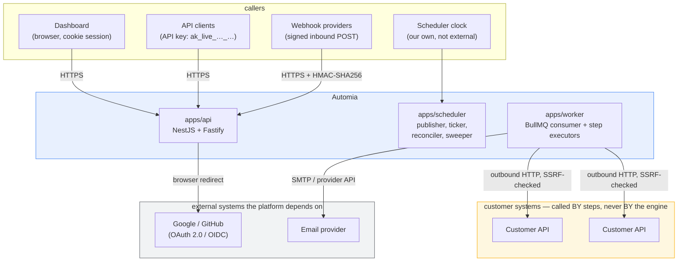
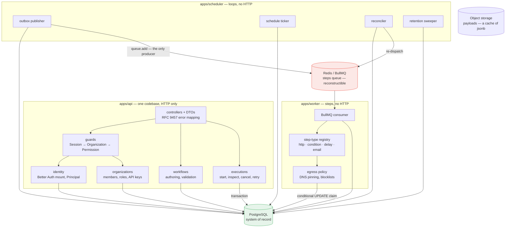
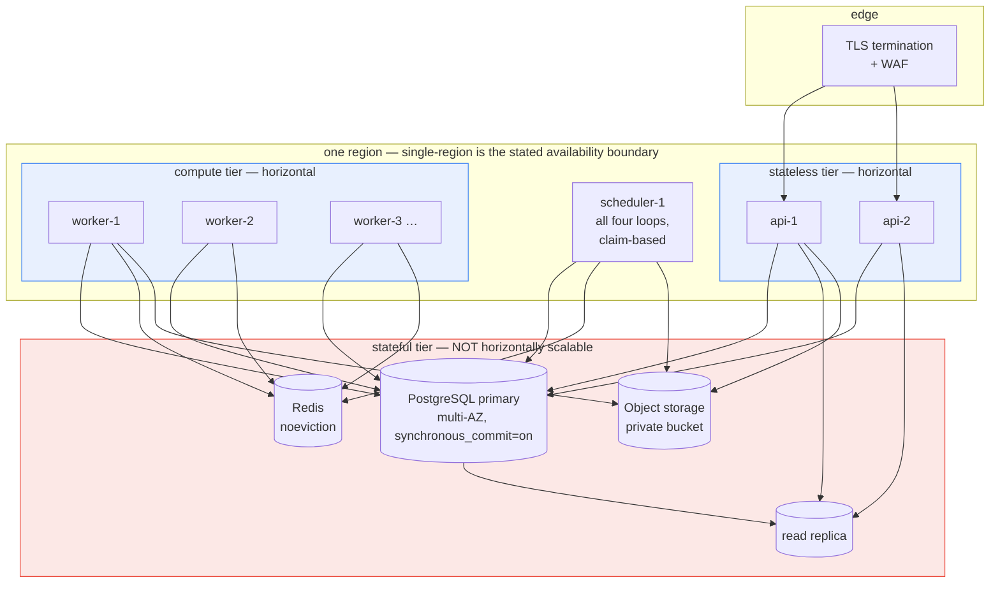
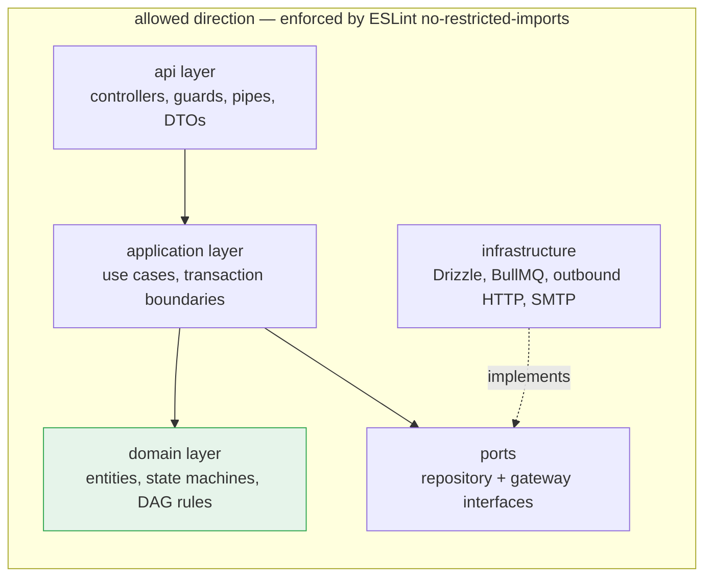
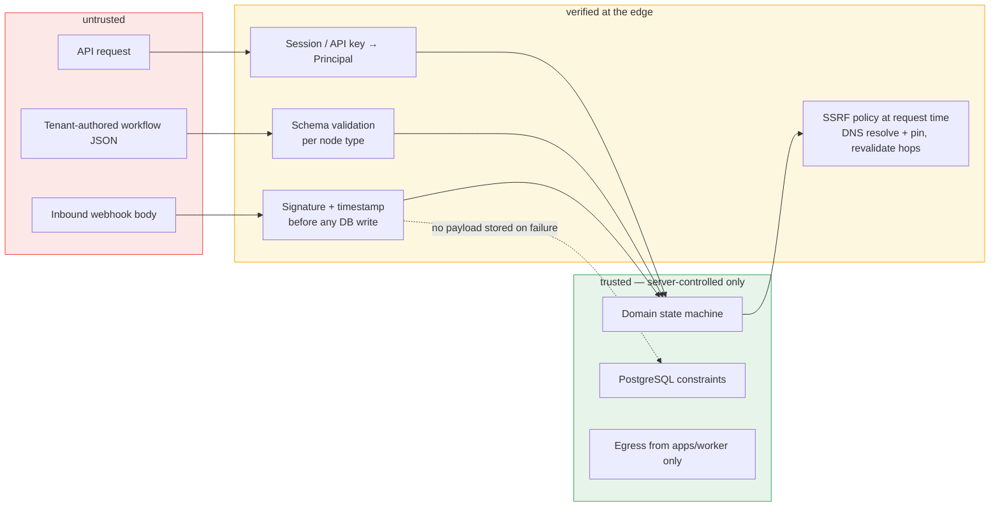
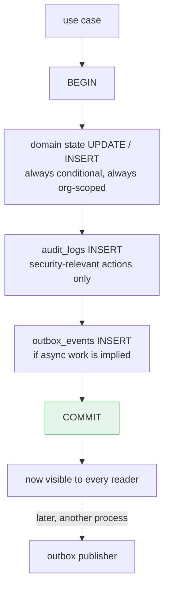
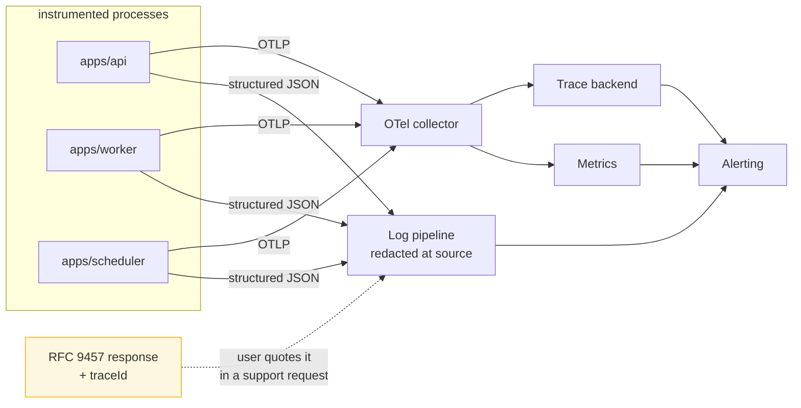

# System Architecture Diagrams

| Field | Value |
|---|---|
| Status | **Proposed** |
| Date | 2026-10-05 |
| Companion docs | [system-overview.md](../architecture/system-overview.md), [execution-flow.md](./execution-flow.md), [failure-recovery.md](./failure-recovery.md), [database-erd.md](./database-erd.md) |
| Decisions | [ADR-002](../adr/002-postgresql.md), [ADR-003](../adr/003-bullmq.md), [ADR-004](../adr/004-modular-monolith.md) |

This document holds the diagrams that describe the system as a whole. Execution
mechanics live in [execution-flow.md](./execution-flow.md), failure and recovery
in [failure-recovery.md](./failure-recovery.md), and the physical schema in
[database-erd.md](./database-erd.md).

**The one boundary to read every diagram against:** PostgreSQL holds
authoritative state; Redis holds delivery state and is fully reconstructible.
Most of the apparent redundancy below exists to serve that line.

---

## 1. System context

Two boundaries in this diagram are load-bearing:

1. **The engine never calls a customer system.** `apps/api` and `apps/scheduler`
   have no outbound path to `customer`. Only `apps/worker` does, which is why the
   SSRF controls ([security.md](../architecture/security.md) §6) are effective
   rather than advisory: a public request can never reach step execution.
2. **The scheduler is internal.** A schedule is a business fact in PostgreSQL, not
   an external cron service. That is what makes "when does this run next?"
   answerable and what makes catch-up-after-downtime possible.

---

## 2. Component diagram

### Why there are three processes and not three services

| | Separate processes | Separate services |
|---|---|---|
| Independent scaling of step execution | **Yes** — scale `worker` | Yes |
| Failure blast radius | Yes — `api` cannot run steps | Yes |
| Atomic workflow transition | **Yes** — one transaction, one database | No — needs a saga |
| Deployables to operate | 3 | 3 + N contracts, N pipelines |
| Distributed tracing | Free | Required |

The deciding factor is the third row. Advancement updates `step_executions`,
`executions`, `outbox_events` and `audit_logs` atomically, and a cross-service
transaction would replace that with a distributed failure taxonomy in the one place
where correctness matters most. [ADR-004](../adr/004-modular-monolith.md) has the
full reasoning and the five extraction criteria.

**The colours are the operational rule.** Green is the system of record: if it is
lost, it is catastrophic. Red is reconstructible: `FLUSHDB` is a latency event,
repaired by the reconciler. An operator who internalises those two colours
internalises the whole reliability model.

---

## 3. Deployment view

| Tier | Scaling | State | Notes |
|---|---|---|---|
| `api` | Horizontal on request rate | None | Stateless. Sessions are in PostgreSQL. |
| `worker` | Horizontal on step concurrency | None | In-memory lease renewal only; a lost node loses nothing. |
| `scheduler` | **1 by default**, safe at N | None | Every loop claims with `FOR UPDATE SKIP LOCKED`, so N replicas partition work with no leader election. |
| PostgreSQL | Vertical, then replicas | All of it | The single hard availability dependency. |
| Redis | Vertical | Delivery only | `noeviction` so a job is never silently dropped. |

**Why the scheduler is 1 by default and still safe at N.** Each of its four loops
is a claim query. Two publishers never claim the same outbox row; two tickers never
claim the same schedule occurrence. That property comes from
`FOR UPDATE SKIP LOCKED` plus the unique `executions.dedup_key`, not from a
coordination service — which is why there is no lease table to run.

**Why `api` readiness does not check Redis.** A Redis outage must not take the API
out of rotation. The API accepts executions and commits them; the outbox drains
when Redis returns. Failing readiness on Redis would turn a delay-only incident
into a total outage.

---

## 4. Module dependency direction

The `domain` layer has no database client, no HTTP client, and no logger. That is
what makes the execution state machines testable as pure functions with an
injected clock, and what would make extracting a module into a service a packaging
change rather than a rewrite.

**Nine domain modules, and the tables each owns.** Table ownership is a CI-checked
map: exactly one module may reference each table.

| Module | Owns |
|---|---|
| `identity` | `users`, `sessions`, `accounts`, `verifications` |
| `organizations` | `organizations`, `memberships`, `membership_invitations` |
| `workflows` | `workflows`, `workflow_versions` |
| `executions` | `executions`, `step_executions` |
| `jobs` | `jobs`, `outbox_events` |
| `webhooks` | `webhook_endpoints`, `webhook_deliveries` |
| `schedules` | `schedules` |
| `credentials` | `credentials`, `api_keys` |
| `audit` | `audit_logs`, `idempotency_keys` |

Three concerns are **libraries, not modules**, because they have no table ownership
and no independent lifecycle: the step-type registry (inside `executions`), the
reliability helpers (clock, jitter, `Retry-After`, leases), and the persistence
adapter.

---

## 5. Trust boundaries

Ordering is the point, not just membership:

- **A workflow definition is validated at write time *and* at run time.** Static
  checks (scheme, literal IP, no userinfo) happen on publish; the DNS-resolution
  and hop-revalidation checks can only happen per attempt, because DNS answers
  change. A URL that passed validation an hour ago is re-checked now.
- **A webhook signature is verified before any database write**, so an unsigned
  flood costs one HMAC computation. A rejected body is not stored.
- **`V3` produces a `Principal` and nothing downstream re-derives identity.** The
  domain cannot tell a cookie from an API key, which is what keeps the two
  authorisation paths from diverging.

---

## 6. Data flow — durable writes

Every durable state change follows one path. There is no second code path, and
this is the invariant most worth protecting in review.

The rule that makes the whole system work: **a transaction that changes domain
state and implies asynchronous work must also insert the `outbox_events` row, in
the same transaction.** Forget the outbox row and the intent is lost with no error
anywhere; the reconciler eventually notices a `READY` step that was never
dispatched, but the work was already late.

`audit_logs` is in the same transaction for the same reason: an action that
succeeds without its audit record is a gap nobody can detect afterwards.

---

## 7. Observability topology

Every error response carries a `traceId`, and that trace id is present in the logs
and traces. This is the supported support path, and it exists specifically so that
internals never have to be returned to a caller.

Three metrics are correctness signals rather than performance signals, and they
are the ones worth alerting on:

| Metric | Alert condition | Why it is not a performance concern |
|---|---|---|
| `outbox_events` oldest `PENDING` age | Growing | Every second of this is work that is due and not running. |
| `step_executions` with an expired lease | Any, beyond a grace period | A stalled worker, and a step that may be executing twice. |
| `outbox_events` in `DEAD` | **Must be zero** | Permanently unperformed work. Not an error-rate question. |

---

## 8. What is deliberately absent

Naming absent components is as informative as naming present ones, because each
one is a mechanism someone will reasonably expect and that we have decided against.

| Not present | Why not | Reference |
|---|---|---|
| Message broker (Kafka, SNS) | One consumer per job with per-job retry is a queue's job, not a log's. The `outbox_events` table *is* the event log. | [ADR-006](../adr/006-transactional-outbox.md) §5 |
| BullMQ Flows | Encodes orchestration in Redis, making a non-durable store authoritative. | [ADR-003](../adr/003-bullmq.md) §1 |
| BullMQ Job Schedulers | A Redis-resident cron registry. `schedules` lives in PostgreSQL and firing is deduped by a unique `dedup_key`. | [system-overview.md](../architecture/system-overview.md) §15 |
| BullMQ rate limiters | Per-organization in-flight limits are engine-side, because the queue cannot count per tenant in a way that survives a flush. | [security.md](../architecture/security.md) §3.4 |
| Separate scheduling service | `scheduled_for` lives on an `executions` row, so "when does this run?" has one answer. | [ADR-003](../adr/003-bullmq.md) §2 |
| Leader election for the scheduler | Every loop claims with `SKIP LOCKED`. | [ADR-004](../adr/004-modular-monolith.md) §3 |
| Distributed cache of domain state | A read-through cache in front of `executions` would create a second source of truth. Definitions are cached; mutable state is not. | [ADR-002](../adr/002-postgresql.md) §1 |
| Scripting in workflows | Would make a tenant who can publish a workflow a code-execution principal. The registry is four types. | [ADR-005](../adr/005-workflow-versioning.md) §Decision |
| Event sourcing | The hot path is a conditional `UPDATE` and the read path is "can I claim this". A projection that can be behind is the wrong shape. | [ADR-004](../adr/004-modular-monolith.md) §3 |

---

## Related

- [execution-flow.md](./execution-flow.md) — the same components in motion
- [failure-recovery.md](./failure-recovery.md) — what each arrow does when it fails
- [database-erd.md](./database-erd.md) — the twenty tables these components own
