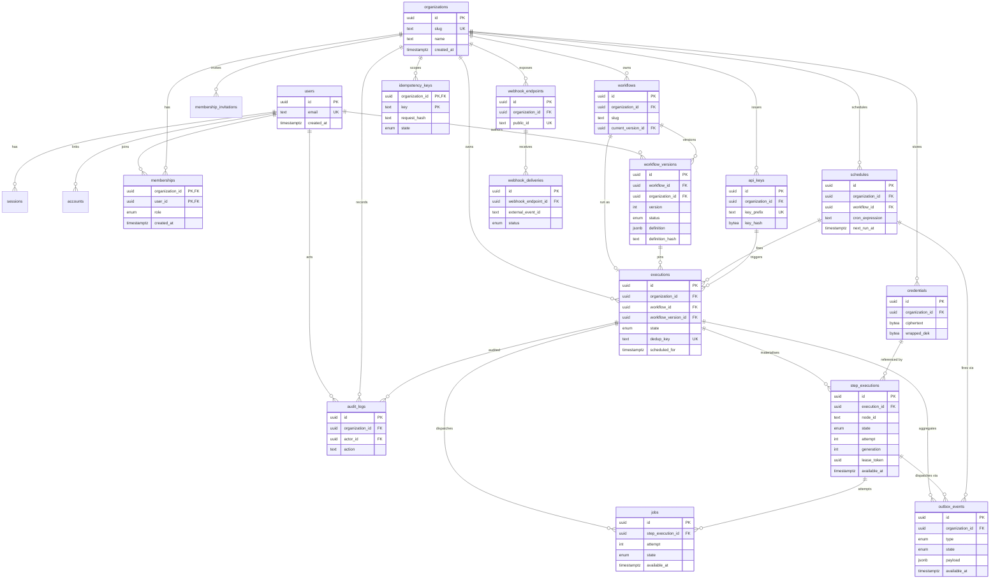
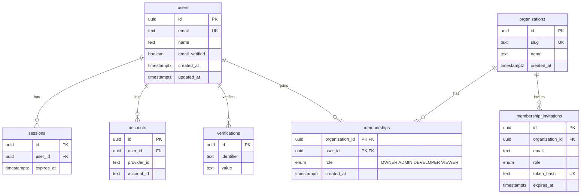
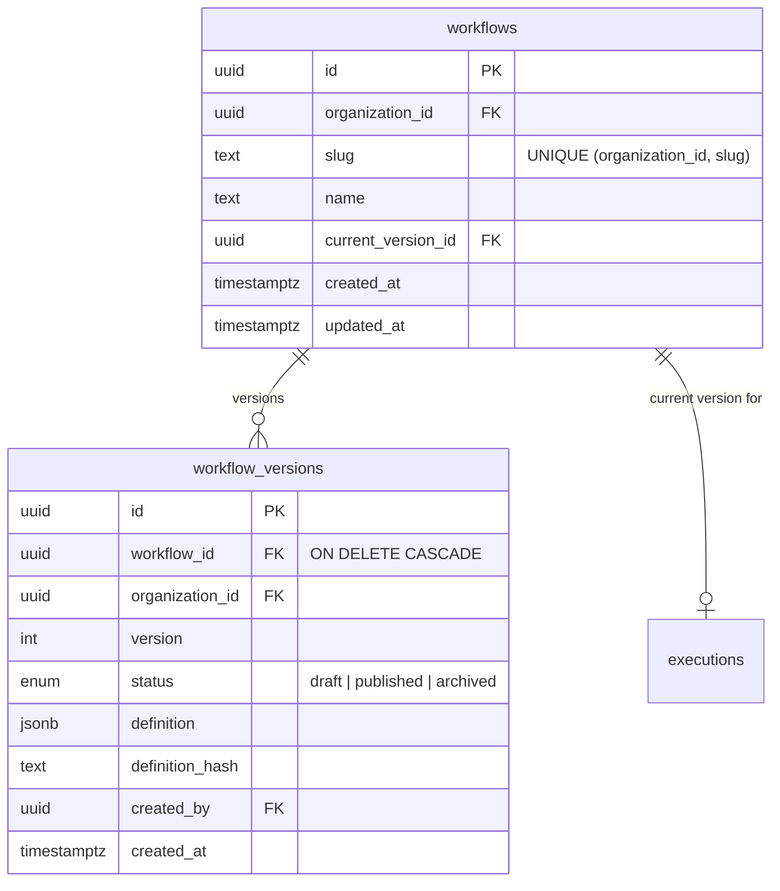
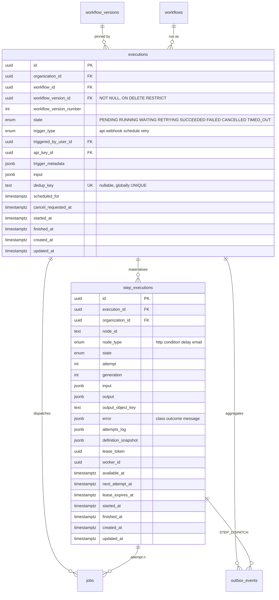
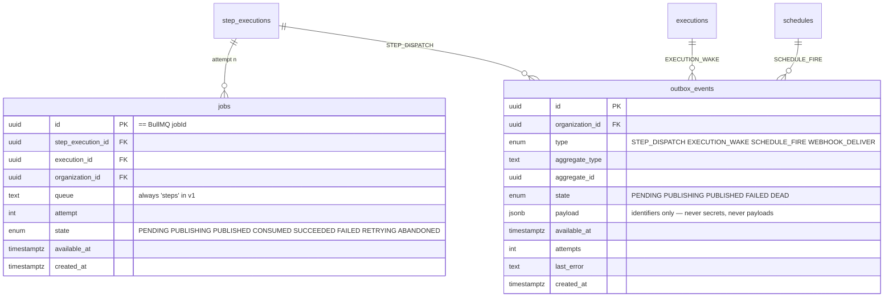
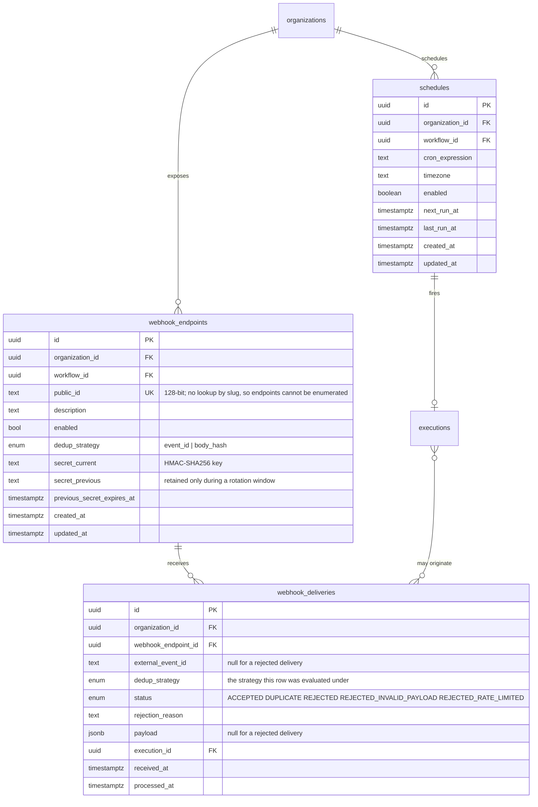
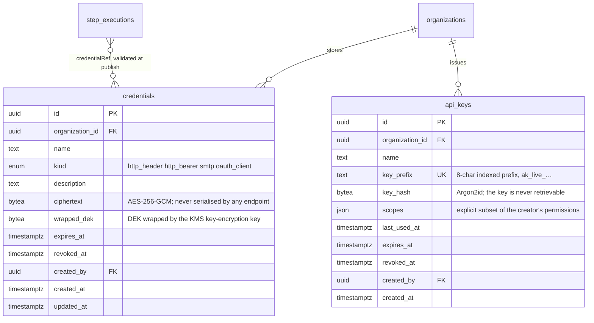
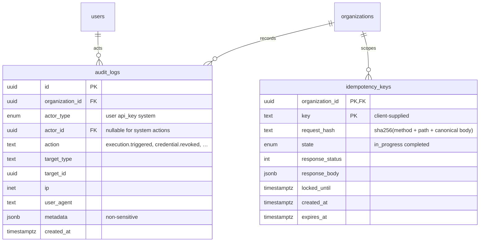
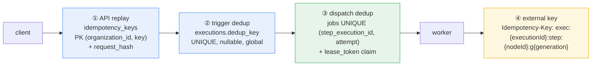

# Database ERD

| Field | Value |
|---|---|
| Status | **Proposed** |
| Date | 2026-10-05 |
| Companion docs | [system-overview.md](../architecture/system-overview.md) §12, [ADR-002](../adr/002-postgresql.md), [ADR-005](../adr/005-workflow-versioning.md), [ADR-006](../adr/006-transactional-outbox.md), [ADR-007](../adr/007-idempotency-strategy.md) |
| Migrations | Generated by `drizzle-kit`, applied behind a PostgreSQL advisory lock |

Twenty tables, one shared schema, `READ COMMITTED`. PostgreSQL is the sole system
of record ([ADR-002](../adr/002-postgresql.md)); nothing here is a cache or a
projection of something else except `jobs`, which is a projection of dispatch
state that is itself reconstructible from `step_executions` and `outbox_events`.

**Read the three invariants first**, because they explain most of the constraint
list that follows:

1. **`organization_id` is on every tenant-owned table**, including `executions` and
   `step_executions`, so tenant filtering is one indexed predicate rather than a
   join.
2. **Composite foreign keys carry `organization_id`.** A cross-tenant reference is
   therefore not forbidden by application discipline — it is unwritable.
3. **Deletion is decided per relationship**, not per table. A workflow version
   referenced by an execution is `ON DELETE RESTRICT`; a draft version with no
   executions is a cascade away.

---

## 1. Entity relationships



`sessions`, `accounts` and `verifications` are Better Auth's own tables and are
shown only in §2. Their shape is Better Auth's contract, not ours
([ADR-001](../adr/001-authentication-strategy.md)).

---

## 2. Identity and tenancy



`sessions`, `accounts` and `verifications` are Better Auth's tables. Their column
names and shape are **Better Auth's contract, not ours** — the adapter writes them
and we do not hand-maintain them ([ADR-001](../adr/001-authentication-strategy.md)).
They are listed here only to make the tenant boundary visible; the session token
itself is opaque and presented in a `__Host-sid` cookie, never in a column we
control.

| Table | Key | Note |
|---|---|---|
| `users` | `id` | `email` is unique across the system, not per tenant — a person has one identity. |
| `organizations` | `id` | The tenant boundary. `slug` is the only human-facing global identifier. |
| `memberships` | `(organization_id, user_id)` | **The authorization subject.** `role` is a role, not a permission list; permissions are derived from it, so adding a role is a code change, not a data migration. |
| `membership_invitations` | `id` | Token stored hashed; expiry enforced in the query, not by a sweeper. |

There is deliberately **no `role` table and no join table of permissions.** A
fixed role enum plus a derived permission set is auditable and small; a
configurable role system is a feature that v1 does not need, and a
`role_permissions` table would put tenant data into the authorization decision.

---

## 3. Workflows and versions



```text
UNIQUE (workflow_id, version)                                    -- numbers never reused
UNIQUE (workflow_id, version) WHERE status = 'draft'            -- exactly one draft
UNIQUE (organization_id, slug)  on workflows                     -- per-tenant slug
```

Three guarantees, all structural rather than procedural:

- **One draft per workflow.** The partial unique index makes "create a draft"
  idempotent at the storage layer, so two concurrent authors cannot both think they
  own the draft.
- **Version numbers are never reused,** so a URL or a log line naming
  `workflow_version_id` and `version` stays unambiguous forever.
- **A published version is immutable** by convention and enforcement: any attempt
  to `PUT` a published definition returns `422` with a pointer to create a new
  draft. The fix for a bad workflow is always a new version
  ([ADR-005](../adr/005-workflow-versioning.md)).

`current_version_id` is repointed on publish, and the previous `published` version
becomes `archived`. It is nullable and may dangle only if every version is a
draft, which means the workflow has never run — and a trigger against it is
`409 workflow-not-published`.

---

## 4. Executions and steps — the engine core



Three columns carry most of the weight:

| Column | Why it exists |
|---|---|
| `workflow_version_id NOT NULL ON DELETE RESTRICT` | An execution's definition can never be deleted out from under it, by any code path. This one constraint is what makes "runs are reproducible" and "history is durable" structural rather than a rule people remember. |
| `dedup_key` nullable, globally `UNIQUE` | Retried triggers are safe. `NULL` means "never deduplicated", and a nullable unique index permits unlimited `NULL`s — so the unkeyed case is expressible in the schema, not in application logic. |
| `lease_token` | A fresh random value per claim. Every write a worker makes carries `WHERE lease_token = $token`, so a stalled worker that wakes up late cannot clobber the attempt that replaced it. |

**Why `organization_id` is duplicated on `step_executions`.** It is denormalised on
purpose: it makes the hot-path claim query and every tenant-scoped step listing a
single indexed predicate, and it lets the composite FK from `jobs` prove
tenant-consistency without a join. The duplication is verified by a constraint, not
trusted.

**Why `definition_snapshot` is copied onto each step.** The step records the exact
node object it was created from. Combined with `workflow_version_id NOT NULL` this
means a step is interpretable without joining, and an execution remains
explainable even if a future migration reshapes the definition format.

`attempts_log` is the human-readable attempt history, and it is where
`error.outcome = UNKNOWN` and the `FATAL` marker live. That is what lets an
operator tell "will never work" apart from "ran out of luck"
([reliability.md](../architecture/reliability.md) §18).

---

## 5. Dispatch — jobs and the outbox



```text
jobs:
  UNIQUE (step_execution_id, attempt)              -- dispatch dedup, permanent
  INDEX  (available_at) WHERE state = 'PENDING'    -- reconciler: undispatched work

outbox_events:
  INDEX  (available_at) WHERE state IN ('PENDING','FAILED')   -- publisher claim
```

**`jobs.id` is the BullMQ `jobId`.** A UUID, deliberately: it contains no `:`
(BullMQ treats that as a structural separator) and is not all-digits (which BullMQ
rejects as colliding with its own auto-increment ids). The human-readable
`exec:{executionId}:step:{nodeId}:g{generation}` key is an *external* provider
idempotency key and is deliberately not used here.

**`UNIQUE (step_execution_id, attempt)` is the dedup mechanism, not an outbox
column.** A `STEP_DISPATCH` row names a `jobId` the engine already inserted in the
same transaction, so attempt *n* of a step can be dispatched at most once, forever,
no matter how many publishers, reconcilers or rollbacks race. There is no
`dedup_key` on `outbox_events` because that would be a second mechanism for a
problem the schema has already solved.

**The partial index is what makes the publisher cheap.** It claims only rows that
are due, so the scan does not degrade as the table fills with `PUBLISHED` history,
and the retention sweeper can run on a separate cadence without hurting dispatch
latency.

**`outbox_events.payload` holds identifiers only.** No payloads, and above all no
secrets. This table is read by the publisher and inspected by operators during
incidents, which makes it the wrong place for anything sensitive.

---

## 6. Triggers — webhooks and schedules



```text
UNIQUE (webhook_endpoint_id, external_event_id)   -- replay protection
INDEX  (next_run_at) WHERE enabled                -- ticker claim
```

**The webhook delivery row is written before the signature is trusted, and a
rejected row stores the *reason, not the payload*.** An unverified body must never
be retained — that would make our database a store of attacker-supplied content.
`REJECTED` is one status with three distinguishable reasons
(`REJECTED`, `REJECTED_INVALID_PAYLOAD`, `REJECTED_RATE_LIMITED`) so that "someone
is sending us bad signatures" remains an alertable signal without retaining
anything sensitive.

`external_event_id` uniqueness is checked at the ingestion boundary, before
anything else, because a replay of a previously valid request is the threat. Where
an endpoint is configured for `body_hash` instead, the guarantee is weaker, so the
strategy used is recorded on the row itself — during an incident review it matters
whether a duplicate was prevented by a strong or a weak strategy.

**`schedules` holds the recurrence, and `executions.scheduled_for` holds the
occurrence.** That split is what makes "why did this run at 09:00 on Monday?"
answerable by query rather than by inference from a Redis repeatable job. Two
secrets are kept during rotation so a rotation does not cause a delivery outage.

Note the deliberate limit on recovery: `next_run_at` is recomputed from `now()`, so
a slot that came due entirely while the ticker was down produces no execution and
is counted in the `schedules.missed` metric instead. Replaying a long outage would
be a worse incident than the one being recovered from.

---

## 7. Credentials and API keys



**Only ciphertext and a wrapped DEK are stored.** The key-encryption key lives in
KMS, never in the database, so a database backup alone is not a credential breach
([security.md](../architecture/security.md) §5.2). The AEAD additional data binds
each ciphertext to its own `credential_id` and `organization_id`, so a ciphertext
cannot be moved between rows.

**`api_keys` stores a hash and a prefix, never the key.** The prefix makes a key
identifiable in a list; the hash makes it verifiable. Verification uses
`timingSafeEqual`, and `last_used_at` is what makes key rotation a scheduled
activity rather than an incident.

A step references a credential by explicit `credentialRef`, resolved within the
step's `organization_id` and validated at **publish** time. A workflow therefore
cannot reference another tenant's credential, and credentials are never
auto-attached by host matching — that would let an author route a stored secret to
a host they control.

---

## 8. Audit and idempotency



`audit_logs` is written **in the same transaction as the action it records**, so
an action that succeeds without its audit record is not representable. It is
append-only in application code and is granted a separate database role with only
`INSERT` and `SELECT` — no `UPDATE`, no `DELETE`. The retention sweeper does not
touch it; audit retention is a separate, compliance-driven decision.

`idempotency_keys` is the `audit` module's other table, and it exists because
"has this *client* retried this *request*?" and "has this *business event* already
produced an execution?" are different questions with different needs. The first
needs to replay a response and detect a body mismatch; the second needs only
uniqueness. `request_hash` is what turns a reused key with a different body into
`422 IDEMPOTENCY_KEY_MISMATCH` rather than a silent wrong answer.

---

## 9. Where the uniqueness lives — the four idempotency layers



| Layer | Constraint | Question it answers | Duplicates possible? |
|---|---|---|---|
| ① | `idempotency_keys` PK | Has this client retried this request? | No — response is replayed |
| ② | `UNIQUE (executions.dedup_key)` | Has this trigger already run? | No — original is returned |
| ③ | `UNIQUE (step_execution_id, attempt)` + `lease_token` | Can two workers run this attempt? | No — the claim is a compare-and-set |
| ④ | External `Idempotency-Key` header | Can the customer's system collapse a repeat? | **Yes, if the target ignores the key** — and we say so |

The last row is the only one with a `Yes`, and it is the only place in the entire
design where a duplicate external effect is possible. Every layer above it is a
database constraint, so it holds across crashes, rollbacks, replicas and
redeploys.

---

## 10. Query patterns the schema is shaped for

| Question | Query shape | Index that makes it cheap |
|---|---|---|
| List an org's executions, newest first | cursor on `(organization_id, created_at DESC, id DESC)` | composite per tenant |
| "Why is this step `QUEUED` but nothing running?" | `step_executions` by id, then `jobs` by `step_execution_id` | PK lookups |
| Outbox lag | `max(now() - created_at) WHERE state='PENDING'` | partial `(available_at)` |
| Dispatch due work | `WHERE available_at <= now() AND state='PENDING' ... FOR UPDATE SKIP LOCKED` | partial index |
| Expired leases | `WHERE state='RUNNING' AND lease_expires_at < now()` | partial index on `(lease_expires_at)` |
| Did this schedule already fire for this instant? | `WHERE dedup_key = 'sched:{id}:{occurrence}'` | `UNIQUE` on `dedup_key` |
| Audit trail for a resource | `(organization_id, resource_type, resource_id, created_at DESC)` | composite per tenant |
| Definition by slug | `WHERE organization_id = $1 AND slug = $2` | `UNIQUE (organization_id, slug)` |

The pattern worth noticing: **every hot query filters on `organization_id` first.**
That is the tenant boundary and the index prefix at the same time, which is why
shared-schema multi-tenancy is affordable here rather than merely possible.

---

## Related

- [architecture.md](./architecture.md) — which process owns each group of tables
- [execution-flow.md](./execution-flow.md) — the writes, in order
- [failure-recovery.md](./failure-recovery.md) — which rows the reconciler repairs
- [system-overview.md](../architecture/system-overview.md) §12 — database architecture
