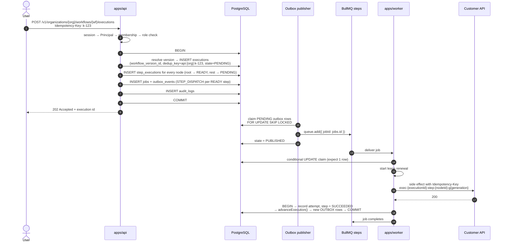
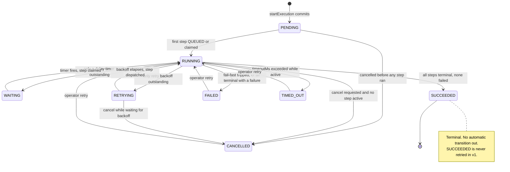
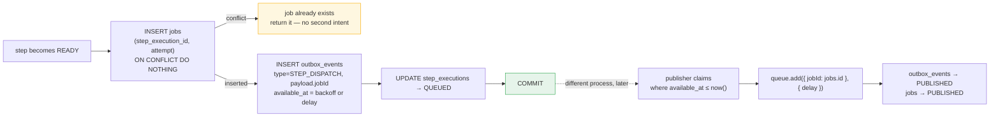
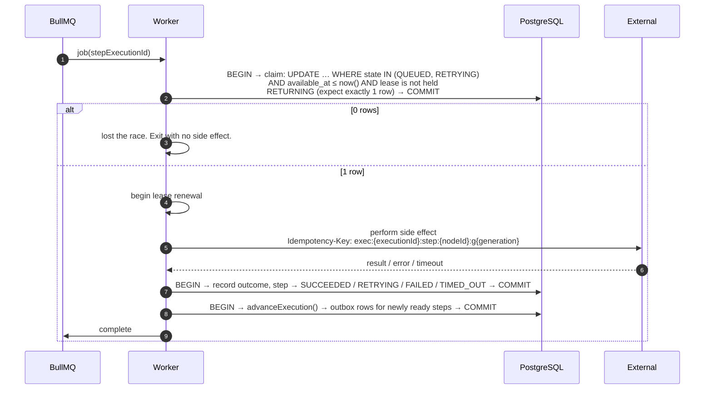
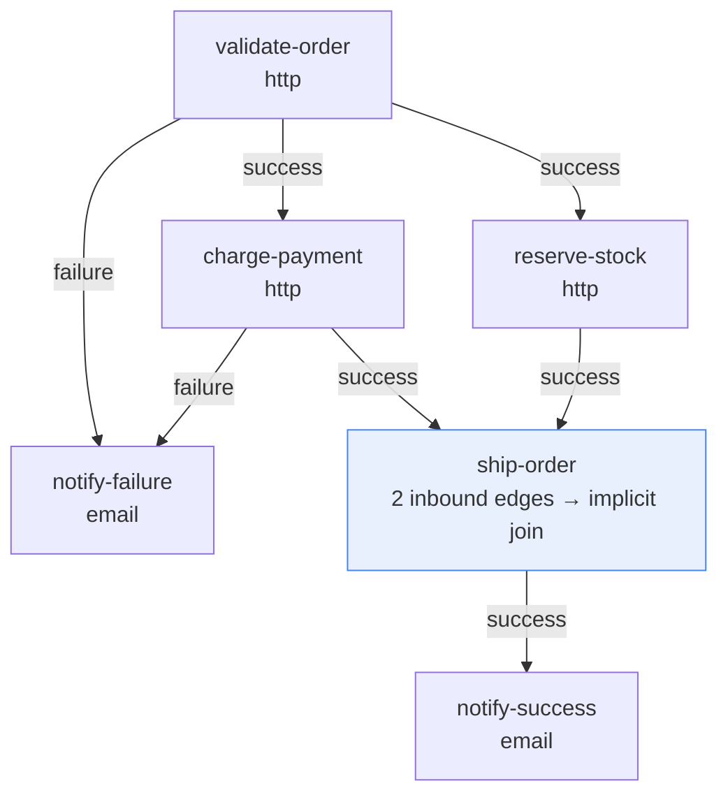
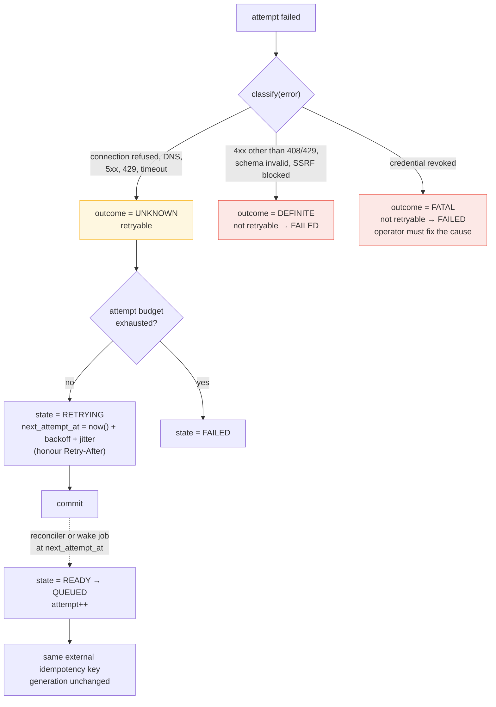
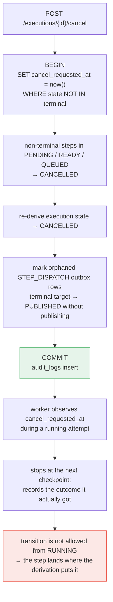
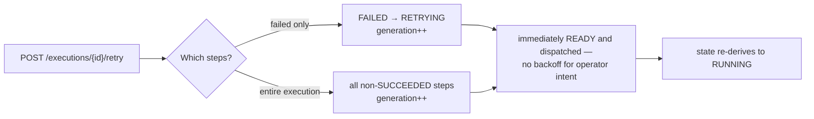
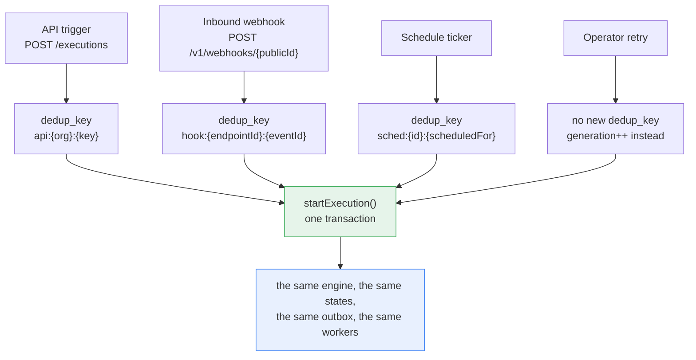

# Execution Flow Diagrams

| Field | Value |
|---|---|
| Status | **Proposed** |
| Date | 2026-10-05 |
| Companion docs | [execution-engine.md](../architecture/execution-engine.md), [reliability.md](../architecture/reliability.md), [failure-recovery.md](./failure-recovery.md), [architecture.md](./architecture.md) |
| Decisions | [ADR-005](../adr/005-workflow-versioning.md), [ADR-006](../adr/006-transactional-outbox.md), [ADR-007](../adr/007-idempotency-strategy.md) |

These diagrams trace one execution from trigger to terminal state. The state
definitions and pseudocode are normative in
[execution-engine.md](../architecture/execution-engine.md); this document is the
visual index into it.

Three numbers to keep in mind while reading, because they explain most of the
shape below: the **outbox publisher is the only producer**, the **claim is the only
mutual exclusion that matters**, and **no transaction ever spans external I/O**.

---

## 1. Manual trigger — the happy path, end to end



Note what is **not** on line 1→2→3: there is no `queue.add` from the API. The
response is sent after `COMMIT`, and the dispatch is a separate transaction in a
separate process. That is the transactional outbox, and it is the reason a Redis
outage cannot lose a trigger.

The response is `202 Accepted`, not `201 Created`. The execution exists, but no
step has run, and a webhook provider's timeout must not be able to hold a
connection open for a six-step workflow.

---

## 2. State machines

Both machines are **derived, not assigned**: nothing writes `state` by hand, and
every writer recomputes it from the step set. See
[execution-engine.md](../architecture/execution-engine.md) §7.2 and §8.2.

### 2.1 Execution



### 2.2 Step

```mermaid
stateDiagram-v2
    [*] --> PENDING : row created at startExecution

    PENDING --> READY : predecessors resolved, ≥1 inbound edge satisfied
    PENDING --> SKIPPED : branch pruned / unreachable
    PENDING --> CANCELLED : execution cancelled

    READY --> QUEUED : jobs + outbox STEP_DISPATCH committed
    READY --> SKIPPED : superseded by fail-fast
    READY --> CANCELLED : execution cancelled

    QUEUED --> RUNNING : worker wins the claim
    QUEUED --> READY : dispatch lost or job expired; reconciler re-arms
    QUEUED --> CANCELLED : cancellation; delayed job becomes a no-op

    RUNNING --> SUCCEEDED : effect succeeded, outcome recorded
    RUNNING --> FAILED : definitive failure, or attempts exhausted
    RUNNING --> RETRYING : retryable failure, backoff scheduled
    RUNNING --> TIMED_OUT : node or execution timeout elapsed
    RUNNING --> CANCELLED : worker observes cancel_requested_at

    RETRYING --> READY : backoff elapsed, re-dispatch next attempt
    RETRYING --> FAILED : attempt budget exhausted
    RETRYING --> CANCELLED : execution cancelled

    SUCCEEDED --> RETRYING : operator re-run (generation++)
    FAILED --> RETRYING : operator retry (generation++)

    note left of PENDING
      In PENDING because a predecessor is
      unresolved — this is what makes the
      join rule expressible.
    end note
```

Four states exist beyond a naive model, and each one closes a specific hole:
`SKIPPED` (a pruned branch would otherwise never let completion detection
terminate), `CANCELLED`, `TIMED_OUT`, and `PENDING`-as-blocked. All four are
additive; no baseline state is redefined.

---

## 3. Dispatch — why the outbox exists



Three properties fall out of this shape, and each is load-bearing:

- **The `ON CONFLICT DO NOTHING` is the dispatch-dedup guarantee.** Attempt *n* of
  a step can be dispatched at most once, no matter how many publishers,
  reconcilers or restarts race. A repeated advancement is a wasted `UPDATE` that
  returns zero rows.
- **The outbox row is delayed rather than published immediately.** The publisher
  only claims rows where `available_at <= now()`, so retry backoff and `delay`
  nodes need no timer of their own and survive a Redis restart. A six-hour wait
  costs nothing while Redis is empty, because nothing is in Redis.
- **Nothing on the left calls `queue.add`.** The producer is a different process
  on a different side of a `COMMIT`.

---

## 4. Worker — claim, act, record

The worker's whole correctness argument is in the shape of these transactions.



**Why three separate transactions rather than one.** If the claim transaction also
held the external call, a slow dependency would hold row locks and a connection
for its whole duration, and a database blip during the call could not be
distinguished from a failed call. Committing the claim first means the lease — not
the transaction — is what protects the step, and the outcome can be written in its
own short transaction.

**Why the claim is a conditional `UPDATE` and not a lock.** A lock is a promise
about a session; a conditional `UPDATE` is a fact in the database. Two workers
racing produce one winner and one zero-row update, and that outcome survives the
loser's crash, a Redis redelivery, or a rebalance.

---

## 5. DAG branches and implicit joins

`join` is **not** a node type. A node with two inbound edges is a join, and it is
satisfied when every inbound edge is resolved and at least one `success` edge is
satisfied.



Trace with the default `errorPolicy: fail-fast`:

| t | Event | Steps touched | Execution |
|---|---|---|---|
| 0 | `startExecution` | `validate-order` → `READY` (root); all others → `PENDING` | `PENDING` |
| 1 | dispatch, claim | `validate-order` → `QUEUED` → `RUNNING` | `RUNNING` |
| 2 | `200` recorded, advance | `validate-order` → `SUCCEEDED`; `charge-payment`, `reserve-stock` → `READY`; `ship-order`, both `email` nodes stay `PENDING` | `RUNNING` |
| 3 | both dispatched | both → `QUEUED` → `RUNNING` | `RUNNING` |
| 4 | `reserve-stock` exhausts its attempts | → `FAILED`; `fail-fast` cascades: `charge-payment` → `CANCELLED`, `ship-order` → `SKIPPED`, `notify-failure` → `CANCELLED`; `notify-success` → `SKIPPED` | `FAILED` |
| 5 | commit | all steps terminal; nothing left to run | `FAILED` |

At t4 the execution is *not* yet `FAILED` on the strength of one failed step: it
becomes `FAILED` because the cascade leaves **every** step terminal, and
`deriveExecutionState` only reaches clause 2 when `steps.every(terminal)`. That
clause ordering is why a partial failure in a still-running branch correctly reads
`RUNNING`.

The t4 cascade is also why the two policies differ so visibly. Under
`errorPolicy: continue` there is no cascade: `charge-payment` would finish
normally, `ship-order`'s inbound `B -success-> J` edge becomes unsatisfiable
rather than unresolved, so it is pruned to `SKIPPED` once `charge-payment`
resolves, and `notify-failure` is reached over its `failure` edge. The execution
still ends `FAILED` — clause 2's precedence makes any terminal `FAILED` step
decisive — but the independent work was allowed to finish.

---

## 6. Retry, with the classification that drives it



| Outcome | Meaning | Retried? | Why |
|---|---|---|---|
| `DEFINITE` | The target rejected the request; the effect did not happen. | No | Repeating a rejected request wastes attempts and hides a real bug. |
| `UNKNOWN` | The request was written but the response was lost. | Yes | The effect may have happened. Retrying with the same key is the only way to find out. |
| `FATAL` | Can never work — revoked credential, blocked destination. | No | The attempt budget would burn on a guaranteed failure. Distinguished in the log so the operator knows to fix a cause rather than wait. |

**`UNKNOWN` is why the external idempotency key matters.** A retry of an `UNKNOWN`
outcome is the one case where a duplicate side effect is genuinely possible, and
it is only safe because the key is stable across automatic retries.

---

## 7. Cancellation



**Cancellation is a request, not a kill.** The in-flight external call is not
recalled — that is not possible at this layer, and pretending otherwise would make
`CANCELLED` a claim we cannot keep. What we do guarantee is that no *new* step
starts after `cancel_requested_at`, and that the outcome of the in-flight attempt
is recorded honestly rather than discarded.

---

## 8. Operator retry



`generation` increments **only** here, and only for an operator retry. An
automatic retry keeps the same `generation`, so the external idempotency key is
identical and the target can collapse the duplicate. An operator retry is a
statement that the previous attempt should not be collapsed — the customer has
changed something, or has decided the effect must genuinely happen again.

---

## 9. All four trigger paths share one engine



This is the payoff of separating *triggering* from *executing*. A webhook
delivery, a cron tick, a dashboard click and an operator retry differ only in how
`dedup_key` is derived and who is allowed to call it. Everything after
`startExecution` is one code path, which is why "works when I click it" and
"fails on a schedule" cannot drift apart.

---

## Related

- [failure-recovery.md](./failure-recovery.md) — what happens when each step above fails
- [architecture.md](./architecture.md) — the components these sequences involve
- [database-erd.md](./database-erd.md) — the tables written at each step
