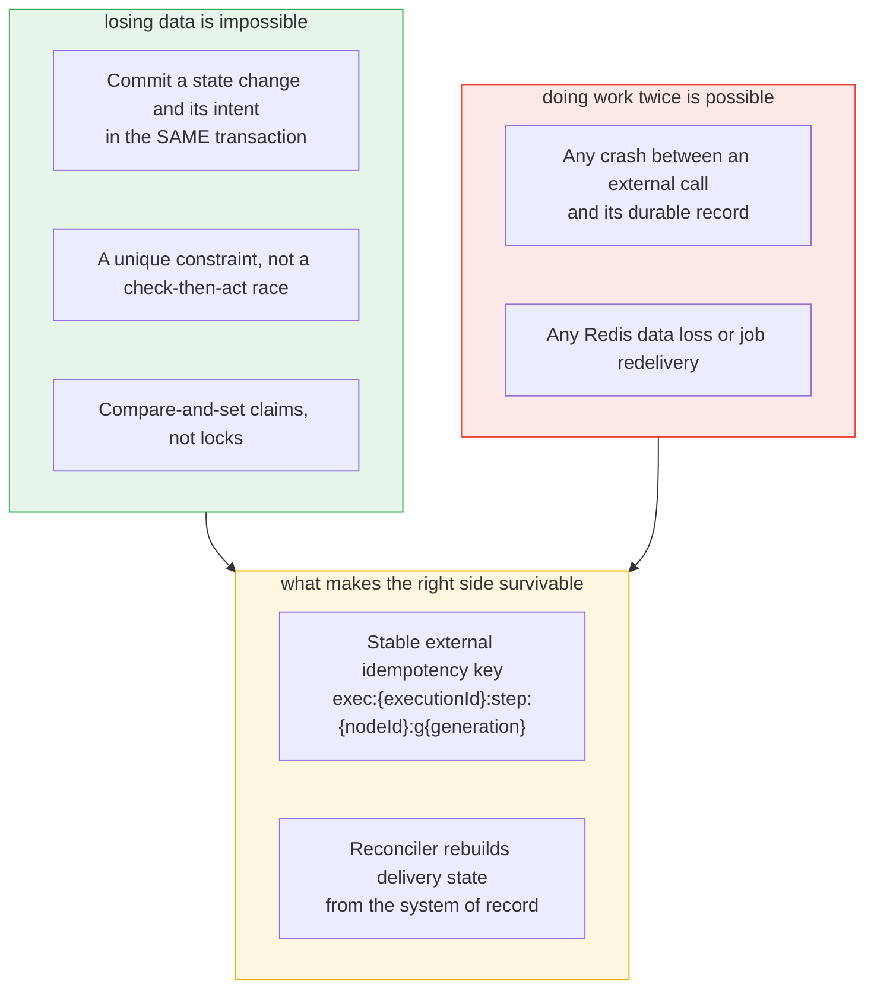
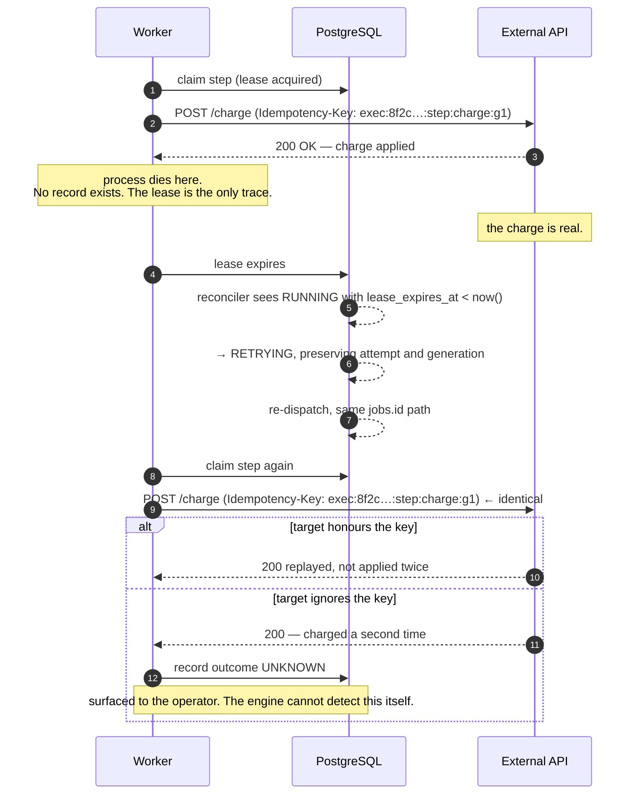
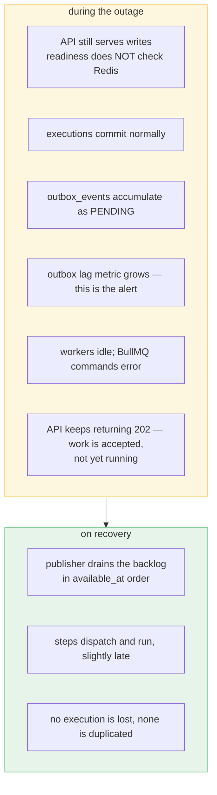
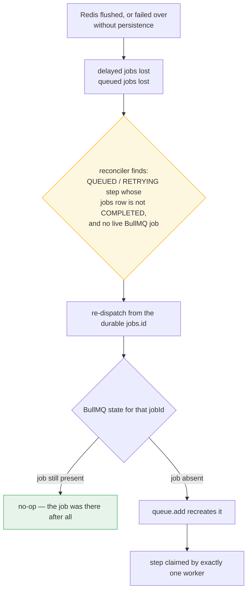
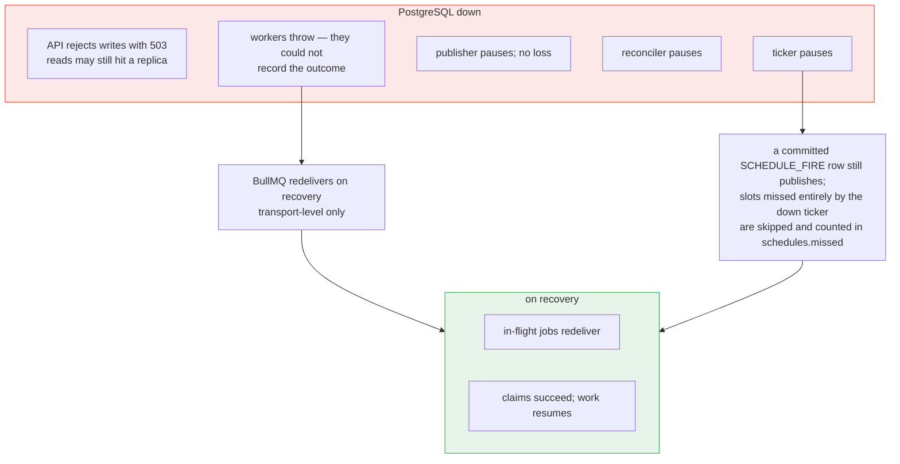
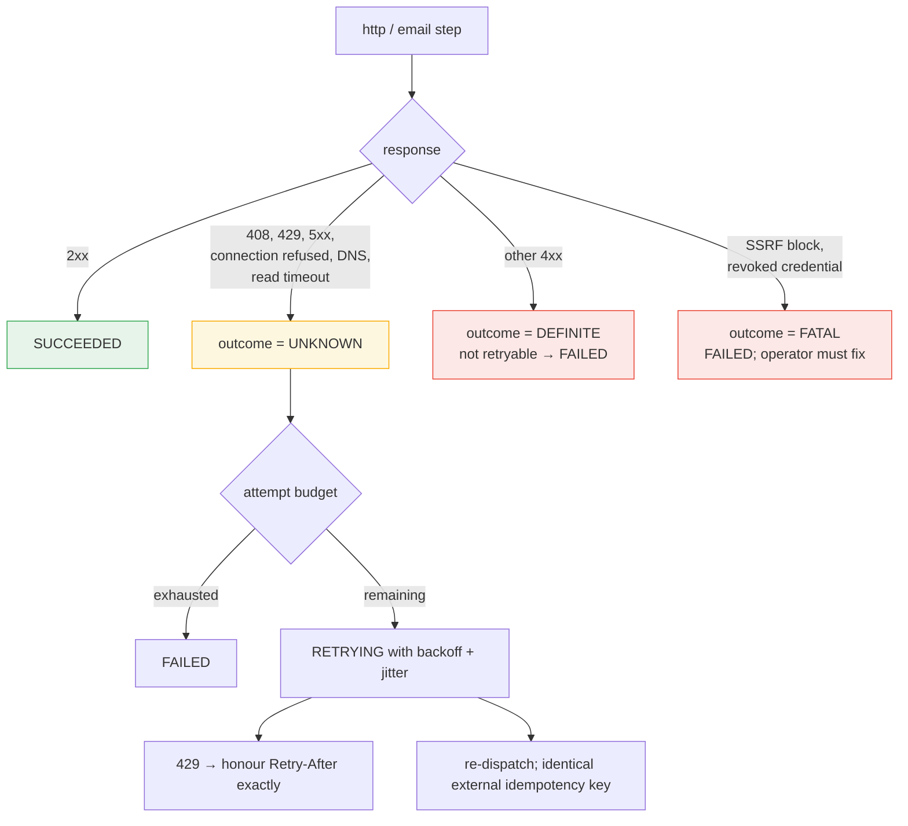
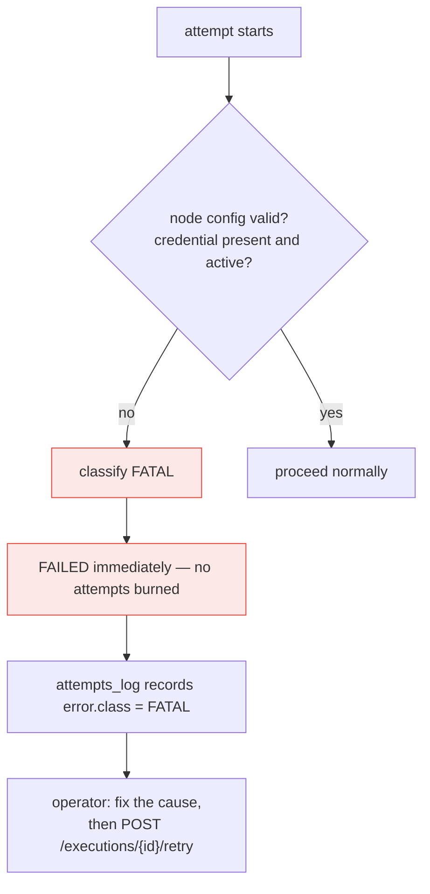
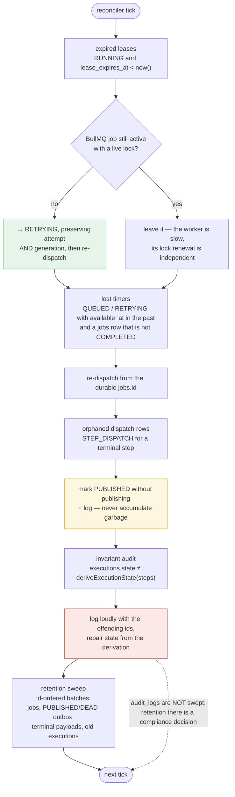
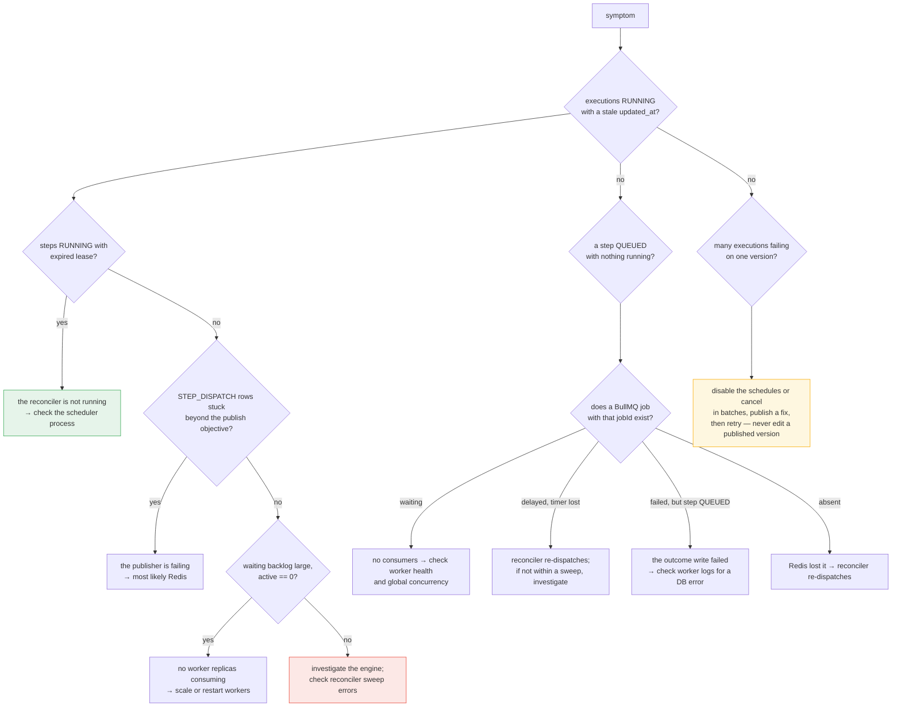

# Failure and Recovery Diagrams

| Field | Value |
|---|---|
| Status | **Proposed** |
| Date | 2026-10-05 |
| Companion docs | [reliability.md](../architecture/reliability.md), [execution-engine.md](../architecture/execution-engine.md), [execution-flow.md](./execution-flow.md) |
| Decisions | [ADR-002](../adr/002-postgresql.md), [ADR-003](../adr/003-bullmq.md), [ADR-006](../adr/006-transactional-outbox.md), [ADR-007](../adr/007-idempotency-strategy.md) |

The normative failure matrix is [reliability.md](../architecture/reliability.md)
§21 and the runbooks are §22. This document is the visual form of the same
content, plus the reasoning that is easier to show than to tabulate.

**One framing decision governs everything here.** Delivery is at-least-once. Every
layer is designed so that a duplicate is harmless, and exactly one failure — a
crash between an external effect and its durable record — is allowed to produce a
real duplicate. The system is built to make that one case *detectable* rather than
to pretend it does not exist.

---

## 1. The two halves of the design

We did not choose between the two columns. We removed the possibility of failure
from the left column by putting it in the database, and made the right column
*survivable* by making duplicates detectable by the target. What remains is a
system with no silent data loss and a bounded, observable duplicate risk.

---

## 2. The one failure with real duplicate risk

Three properties make this the best available outcome rather than an unacceptable
one:

1. **The retry is automatic.** A human is not in the loop, so the duplicate is not
   caused by operator error.
2. **The idempotency key is identical.** `generation` increments only on an
   explicit operator retry, so an automatic redelivery always presents the same key
   and a well-behaved target collapses it.
3. **The system says what happened.** The attempt is recorded with
   `outcome = UNKNOWN` and a `duplicate_risk` annotation. The engine does not claim
   to know whether the effect landed twice; it records that it could not find out,
   which is the truth.

**Why a database lock cannot fix this.** A transaction lock protects the row while
it is held, and the crash releases it. The gap between the external call and the
commit is not inside any lock we can hold, so no amount of `SELECT … FOR UPDATE`
covers it. This is matrix rows 1, 2, 9 and 13 — the same failure wearing four
costumes.

---

## 3. Redis unavailable

The load-bearing choice is that **`apps/api` readiness does not check Redis.** A
Redis outage must not take the API out of rotation: the API's job is to commit an
intent, and it can still do that. Failing readiness on Redis would convert a
delay-only incident into a total outage.

Draining is not instant, and the queue is not the record of what is owed —
`outbox_events` is. An operator watching a growing backlog should read
`oldest PENDING age`, not queue depth, as the health signal.

---

## 4. Redis loses data

Distinct from an outage: Redis is up and healthy, but empty or partially
overwritten. No alert from Redis itself — the repair has to come from us.

The reconciler needs no Redis-side signal to do this. It compares two things it
already owns — the domain row and the `jobs` row — and the mismatch is detectable
from PostgreSQL alone. That is the payoff of keeping `jobs` as a durable
projection instead of treating Redis as the source of truth.

Because the claim is a conditional `UPDATE`, a re-dispatch that races an
already-running original produces one winner and one zero-row update.

---

## 5. PostgreSQL unavailable

**Workers throw rather than swallow.** A worker that cannot record an outcome has
no correct action other than failing the job, because BullMQ's transport-level
`attempts: 3` is the mechanism that will redeliver it. Swallowing the error would
lose the work; that is the one condition where re-delivery is the right answer.

**No transaction spans external I/O**, so a database outage cannot leave a
half-applied state machine. There is no partially advanced DAG to repair, only
steps whose claim or outcome write did not land.

Note the deliberate limit on schedule recovery: a slot that came due entirely
while the ticker was down produces no row, so it is *not* replayed.
`next_run_at` is recomputed from `now()` and the gap is counted in
`schedules.missed`. Replaying a four-hour outage as thousands of executions would
be a worse incident than the one being recovered from.

PostgreSQL loss itself is not survivable by application design — it is the only
dependency that cannot be rebuilt. Mitigations are infrastructure: managed HA,
point-in-time recovery, tested restores.

---

## 6. External dependency

Two distinctions carry the weight here, and conflating either one is a bug:

- **`DEFINITE` versus `UNKNOWN`.** A `503` is a decision the target made. A socket
  reset after the request was written is not. Only the first means "it definitely
  did not happen", and only the first should be recorded as a failed attempt with
  no duplicate concern.
- **`FATAL` versus exhausted attempts.** Both end in `FAILED`, but they demand
  different operator action — fix a cause, versus wait or retry. The
  `error.class` field in the log is what tells them apart.

`Retry-After` is honoured exactly, not clamped, because a target that says "wait an
hour" and receives a retry after 30 seconds has been told a lie about its own
capacity.

---

## 7. Poison input

Two inputs can be unrunnable no matter how many times they are attempted: a
workflow version that references a revoked credential, and an `http` node pointing
at a destination the SSRF policy blocks.

Burning three attempts and a backoff cycle on a guaranteed failure trains operators
to ignore failures. `FATAL` is classified at the first attempt so the signal stays
sharp, and it is also what makes "a mass failure across one workflow version"
identifiable as a version problem rather than a downstream outage.

The related incident — a *published* version that is wrong in a way validation
cannot catch — is handled by never editing it. The fix is a new version, and
running executions stay pinned to the old one ([ADR-005](../adr/005-workflow-versioning.md)).

---

## 8. Reconciler — the loop that makes recovery automatic

Four details that are easy to get wrong:

- **Preserving `attempt` and `generation` on lease expiry is the whole point.** It
  keeps the external idempotency key stable across recovery, which is what makes
  the re-dispatch a retry rather than a second operation.
- **A live BullMQ lock means "slow", not "dead".** The two lease mechanisms are
  independent by design; reclaiming a step whose worker is still running would
  create a genuine concurrent duplicate.
- **Orphaned rows are marked published, not deleted.** The row must stop being
  retried, but deleting it would lose the record that a dispatch was once intended.
- **Invariant auditing is a self-check on the check.** E1 is a correctness property;
  re-deriving and logging a violation makes a bug in `deriveExecutionState` itself
  visible instead of silent.

---

## 9. Operator triage paths

**Never manually flip step states.** A manual edit breaks invariant E1 and will be
overwritten by the next derivation, so it does not fix anything and hides the real
cause. The only lever is to get the reconciler running.

---

## 10. Health check

These are the conditions that must hold *continuously*. A system that satisfies all
of them is not merely "not on fire" — it is provably not accumulating hidden debt.

| Condition | Signal | If violated |
|---|---|---|
| Oldest `PENDING` outbox row below the publish objective | outbox lag | Work is due and not running |
| Zero `DEAD` outbox rows | `count(state='DEAD')` | Permanently unperformed work |
| Zero expired leases, beyond one sweep | `count(RUNNING ∧ lease < now())` | A stalled worker; a step may be running twice |
| `waiting` depth not monotonically increasing | queue depth | Consumers cannot keep up |
| `PENDING` outbox count not monotonically increasing | outbox count | The publisher is not draining |
| No `RUNNING` execution older than the max timeout | `executions.updated_at` | Advancement stopped |
| Reconciler sweep iteration count increasing | scheduler metrics | Recovery is not running at all |
| Zero `UNKNOWN` outcomes for a version, sustained | `error.outcome` | Duplicate risk, or a target that ignores keys |

`DEAD` outbox rows are the one signal where **any** value is a page rather than a
dashboard line. Every other metric here describes capacity or progress; a `DEAD`
row describes work that will never happen.

---

## Related

- [execution-flow.md](./execution-flow.md) — the same transitions in normal operation
- [architecture.md](./architecture.md) — which component owns each recovery loop
- [reliability.md](../architecture/reliability.md) §21–§24 — normative matrix and runbooks
